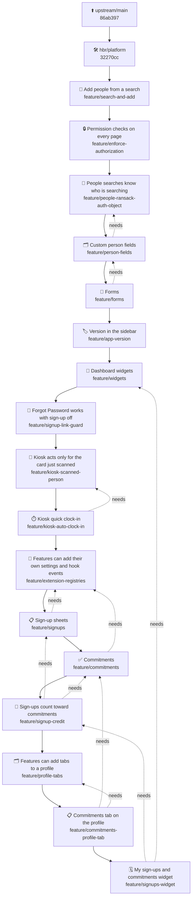

# 📦 HBR build catalog

> [!NOTE]
> Generated by `bin/fork-changelog` each time `bin/fork-rebuild` runs. Don't edit it here: change `fork/catalog.yml` or `FORK.md` on `hbr/platform`, then rebuild.

- 🏷️ **Release:** `v0.0.0-hbr.18`
- 🔨 **Build:** `85852ff` on `hbr/integration`, 2026-10-12
- ⬆️ **Upstream base:** `86ab397` Merge pull request #532 from thatnerdjack/fix/flag-review-500 (2026-10-08)
- 🧩 **Features:** 17 merged
- ⏮️ **Previous release:** `v0.0.0-hbr.17` (`f8eecda`, 2026-10-12)

**Contents:** [Try this build](#try) · [How it's built](#build) · [Features](#catalog) · [What's new](#whats-new) · [Disabled and retired](#disabled)

<a id="try"></a>

## 🧪 Try this build

Run it in Docker with the Northwind sample data loaded. You need Git, Docker with Compose v2, and `openssl`; it runs as its own stack, named `hbr-demo`.

```bash
git clone https://github.com/frc1747/gatherpack.git hbr-gatherpack-demo
cd hbr-gatherpack-demo
git checkout v0.0.0-hbr.18
cat > .env <<SETTINGS
COMPOSE_PROJECT_NAME=hbr-demo
GATHERPACK_IMAGE=ghcr.io/frc1747/gatherpack
GATHERPACK_TAG=0.0.0-hbr.18
ROOT_URL=http://localhost:3000
SECRET_KEY_BASE=$(openssl rand -hex 64)
DATABASE_PASSWORD=$(openssl rand -hex 16)
JOBS_DASHBOARD_PASSWORD=$(openssl rand -hex 16)
SETTINGS
docker compose -f docker-compose.production.yml up -d db
docker compose -f docker-compose.production.yml run --rm web ./bin/rails db:create db:schema:load
docker compose -f docker-compose.production.yml run --rm web ./bin/rails hbr:sample_data
docker compose -f docker-compose.production.yml up -d
```

Then open `http://localhost:3000` and sign in as `admin@example.com` with the password `password123`. To remove it and all of its data: `docker compose -f docker-compose.production.yml down -v`.

[`fork/sample_data/README.md`](fork/sample_data/README.md) has every step explained, the other logins, what to try in each feature, and how to load the data into a copy you already run.

<a id="build"></a>

## 🧬 How this build is made

Each box is merged on top of the one before it, top to bottom. Dotted arrows point from a feature to a feature it needs.



<a id="catalog"></a>

## 🗂️ Features in this build

In merge order. **Status** is where the feature stands with upstream GatherPack: 🚧 wip means it hasn't been offered upstream (yet, or ever), 📬 proposed means a pull request is open.

| Feature | Status | Turned on by | Shipped |
|---|---|---|---|
| [🔎 Add people from a search](#feature-search-and-add) | 🚧 wip | always on | hbr.1 |
| [🔒 Permission checks on every page](#feature-enforce-authorization) | 📬 proposed | always on | hbr.3 |
| [🧭 People searches know who is searching](#feature-people-ransack-auth-object) | 🚧 wip | always on | hbr.4 |
| [🗂️ Custom person fields](#feature-person-fields) | 🚧 wip | `feature_person_fields` | hbr.4 |
| [📝 Forms](#feature-forms) | 🚧 wip | `feature_forms` +2 | hbr.7 |
| [🏷️ Version in the sidebar](#feature-app-version) | 🚧 wip | `GATHERPACK_VERSION` | hbr.6 |
| [🧱 Dashboard widgets](#feature-widgets) | 🚧 wip | `feature_widgets` | hbr.8 |
| [🔑 Forgot Password works with sign-up off](#feature-signup-link-guard) | 🚧 wip | `local_signup` | hbr.10 |
| [🪪 Kiosk acts only for the card just scanned](#feature-kiosk-scanned-person) | 🚧 wip | always on | hbr.12 |
| [⏱️ Kiosk quick clock-in](#feature-kiosk-auto-clock-in) | 🚧 wip | `time_kiosk_allow_unassigned` +2 | hbr.12 |
| [🧩 Features can add their own settings and hook events](#feature-extension-registries) | 🚧 wip | always on | hbr.16 |
| [📋 Sign-up sheets](#feature-signups) | 🚧 wip | `feature_signups` +1 | hbr.16 |
| [✅ Commitments](#feature-commitments) | 🚧 wip | `feature_commitments` +1 | hbr.17 |
| [🤝 Sign-ups count toward commitments](#feature-signup-credit) | 🚧 wip | always on | hbr.17 |
| [🗂️ Features can add tabs to a profile](#feature-profile-tabs) | 🚧 wip | always on | 🆕 this build |
| [📋 Commitments tab on the profile](#feature-commitments-profile-tab) | 🚧 wip | always on | 🆕 this build |
| [🗓️ My sign-ups and commitments widget](#feature-signups-widget) | 🚧 wip | always on | 🆕 this build |

<a id="feature-search-and-add"></a>

### 🔎 Add people from a search

Badge holders, team members, a person's teams and event check-ins each get a search panel beside the list. Type a name and press Add; the list updates in place, and only people or teams that can still be added are shown.

- 👥 **Who uses it:** Team managers and admins
- ⚙️ **Settings:** none; always on
- 🔄 **Upstream:** 🚧 wip
- 🚀 **Shipped in:** hbr.1
- 🌿 **Branch:** `feature/search-and-add` at `cbbccb2`
- 🗃️ **Migrations:** none

<a id="feature-enforce-authorization"></a>

### 🔒 Permission checks on every page

Every page now checks who may see or change it. Members can no longer delete their team, edit its announcements, change other people's check-ins or edit badge types. People who were already allowed to do these things see no change.

- 👥 **Who uses it:** Everyone (behind the scenes)
- ⚙️ **Settings:** none; always on
- 🔄 **Upstream:** 📬 proposed · PR [#518](https://github.com/GatherPack/gatherpack/pull/518), issue [#517](https://github.com/GatherPack/gatherpack/issues/517)
- 🚀 **Shipped in:** hbr.3
- 🌿 **Branch:** `feature/enforce-authorization` at `7a5922d`
- 🗃️ **Migrations:** none

<a id="feature-people-ransack-auth-object"></a>

### 🧭 People searches know who is searching

Every search over people (the directory, person search, team members, birthdays on the calendar) now knows who is asking. Nothing changes on screen; it lets Custom person fields keep hidden details out of search results.

- 👥 **Who uses it:** Everyone (behind the scenes)
- ⚙️ **Settings:** none; always on
- 🔄 **Upstream:** 🚧 wip
- 🚀 **Shipped in:** hbr.4
- 🌿 **Branch:** `feature/people-ransack-auth-object` at `449e0de`
- 🗃️ **Migrations:** none

<a id="feature-person-fields"></a>

### 🗂️ Custom person fields

Admins add their own profile fields, such as medical notes or an emergency contact, and choose who can see and change each one: the person, their guardians, their team's leaders, or holders of a badge. Built-in details like phone, address and birthday follow the same rules, even with the setting off.

- 👥 **Who uses it:** Admins set fields up; everyone who views profiles
- ⚙️ **Settings:**
  - Custom Person Fields (`feature_person_fields`): default off
- 🔄 **Upstream:** 🚧 wip · Issue [#489](https://github.com/GatherPack/gatherpack/issues/489)
- 🚀 **Shipped in:** hbr.4
- 🌿 **Branch:** `feature/person-fields` at `c050087`
- 🔗 **Needs:** [🧭 People searches know who is searching](#feature-people-ransack-auth-object)
- 🗃️ **Migrations:** 7

<details><summary>Migrations</summary>

- `20261002200000_add_guardianship_to_relationship_types.rb`
- `20261002200100_create_person_field_groups.rb`
- `20261002200200_create_person_fields.rb`
- `20261002200300_create_person_field_values.rb`
- `20261002200400_create_person_field_badge_grants.rb`
- `20261003120000_create_system_person_fields.rb`
- `20261003130000_add_person_field_and_read_permission_to_checkin_fields.rb`

</details>

<a id="feature-forms"></a>

### 📝 Forms

Leaders ask a group of people for information by a deadline: meal choices, permission slips, or who is coming to an event. People find their forms on the dashboard and their profile, guardians can answer and sign for their students, and leaders see who still owes an answer and print lists of the answers.

- 👥 **Who uses it:** Members and families answer; leaders and form creators ask
- ⚙️ **Settings:**
  - Forms (`feature_forms`): default off
  - Form Creator Badge (`forms_creator_badge`): default blank (no form creators)
  - Highest Team for Form Creators (`forms_creator_highest_team`): default blank (only their own teams and the teams below)
- 🔄 **Upstream:** 🚧 wip
- 🚀 **Shipped in:** hbr.7
- 🌿 **Branch:** `feature/forms` at `13e5a83`
- 🔗 **Needs:** [🗂️ Custom person fields](#feature-person-fields)
- 🗃️ **Migrations:** 11

<details><summary>Migrations</summary>

- `20261005120000_create_forms.rb`
- `20261005120100_create_form_questions.rb`
- `20261005120200_create_form_responses.rb`
- `20261005120300_create_form_submissions.rb`
- `20261005120400_create_form_reminders.rb`
- `20261006120000_create_form_audience_rules.rb`
- `20261006120100_create_form_signatures.rb`
- `20261006120200_create_form_badge_grants.rb`
- `20261006120300_add_consent_columns_to_forms.rb`
- `20261006130000_add_event_to_forms.rb`
- `20261006140000_add_sharing_options_to_forms.rb`

</details>

<a id="feature-app-version"></a>

### 🏷️ Version in the sidebar

The sidebar shows which release is running, under "powered by GatherPack". Point at it to see the exact build. Use it when reporting a problem.

- 👥 **Who uses it:** Everyone signed in
- ⚙️ **Settings:**
  - Release number, set when the image is built (`GATHERPACK_VERSION`): default blank (nothing shown)
- 🔄 **Upstream:** 🚧 wip
- 🚀 **Shipped in:** hbr.6
- 🌿 **Branch:** `feature/app-version` at `6b08f39`
- 🗃️ **Migrations:** none

<a id="feature-widgets"></a>

### 🧱 Dashboard widgets

Admins add titled sections to the dashboard, such as a kickoff countdown, shop hours for the week, or who is clocked in right now. Each widget can be shown to everyone or only to some people, and can refresh itself.

- 👥 **Who uses it:** Admins write them; everyone sees the ones meant for them
- ⚙️ **Settings:**
  - Dashboard Widgets (`feature_widgets`): default off
- 🔄 **Upstream:** 🚧 wip
- 🚀 **Shipped in:** hbr.8
- 🌿 **Branch:** `feature/widgets` at `aa05189`
- 🗃️ **Migrations:** 1

<details><summary>Migrations</summary>

- `20261006200000_create_widgets.rb`

</details>

<a id="feature-signup-link-guard"></a>

### 🔑 Forgot Password works with sign-up off

With local sign-up turned off, the Forgot Password page used to crash. It now opens normally and hides the sign-up link, like the sign-in page does.

- 👥 **Who uses it:** Anyone who signs in with an email and password
- ⚙️ **Settings:**
  - Enable Creating Local Accounts, an existing setting (`local_signup`): default on
- 🔄 **Upstream:** 🚧 wip
- 🚀 **Shipped in:** hbr.10
- 🌿 **Branch:** `feature/signup-link-guard` at `3239a70`
- 🗃️ **Migrations:** none

<a id="feature-kiosk-scanned-person"></a>

### 🪪 Kiosk acts only for the card just scanned

The time kiosk's buttons work only for the person whose card was just scanned, and only for a few minutes. No one can clock someone else in or out from a link or by changing the page, and rapid card guessing is blocked.

- 👥 **Who uses it:** People clocking in at the kiosk
- ⚙️ **Settings:** none; always on
- 🔄 **Upstream:** 🚧 wip
- 🚀 **Shipped in:** hbr.12
- 🌿 **Branch:** `feature/kiosk-scanned-person` at `7a79080`
- 🗃️ **Migrations:** none

<a id="feature-kiosk-auto-clock-in"></a>

### ⏱️ Kiosk quick clock-in

Admins can have a scan clock the person in right away when only one time period applies to them, send the kiosk back to the welcome screen after a few seconds, and choose a team whose members may open the kiosk. When a scan can clock people in, the button reads Clock In. An unrecognized card shows "Card not recognized" on the welcome screen. With the default settings the kiosk otherwise works as before.

- 👥 **Who uses it:** People clocking in at the kiosk; admins set it up
- ⚙️ **Settings:**
  - Kiosk: Allow Unassigned Punches (`time_kiosk_allow_unassigned`): default on
  - Kiosk: Return to Welcome After (seconds) (`time_kiosk_return_seconds`): default 0 (stays on the person's screen)
  - Kiosk: Who Can Open the Kiosk (`time_kiosk_users_team`): default blank (anyone signed in)
- 🔄 **Upstream:** 🚧 wip
- 🚀 **Shipped in:** hbr.12
- 🌿 **Branch:** `feature/kiosk-auto-clock-in` at `b756cf5`
- 🔗 **Needs:** [🪪 Kiosk acts only for the card just scanned](#feature-kiosk-scanned-person)
- 🗃️ **Migrations:** none

<a id="feature-extension-registries"></a>

### 🧩 Features can add their own settings and hook events

Infrastructure, nothing to see on its own. It lets a feature register its own settings and Hook events from its own code, so features no longer edit the shared lists and conflict with each other. Sign-up sheets use it.

- 👥 **Who uses it:** Developers; no one will notice a change
- ⚙️ **Settings:** none; always on
- 🔄 **Upstream:** 🚧 wip
- 🚀 **Shipped in:** hbr.16
- 🌿 **Branch:** `feature/extension-registries` at `ae53a18`
- 🗃️ **Migrations:** none

<a id="feature-signups"></a>

### 📋 Sign-up sheets

Sheets where people sign up to work or bring things at events, such as greeters, a first aid table, or the pizza for a lunch. A position asks for people (a number of places) or items (a quantity, like 6 pizzas), and can ask one question. Rules say who may take it: a badge, an age range, or being on any of a list of teams. Each place is one sign-up for one person, so two people working together are two sign-ups, and a sign-up can be made on behalf of another person. Organizers hold a badge you choose, run their own sheets without managing a team, and mark who showed up or brought their items. An admin turns it on in Settings.

- 👥 **Who uses it:** Everyone signs up; organizers run the sheets; admins choose the organizer badge
- ⚙️ **Settings:**
  - Sign-up Sheets (`feature_signups`): default off
  - Sign-up Sheet Organizers (`signups_organizers`): default blank (only admins and team managers run sheets)
- 🔄 **Upstream:** 🚧 wip
- 🚀 **Shipped in:** hbr.16
- 🌿 **Branch:** `feature/signups` at `2a1bdad`
- 🔗 **Needs:** [🧩 Features can add their own settings and hook events](#feature-extension-registries)
- 🗃️ **Migrations:** 11

<details><summary>Migrations</summary>

- `20261011120000_create_signup_sheets.rb`
- `20261011120100_create_signup_sheet_organizers.rb`
- `20261011120200_create_signup_audience_rules.rb`
- `20261011120300_create_signup_sheet_events.rb`
- `20261011120400_create_signup_positions.rb`
- `20261011120500_create_signup_position_rules.rb`
- `20261011120600_create_signup_slots.rb`
- `20261011120700_create_signups.rb`
- `20261011210204_signup_position_rules_any_of_teams.rb`
- `20261012010000_remove_extra_people_from_signups.rb`
- `20261012020000_add_reminder_and_checkin_tracking_to_signups.rb`

</details>

<a id="feature-commitments"></a>

### ✅ Commitments

Track what people owe over a season, such as two volunteer shifts each, and credit it from what they do, such as checking in at events of a chosen type. A commitment can be owed by families together, with more owed for each extra child, and holders of a badge can be exempt. Each person sees what they owe and how to earn it; organizers see everyone's progress, add credit by hand with a reason, and message those who still owe.

- 👥 **Who uses it:** Members and families see their progress; organizers and admins set commitments up
- ⚙️ **Settings:**
  - Commitments (`feature_commitments`): default off
  - Commitment Organizers (`commitments_organizers`): default blank (only admins and team managers run commitments)
- 🔄 **Upstream:** 🚧 wip
- 🚀 **Shipped in:** hbr.17
- 🌿 **Branch:** `feature/commitments` at `d1f789a`
- 🔗 **Needs:** [🧩 Features can add their own settings and hook events](#feature-extension-registries)
- 🗃️ **Migrations:** 5

<details><summary>Migrations</summary>

- `20261012120000_create_commitments.rb`
- `20261012120100_create_commitment_organizers.rb`
- `20261012120200_create_commitment_sources.rb`
- `20261012120300_create_commitment_adjustments.rb`
- `20261012120400_add_groups_and_exempt_badge_to_commitments.rb`

</details>

<a id="feature-signup-credit"></a>

### 🤝 Sign-ups count toward commitments

A sign-up sheet, or one position on it, can count toward a commitment: signing up shows as planned, and showing up or bringing the items counts it. A sign-up made on behalf of someone credits that person, so a parent working a place for their child credits the family. The sign up dialog shows how much each person still owes. It has no setting of its own and works while Sign-up Sheets and Commitments are both on.

- 👥 **Who uses it:** Everyone who signs up; organizers choose which sheets count
- ⚙️ **Settings:** none; always on
- 🔄 **Upstream:** 🚧 wip
- 🚀 **Shipped in:** hbr.17
- 🌿 **Branch:** `feature/signup-credit` at `5aa5929`
- 🔗 **Needs:** [📋 Sign-up sheets](#feature-signups), [✅ Commitments](#feature-commitments)
- 🗃️ **Migrations:** none

<a id="feature-profile-tabs"></a>

### 🗂️ Features can add tabs to a profile

Infrastructure, nothing to see on its own. It lets a feature add a tab to a person's profile from its own code, shown only to the people it says, instead of editing the profile page. The Commitments tab uses it.

- 👥 **Who uses it:** Developers; no one will notice a change
- ⚙️ **Settings:** none; always on
- 🔄 **Upstream:** 🚧 wip
- 🚀 **Shipped in:** 🆕 this build
- 🌿 **Branch:** `feature/profile-tabs` at `62a6861`
- 🗃️ **Migrations:** none

<a id="feature-commitments-profile-tab"></a>

### 📋 Commitments tab on the profile

A Commitments tab on a person's profile shows what they owe and how to earn it. People see their own; a parent sees it on a child's profile when the commitment is shared by the family. The tab appears only when there is something to show. It has no setting of its own and works while Commitments is on.

- 👥 **Who uses it:** Members and their parents
- ⚙️ **Settings:** none; always on
- 🔄 **Upstream:** 🚧 wip
- 🚀 **Shipped in:** 🆕 this build
- 🌿 **Branch:** `feature/commitments-profile-tab` at `41f4982`
- 🔗 **Needs:** [✅ Commitments](#feature-commitments), [🗂️ Features can add tabs to a profile](#feature-profile-tabs)
- 🗃️ **Migrations:** none

<a id="feature-signups-widget"></a>

### 🗓️ My sign-ups and commitments widget

A dashboard widget that shows each person their upcoming sign-ups (their own and those made for their family) and what they still owe on their commitments, with links to the sheets and details. An admin adds it as a widget whose content is one line; it hides itself for anyone with nothing to show.

- 👥 **Who uses it:** Everyone signed in; admins place it
- ⚙️ **Settings:** none; always on
- 🔄 **Upstream:** 🚧 wip
- 🚀 **Shipped in:** 🆕 this build
- 🌿 **Branch:** `feature/signups-widget` at `1849558`
- 🔗 **Needs:** [🤝 Sign-ups count toward commitments](#feature-signup-credit), [🧱 Dashboard widgets](#feature-widgets)
- 🗃️ **Migrations:** none

<a id="whats-new"></a>

## 🆕 What's new since v0.0.0-hbr.17

Commits in this build that weren't in `v0.0.0-hbr.17`, oldest first. A commit that was rebased or cherry-picked (same author, date and subject) counts as already released.

### 📋 Sign-up sheets · ✏️ 1 change

- Document why a time change can queue a reminder twice (`2a1bdad`)

### 🗂️ Features can add tabs to a profile · 🆕 new in this build

- Let features add tabs to a person's profile (`62a6861`)

### 📋 Commitments tab on the profile · 🆕 new in this build

- Add a Commitments tab to the person profile (`41f4982`)

### 🗓️ My sign-ups and commitments widget · 🆕 new in this build

- Add the "My sign-ups and commitments" summary for a dashboard widget (`7275f6a`)
- List sign-ups at events with no end time in the summary (`a19f562`)
- Say who takes a summarized sign-up, as My sign-ups does (`0dc2ecf`)
- Leave ended commitments out of the summary before checking them (`2b03a98`)
- Test that the summary leaves out sign-ups on sheets the person can't see (`1849558`)

**No changes:** 🔎 Add people from a search, 🔒 Permission checks on every page, 🧭 People searches know who is searching, 🗂️ Custom person fields, 📝 Forms, 🏷️ Version in the sidebar, 🧱 Dashboard widgets, 🔑 Forgot Password works with sign-up off, 🪪 Kiosk acts only for the card just scanned, ⏱️ Kiosk quick clock-in, 🧩 Features can add their own settings and hook events, ✅ Commitments, 🤝 Sign-ups count toward commitments

### ⬆️ Upstream

No new upstream commits (still on `86ab397`).

### 🛠️ Fork tooling (`hbr/platform`)

<details><summary>7 changes</summary>

- FORK.md: hbr.17 ships commitments and sign-up credit; sign-up reminders keep while off (`3c8178d`)
- HBR rollout: configuration matches Ditto (Friends of HBR, team rules, check-in sources, commencement sheet) (`721c581`)
- Sign-ups spec rev. 10 status and a sign-ups and commitments pitch (`9d5afbc`)
- Pitch: clarify group amounts (`68f62ad`)
- Record profile-tabs, commitments-profile-tab and signups-widget (`fe17fea`)
- Add profile-tabs, commitments-profile-tab and signups-widget to the manifest (`1edecdf`)
- Show the widget's on-behalf place through Ella, not Paula (`32270cc`)

</details>

<a id="disabled"></a>

## 💤 Disabled and retired

**Disabled in the manifest** (commented out in `fork/features.txt`, so not in this build):

- None

**Retired** (marked `retired` in `FORK.md`; no longer merged):

<details><summary>9 retired features</summary>

| Branch | Shipped | Upstream |
|---|---|---|
| `feature/audit-log-nil-changes` | hbr.1 | PR [#515](https://github.com/GatherPack/gatherpack/pull/515), issue [#517](https://github.com/GatherPack/gatherpack/issues/517) |
| `feature/membership-create-policy` | hbr.1 | PR [#521](https://github.com/GatherPack/gatherpack/pull/521), issue [#517](https://github.com/GatherPack/gatherpack/issues/517) |
| `feature/unique-assignments` | hbr.1 | PR [#522](https://github.com/GatherPack/gatherpack/pull/522), issue [#517](https://github.com/GatherPack/gatherpack/issues/517) |
| `feature/membership-filters-fix` | hbr.1 | PR [#516](https://github.com/GatherPack/gatherpack/pull/516), issue [#517](https://github.com/GatherPack/gatherpack/issues/517) |
| `feature/brakeman-8.1` | hbr.1 | — |
| `feature/calendar-birthday-team-filter` | hbr.3 | PR [#519](https://github.com/GatherPack/gatherpack/pull/519), issue [#517](https://github.com/GatherPack/gatherpack/issues/517) |
| `feature/user-display-name` | hbr.5 | PR [#520](https://github.com/GatherPack/gatherpack/pull/520), issue [#517](https://github.com/GatherPack/gatherpack/issues/517) |
| `feature/team-page-qa-crash` | hbr.6 | PR [#523](https://github.com/GatherPack/gatherpack/pull/523), issue [#517](https://github.com/GatherPack/gatherpack/issues/517) |
| `feature/team-page-parent-managers` | hbr.6 | PR [#524](https://github.com/GatherPack/gatherpack/pull/524), issue [#517](https://github.com/GatherPack/gatherpack/issues/517) |

</details>

---

<sub>Made by `bin/fork-changelog` from `fork/features.txt`, `fork/catalog.yml` and `FORK.md` at `32270cc`.</sub>
