# 📦 HBR build catalog

> [!NOTE]
> Generated by `bin/fork-changelog` each time `bin/fork-rebuild` runs. Don't edit it here: change `fork/catalog.yml` or `FORK.md` on `hbr/platform`, then rebuild.

- 🏷️ **Release:** `v0.0.0-hbr.32` when tagged (not tagged yet)
- 🔨 **Build:** `08f385b` on `hbr/integration`, 2026-11-05
- ⬆️ **Upstream base:** `3fa5700` lining and test fixing and such (2026-10-26)
- 🧩 **Features:** 39 merged
- ⏮️ **Previous release:** `v0.0.0-hbr.31` (`bfe8c86`, 2026-11-04)

**Contents:** [Try this build](#try) · [How it's built](#build) · [Features](#catalog) · [What's new](#whats-new) · [Disabled and retired](#disabled)

<a id="try"></a>

## 🧪 Try this build

Run it in Docker with the Northwind sample data loaded. You need Git, Docker with Compose v2, and `openssl`; it runs as its own stack, named `hbr-demo`.

> [!NOTE]
> This build isn't a release yet, so these steps run the latest release, `v0.0.0-hbr.31`.

```bash
git clone https://github.com/frc1747/gatherpack.git hbr-gatherpack-demo
cd hbr-gatherpack-demo
git checkout v0.0.0-hbr.31
cat > .env <<SETTINGS
COMPOSE_PROJECT_NAME=hbr-demo
GATHERPACK_IMAGE=ghcr.io/frc1747/gatherpack
GATHERPACK_TAG=0.0.0-hbr.31
ROOT_URL=http://localhost:3000
SECRET_KEY_BASE=$(openssl rand -hex 64)
DATABASE_PASSWORD=$(openssl rand -hex 16)
JOBS_DASHBOARD_PASSWORD=$(openssl rand -hex 16)
SETTINGS
docker compose -f docker-compose.production.yml up -d db
docker compose -f docker-compose.production.yml run --rm web ./bin/rails db:create db:schema:load
docker compose -f docker-compose.production.yml run --rm web ./bin/rails hbr:sample_data
docker compose -f docker-compose.production.yml up -d
```

Then open `http://localhost:3000` and sign in as `admin@example.com` with the password `password123`. To remove it and all of its data: `docker compose -f docker-compose.production.yml down -v`.

[`fork/sample_data/README.md`](fork/sample_data/README.md) has every step explained, the other logins, what to try in each feature, and how to load the data into a copy you already run.

<a id="build"></a>

## 🧬 How this build is made

Each box is merged on top of the one before it, top to bottom. Dotted arrows point from a feature to a feature it needs.

```mermaid
flowchart TB
  upstream["⬆️ upstream/main<br/>3fa5700"]
  platform["🛠️ hbr/platform<br/>f72bb0d"]
  f1["🔎 Add people from a search<br/>feature/search-and-add"]
  f2["🧭 People searches know who is searching<br/>feature/people-ransack-auth-object"]
  f3["🗂️ Custom person fields<br/>feature/person-fields"]
  f4["📝 Forms<br/>feature/forms"]
  f5["🏷️ Version in the sidebar<br/>feature/app-version"]
  f6["🧱 Dashboard widgets<br/>feature/widgets"]
  f7["🔑 Forgot Password works with sign-up off<br/>feature/signup-link-guard"]
  f8["🪪 Kiosk acts only for the card just scanned<br/>feature/kiosk-scanned-person"]
  f9["⏱️ Kiosk quick clock-in<br/>feature/kiosk-auto-clock-in"]
  f10["🧩 Features can add their own settings and hook events<br/>feature/extension-registries"]
  f11["📋 Sign-up sheets<br/>feature/signups"]
  f12["✅ Commitments<br/>feature/commitments"]
  f13["🤝 Sign-ups count toward commitments<br/>feature/signup-credit"]
  f14["🗂️ Features can add tabs to a profile<br/>feature/profile-tabs"]
  f15["📋 Commitments tab on the profile<br/>feature/commitments-profile-tab"]
  f16["🗓️ My sign-ups and commitments on the dashboard<br/>feature/signups-widget"]
  f17["🧪 Tests run against the right hosts again<br/>feature/test-hosts"]
  f18["🔎 Automation and setup lists open again<br/>feature/ransack-associations-default"]
  f19["📄 Page links read normally again<br/>feature/pagination-labels"]
  f20["🤖 Ask an AI client about GatherPack<br/>feature/mcp"]
  f21["🗂️ AI clients respect custom person fields<br/>feature/mcp-person-fields"]
  f22["📝 Ask an AI client about forms<br/>feature/mcp-forms"]
  f23["📋 Ask an AI client about sign-ups<br/>feature/mcp-signups"]
  f24["🤝 Ask an AI client about commitments<br/>feature/mcp-commitments"]
  f25["🔑 Set up OAuth apps without surprises<br/>feature/oauth-admin-fixes"]
  f26["🌱 A new install starts on its first try<br/>feature/seeds-membership-order"]
  f27["⏱️ Period hours include the last day's meetings<br/>feature/period-hours-date-bounds"]
  f28["🛑 A delete that can't happen says why<br/>feature/blocked-delete-message"]
  f29["🪪 The kiosk works for hours with no period<br/>feature/kiosk-period-less-punches"]
  f30["🚨 Error messages stand out<br/>feature/alert-flash-style"]
  f31["🗑️ Delete an event that has check-ins<br/>feature/event-destroy-checkins"]
  f32["🗂️ Delete an event type that has check-in questions<br/>feature/event-type-checkin-fields"]
  f33["📜 The audit log only records deletes that happened<br/>feature/refused-delete-audit"]
  f34["📅 All-day events and #quot;Time TBA#quot;<br/>feature/event-time-display"]
  f35["🧮 Team lists that add up<br/>feature/person-team-ids"]
  f36["🪪 See all of someone's teams<br/>feature/profile-all-teams"]
  f37["↩️ Changing an event's type keeps answers<br/>feature/event-type-change-answers"]
  f38["⚙️ Saved settings apply everywhere at once<br/>feature/settings-read-through"]
  f39["🪝 Hooks can run on every kind of record<br/>feature/hook-catalog-models"]
  upstream --> platform
  platform --> f1
  f1 --> f2
  f2 --> f3
  f3 --> f4
  f4 --> f5
  f5 --> f6
  f6 --> f7
  f7 --> f8
  f8 --> f9
  f9 --> f10
  f10 --> f11
  f11 --> f12
  f12 --> f13
  f13 --> f14
  f14 --> f15
  f15 --> f16
  f16 --> f17
  f17 --> f18
  f18 --> f19
  f19 --> f20
  f20 --> f21
  f21 --> f22
  f22 --> f23
  f23 --> f24
  f24 --> f25
  f25 --> f26
  f26 --> f27
  f27 --> f28
  f28 --> f29
  f29 --> f30
  f30 --> f31
  f31 --> f32
  f32 --> f33
  f33 --> f34
  f34 --> f35
  f35 --> f36
  f36 --> f37
  f37 --> f38
  f38 --> f39
  f3 -. needs .-> f2
  f4 -. needs .-> f3
  f9 -. needs .-> f8
  f11 -. needs .-> f10
  f12 -. needs .-> f10
  f13 -. needs .-> f11
  f13 -. needs .-> f12
  f15 -. needs .-> f12
  f15 -. needs .-> f14
  f16 -. needs .-> f13
  f21 -. needs .-> f3
  f21 -. needs .-> f20
  f22 -. needs .-> f4
  f22 -. needs .-> f20
  f23 -. needs .-> f11
  f23 -. needs .-> f20
  f24 -. needs .-> f12
  f24 -. needs .-> f20
  f37 -. needs .-> f3
  f39 -. needs .-> f3
  f39 -. needs .-> f4
  f39 -. needs .-> f6
  f39 -. needs .-> f10
```



<a id="catalog"></a>

## 🗂️ Features in this build

In merge order. **Status** is where the feature stands with upstream GatherPack: 🚧 wip means it hasn't been offered upstream (yet, or ever), 📬 proposed means a pull request is open.

| Feature | Status | Turned on by | Shipped |
|---|---|---|---|
| [🔎 Add people from a search](#feature-search-and-add) | 🚧 wip | always on | hbr.1 |
| [🧭 People searches know who is searching](#feature-people-ransack-auth-object) | 🚧 wip | always on | hbr.4 |
| [🗂️ Custom person fields](#feature-person-fields) | 🚧 wip | `feature_person_fields` | hbr.4 |
| [📝 Forms](#feature-forms) | 🚧 wip | `feature_forms` +2 | hbr.7 |
| [🏷️ Version in the sidebar](#feature-app-version) | 🚧 wip | `GATHERPACK_VERSION` | hbr.6 |
| [🧱 Dashboard widgets](#feature-widgets) | 🚧 wip | `feature_widgets` | hbr.8 |
| [🔑 Forgot Password works with sign-up off](#feature-signup-link-guard) | 🚧 wip | `local_signup` | hbr.10 |
| [🪪 Kiosk acts only for the card just scanned](#feature-kiosk-scanned-person) | 🚧 wip | always on | hbr.12 |
| [⏱️ Kiosk quick clock-in](#feature-kiosk-auto-clock-in) | 🚧 wip | `time_kiosk_allow_unassigned` +2 | hbr.12 |
| [🧩 Features can add their own settings and hook events](#feature-extension-registries) | 🚧 wip | always on | hbr.16 |
| [📋 Sign-up sheets](#feature-signups) | 🚧 wip | `feature_signups` +1 | hbr.16 |
| [✅ Commitments](#feature-commitments) | 🚧 wip | `feature_commitments` +1 | hbr.17 |
| [🤝 Sign-ups count toward commitments](#feature-signup-credit) | 🚧 wip | always on | hbr.17 |
| [🗂️ Features can add tabs to a profile](#feature-profile-tabs) | 🚧 wip | always on | hbr.18 |
| [📋 Commitments tab on the profile](#feature-commitments-profile-tab) | 🚧 wip | always on | hbr.18 |
| [🗓️ My sign-ups and commitments on the dashboard](#feature-signups-widget) | 🚧 wip | always on | hbr.18 |
| [🧪 Tests run against the right hosts again](#feature-test-hosts) | 🚧 wip | always on | hbr.22 |
| [🔎 Automation and setup lists open again](#feature-ransack-associations-default) | 🚧 wip | always on | hbr.23 |
| [📄 Page links read normally again](#feature-pagination-labels) | 📬 proposed | always on | 🆕 this build |
| [🤖 Ask an AI client about GatherPack](#feature-mcp) | 🚧 wip | `mcp_allowed_badge` +2 | 🆕 this build |
| [🗂️ AI clients respect custom person fields](#feature-mcp-person-fields) | 🚧 wip | always on | 🆕 this build |
| [📝 Ask an AI client about forms](#feature-mcp-forms) | 🚧 wip | always on | 🆕 this build |
| [📋 Ask an AI client about sign-ups](#feature-mcp-signups) | 🚧 wip | always on | 🆕 this build |
| [🤝 Ask an AI client about commitments](#feature-mcp-commitments) | 🚧 wip | always on | 🆕 this build |
| [🔑 Set up OAuth apps without surprises](#feature-oauth-admin-fixes) | 🚧 wip | always on | 🆕 this build |
| [🌱 A new install starts on its first try](#feature-seeds-membership-order) | 🚧 wip | always on | 🆕 this build |
| [⏱️ Period hours include the last day's meetings](#feature-period-hours-date-bounds) | 🚧 wip | always on | 🆕 this build |
| [🛑 A delete that can't happen says why](#feature-blocked-delete-message) | 🚧 wip | always on | 🆕 this build |
| [🪪 The kiosk works for hours with no period](#feature-kiosk-period-less-punches) | 🚧 wip | always on | 🆕 this build |
| [🚨 Error messages stand out](#feature-alert-flash-style) | 🚧 wip | always on | 🆕 this build |
| [🗑️ Delete an event that has check-ins](#feature-event-destroy-checkins) | 🚧 wip | always on | 🆕 this build |
| [🗂️ Delete an event type that has check-in questions](#feature-event-type-checkin-fields) | 🚧 wip | always on | 🆕 this build |
| [📜 The audit log only records deletes that happened](#feature-refused-delete-audit) | 🚧 wip | always on | 🆕 this build |
| [📅 All-day events and "Time TBA"](#feature-event-time-display) | 🚧 wip | always on | 🆕 this build |
| [🧮 Team lists that add up](#feature-person-team-ids) | 🚧 wip | always on | 🆕 this build |
| [🪪 See all of someone's teams](#feature-profile-all-teams) | 🚧 wip | always on | 🆕 this build |
| [↩️ Changing an event's type keeps answers](#feature-event-type-change-answers) | 🚧 wip | always on | 🆕 this build |
| [⚙️ Saved settings apply everywhere at once](#feature-settings-read-through) | 📬 proposed | always on | 🆕 this build |
| [🪝 Hooks can run on every kind of record](#feature-hook-catalog-models) | 🚧 wip | always on | 🆕 this build |

<a id="feature-search-and-add"></a>

### 🔎 Add people from a search

Badge holders, team members, a person's teams and event check-ins each get a search panel beside the list. Type a name and press Add; the list updates in place, and only people or teams that can still be added are shown.

- 👥 **Who uses it:** Team managers and admins
- ⚙️ **Settings:** none; always on
- 🔄 **Upstream:** 🚧 wip
- 🚀 **Shipped in:** hbr.1
- 🌿 **Branch:** `feature/search-and-add` at `0873ccd`
- 🗃️ **Migrations:** none

<a id="feature-people-ransack-auth-object"></a>

### 🧭 People searches know who is searching

Every search over people (the directory, person search, team members, birthdays on the calendar) now knows who is asking. Nothing changes on screen; it lets Custom person fields keep hidden details out of search results.

- 👥 **Who uses it:** Everyone (behind the scenes)
- ⚙️ **Settings:** none; always on
- 🔄 **Upstream:** 🚧 wip
- 🚀 **Shipped in:** hbr.4
- 🌿 **Branch:** `feature/people-ransack-auth-object` at `f5f7cd1`
- 🗃️ **Migrations:** none

<a id="feature-person-fields"></a>

### 🗂️ Custom person fields

Admins add their own profile fields, such as medical notes or an emergency contact, and choose who can see and change each one: the person, their guardians, their team's leaders, or holders of a badge. Built-in details like phone, address and birthday follow the same rules, even with the setting off.

- 👥 **Who uses it:** Admins set fields up; everyone who views profiles
- ⚙️ **Settings:**
  - Custom Person Fields (`feature_person_fields`): default off
- 🔄 **Upstream:** 🚧 wip · Issue [#489](https://github.com/GatherPack/gatherpack/issues/489)
- 🚀 **Shipped in:** hbr.4
- 🌿 **Branch:** `feature/person-fields` at `42b4373`
- 🔗 **Needs:** [🧭 People searches know who is searching](#feature-people-ransack-auth-object)
- 🗃️ **Migrations:** 8

<details><summary>Migrations</summary>

- `20261002200000_add_guardianship_to_relationship_types.rb`
- `20261002200100_create_person_field_groups.rb`
- `20261002200200_create_person_fields.rb`
- `20261002200300_create_person_field_values.rb`
- `20261002200400_create_person_field_badge_grants.rb`
- `20261003120000_create_system_person_fields.rb`
- `20261003130000_add_person_field_and_read_permission_to_checkin_fields.rb`
- `20261105120000_add_show_contact_details_to_relationship_types.rb`

</details>

<a id="feature-forms"></a>

### 📝 Forms

Leaders ask a group of people for information by a deadline: meal choices, permission slips, or who is coming to an event. People find their forms on the dashboard and their profile, guardians can answer and sign for their students, and leaders see who still owes an answer and print lists of the answers.

- 👥 **Who uses it:** Members and families answer; leaders and form creators ask
- ⚙️ **Settings:**
  - Forms (`feature_forms`): default off
  - Form Creator Badge (`forms_creator_badge`): default blank (no form creators)
  - Highest Team for Form Creators (`forms_creator_highest_team`): default blank (only their own teams and the teams below)
- 🔄 **Upstream:** 🚧 wip
- 🚀 **Shipped in:** hbr.7
- 🌿 **Branch:** `feature/forms` at `79636e7`
- 🔗 **Needs:** [🗂️ Custom person fields](#feature-person-fields)
- 🗃️ **Migrations:** 12

<details><summary>Migrations</summary>

- `20261005120000_create_forms.rb`
- `20261005120100_create_form_questions.rb`
- `20261005120200_create_form_responses.rb`
- `20261005120300_create_form_submissions.rb`
- `20261005120400_create_form_reminders.rb`
- `20261006120000_create_form_audience_rules.rb`
- `20261006120100_create_form_signatures.rb`
- `20261006120200_create_form_badge_grants.rb`
- `20261006120300_add_consent_columns_to_forms.rb`
- `20261006130000_add_event_to_forms.rb`
- `20261006140000_add_sharing_options_to_forms.rb`
- `20261013120000_add_reminder_messages_to_forms.rb`

</details>

<a id="feature-app-version"></a>

### 🏷️ Version in the sidebar

The sidebar shows which release is running, under "powered by GatherPack". Point at it to see the exact build. Use it when reporting a problem.

- 👥 **Who uses it:** Everyone signed in
- ⚙️ **Settings:**
  - Release number, set when the image is built (`GATHERPACK_VERSION`): default blank (nothing shown)
- 🔄 **Upstream:** 🚧 wip
- 🚀 **Shipped in:** hbr.6
- 🌿 **Branch:** `feature/app-version` at `4c14974`
- 🗃️ **Migrations:** none

<a id="feature-widgets"></a>

### 🧱 Dashboard widgets

Admins add titled sections to the dashboard, such as a kickoff countdown, shop hours for the week, or who is clocked in right now. Each widget can be shown to everyone or only to some people, and can refresh itself.

- 👥 **Who uses it:** Admins write them; everyone sees the ones meant for them
- ⚙️ **Settings:**
  - Dashboard Widgets (`feature_widgets`): default off
- 🔄 **Upstream:** 🚧 wip
- 🚀 **Shipped in:** hbr.8
- 🌿 **Branch:** `feature/widgets` at `f1030d6`
- 🗃️ **Migrations:** 1

<details><summary>Migrations</summary>

- `20261006200000_create_widgets.rb`

</details>

<a id="feature-signup-link-guard"></a>

### 🔑 Forgot Password works with sign-up off

With local sign-up turned off, the Forgot Password page used to crash. It now opens normally and hides the sign-up link, like the sign-in page does.

- 👥 **Who uses it:** Anyone who signs in with an email and password
- ⚙️ **Settings:**
  - Enable Creating Local Accounts, an existing setting (`local_signup`): default on
- 🔄 **Upstream:** 🚧 wip
- 🚀 **Shipped in:** hbr.10
- 🌿 **Branch:** `feature/signup-link-guard` at `90a119a`
- 🗃️ **Migrations:** none

<a id="feature-kiosk-scanned-person"></a>

### 🪪 Kiosk acts only for the card just scanned

The time kiosk's buttons work only for the person whose card was just scanned, and only for a few minutes. No one can clock someone else in or out from a link or by changing the page, and rapid card guessing is blocked.

- 👥 **Who uses it:** People clocking in at the kiosk
- ⚙️ **Settings:** none; always on
- 🔄 **Upstream:** 🚧 wip
- 🚀 **Shipped in:** hbr.12
- 🌿 **Branch:** `feature/kiosk-scanned-person` at `29444a7`
- 🗃️ **Migrations:** none

<a id="feature-kiosk-auto-clock-in"></a>

### ⏱️ Kiosk quick clock-in

Admins can have a scan clock the person in right away when only one time period applies to them, send the kiosk back to the welcome screen after a few seconds, and choose a team whose members may open the kiosk. When a scan can clock people in, the button reads Clock In. An unrecognized card shows "Card not recognized" on the welcome screen. With the default settings the kiosk otherwise works as before.

- 👥 **Who uses it:** People clocking in at the kiosk; admins set it up
- ⚙️ **Settings:**
  - Kiosk: Allow Unassigned Punches (`time_kiosk_allow_unassigned`): default on
  - Kiosk: Return to Welcome After (seconds) (`time_kiosk_return_seconds`): default 0 (stays on the person's screen)
  - Kiosk: Who Can Open the Kiosk (`time_kiosk_users_team`): default blank (anyone signed in)
- 🔄 **Upstream:** 🚧 wip
- 🚀 **Shipped in:** hbr.12
- 🌿 **Branch:** `feature/kiosk-auto-clock-in` at `ba803dc`
- 🔗 **Needs:** [🪪 Kiosk acts only for the card just scanned](#feature-kiosk-scanned-person)
- 🗃️ **Migrations:** none

<a id="feature-extension-registries"></a>

### 🧩 Features can add their own settings and hook events

Infrastructure, nothing to see on its own. It lets a feature register its own settings and Hook events from its own code, so features no longer edit the shared lists and conflict with each other. Sign-up sheets use it.

- 👥 **Who uses it:** Developers; no one will notice a change
- ⚙️ **Settings:** none; always on
- 🔄 **Upstream:** 🚧 wip
- 🚀 **Shipped in:** hbr.16
- 🌿 **Branch:** `feature/extension-registries` at `0db04e3`
- 🗃️ **Migrations:** none

<a id="feature-signups"></a>

### 📋 Sign-up sheets

Sheets where people sign up to work or bring things at events, such as greeters, a first aid table, or the pizza for a lunch. A position asks for people (a number of places) or items (a quantity, like 6 pizzas), and can ask one question. Rules say who may take it: a badge, an age range, or being on any of a list of teams. Each place is one sign-up for one person, so two people working together are two sign-ups, and a sign-up can be made on behalf of another person. Organizers hold a badge you choose, run their own sheets without managing a team, and mark who showed up or brought their items. An admin turns it on in Settings.

- 👥 **Who uses it:** Everyone signs up; organizers run the sheets; admins choose the organizer badge
- ⚙️ **Settings:**
  - Sign-up Sheets (`feature_signups`): default off
  - Sign-up Sheet Organizers (`signups_organizers`): default blank (only admins and team managers run sheets)
- 🔄 **Upstream:** 🚧 wip
- 🚀 **Shipped in:** hbr.16
- 🌿 **Branch:** `feature/signups` at `c706bde`
- 🔗 **Needs:** [🧩 Features can add their own settings and hook events](#feature-extension-registries)
- 🗃️ **Migrations:** 12

<details><summary>Migrations</summary>

- `20261011120000_create_signup_sheets.rb`
- `20261011120100_create_signup_sheet_organizers.rb`
- `20261011120200_create_signup_audience_rules.rb`
- `20261011120300_create_signup_sheet_events.rb`
- `20261011120400_create_signup_positions.rb`
- `20261011120500_create_signup_position_rules.rb`
- `20261011120600_create_signup_slots.rb`
- `20261011120700_create_signups.rb`
- `20261011210204_signup_position_rules_any_of_teams.rb`
- `20261012010000_remove_extra_people_from_signups.rb`
- `20261012020000_add_reminder_and_checkin_tracking_to_signups.rb`
- `20261105120100_add_placed_by_organizer_to_signups.rb`

</details>

<a id="feature-commitments"></a>

### ✅ Commitments

Track what people owe over a season, such as two volunteer shifts each, and credit it from what they do, such as checking in at events of a chosen type. A commitment can be owed by families together, with more owed for each extra child, and holders of a badge can be exempt. Each person sees what they owe and how to earn it; organizers see everyone's progress, add credit by hand with a reason, and message those who still owe.

- 👥 **Who uses it:** Members and families see their progress; organizers and admins set commitments up
- ⚙️ **Settings:**
  - Commitments (`feature_commitments`): default off
  - Commitment Organizers (`commitments_organizers`): default blank (only admins and team managers run commitments)
- 🔄 **Upstream:** 🚧 wip
- 🚀 **Shipped in:** hbr.17
- 🌿 **Branch:** `feature/commitments` at `9e8784c`
- 🔗 **Needs:** [🧩 Features can add their own settings and hook events](#feature-extension-registries)
- 🗃️ **Migrations:** 5

<details><summary>Migrations</summary>

- `20261012120000_create_commitments.rb`
- `20261012120100_create_commitment_organizers.rb`
- `20261012120200_create_commitment_sources.rb`
- `20261012120300_create_commitment_adjustments.rb`
- `20261012120400_add_groups_and_exempt_badge_to_commitments.rb`

</details>

<a id="feature-signup-credit"></a>

### 🤝 Sign-ups count toward commitments

A sign-up sheet, or one position on it, can count toward a commitment: signing up shows as planned, and showing up or bringing the items counts it. A sign-up made on behalf of someone credits that person, so a parent working a place for their child credits the family. The sign up dialog shows how much each person still owes. It has no setting of its own and works while Sign-up Sheets and Commitments are both on.

- 👥 **Who uses it:** Everyone who signs up; organizers choose which sheets count
- ⚙️ **Settings:** none; always on
- 🔄 **Upstream:** 🚧 wip
- 🚀 **Shipped in:** hbr.17
- 🌿 **Branch:** `feature/signup-credit` at `8908a69`
- 🔗 **Needs:** [📋 Sign-up sheets](#feature-signups), [✅ Commitments](#feature-commitments)
- 🗃️ **Migrations:** none

<a id="feature-profile-tabs"></a>

### 🗂️ Features can add tabs to a profile

Infrastructure, nothing to see on its own. It lets a feature add a tab to a person's profile from its own code, shown only to the people it says, instead of editing the profile page. The Commitments tab uses it.

- 👥 **Who uses it:** Developers; no one will notice a change
- ⚙️ **Settings:** none; always on
- 🔄 **Upstream:** 🚧 wip
- 🚀 **Shipped in:** hbr.18
- 🌿 **Branch:** `feature/profile-tabs` at `5f6edf0`
- 🗃️ **Migrations:** none

<a id="feature-commitments-profile-tab"></a>

### 📋 Commitments tab on the profile

A Commitments tab on a person's profile shows what they owe and how to earn it. People see their own; a parent sees it on a child's profile when the commitment is shared by the family. The tab appears only when there is something to show. It has no setting of its own and works while Commitments is on.

- 👥 **Who uses it:** Members and their parents
- ⚙️ **Settings:** none; always on
- 🔄 **Upstream:** 🚧 wip
- 🚀 **Shipped in:** hbr.18
- 🌿 **Branch:** `feature/commitments-profile-tab` at `77de22f`
- 🔗 **Needs:** [✅ Commitments](#feature-commitments), [🗂️ Features can add tabs to a profile](#feature-profile-tabs)
- 🗃️ **Migrations:** none

<a id="feature-signups-widget"></a>

### 🗓️ My sign-ups and commitments on the dashboard

A dashboard card that shows each person their upcoming sign-ups (their own and those made for their family) and what they still owe on their commitments, with links to the sheets and details. It hides itself for anyone with nothing to show.

- 👥 **Who uses it:** Everyone signed in
- ⚙️ **Settings:** none; always on
- 🔄 **Upstream:** 🚧 wip
- 🚀 **Shipped in:** hbr.18
- 🌿 **Branch:** `feature/signups-widget` at `afd6bf8`
- 🔗 **Needs:** [🤝 Sign-ups count toward commitments](#feature-signup-credit)
- 🗃️ **Migrations:** none

<a id="feature-test-hosts"></a>

### 🧪 Tests run against the right hosts again

Fixes tests that upstream's latest update broke, so the build's checks pass. Nothing changes for anyone using GatherPack.

- 👥 **Who uses it:** Developers (tests only)
- ⚙️ **Settings:** none; always on
- 🔄 **Upstream:** 🚧 wip
- 🚀 **Shipped in:** hbr.22
- 🌿 **Branch:** `feature/test-hosts` at `7cff3ae`
- 🗃️ **Migrations:** none

<a id="feature-ransack-associations-default"></a>

### 🔎 Automation and setup lists open again

Fixes the Hooks, Variables, Reports, Event Types, Team Types and Mailboxes lists, which showed an error after upstream's latest update.

- 👥 **Who uses it:** Admins
- ⚙️ **Settings:** none; always on
- 🔄 **Upstream:** 🚧 wip
- 🚀 **Shipped in:** hbr.23
- 🌿 **Branch:** `feature/ransack-associations-default` at `1dbbbd6`
- 🗃️ **Migrations:** none

<a id="feature-pagination-labels"></a>

### 📄 Page links read normally again

The First, Previous, Next and Last links under long lists showed raw codes such as "&laquo; First" after upstream's latest update. They read as arrows and words again.

- 👥 **Who uses it:** Everyone
- ⚙️ **Settings:** none; always on
- 🔄 **Upstream:** 📬 proposed · Issue [#538](https://github.com/GatherPack/gatherpack/issues/538), PR [#537](https://github.com/GatherPack/gatherpack/pull/537)
- 🚀 **Shipped in:** 🆕 this build
- 🌿 **Branch:** `feature/pagination-labels` at `bae0feb`
- 🗃️ **Migrations:** none

<a id="feature-mcp"></a>

### 🤖 Ask an AI client about GatherPack

Members can connect an AI client, such as Claude, to their own account and ask it about people, teams, badges, events, check-ins, hours, ledgers and pages, or have it add people, fix punches, clock everyone out and post announcements. It sees and does only what that member may, and every call is listed for admins under MCP Calls. Changes stay off until an admin allows them.

- 👥 **Who uses it:** Members who use an AI client, and the admins who set it up
- ⚙️ **Settings:**
  - MCP: allowed badge (`mcp_allowed_badge`): default blank (every member)
  - MCP: allow changes (`mcp_write_enabled`): default false
  - MCP: read dynamic pages (`mcp_dynamic_pages_enabled`): default false
- 🔄 **Upstream:** 🚧 wip
- 🚀 **Shipped in:** 🆕 this build
- 🌿 **Branch:** `feature/mcp` at `b5daa99`
- 🗃️ **Migrations:** 2

<details><summary>Migrations</summary>

- `20261101120000_create_mcp_tool_calls.rb`
- `20261103120000_add_changed_records_to_mcp_tool_calls.rb`

</details>

<a id="feature-mcp-person-fields"></a>

### 🗂️ AI clients respect custom person fields

A connected AI client can read and change the custom person fields a member may read and change, and the field privacy rules apply to contact details on a profile too.

- 👥 **Who uses it:** Members who use an AI client
- ⚙️ **Settings:** none; always on
- 🔄 **Upstream:** 🚧 wip
- 🚀 **Shipped in:** 🆕 this build
- 🌿 **Branch:** `feature/mcp-person-fields` at `e87e9b6`
- 🔗 **Needs:** [🗂️ Custom person fields](#feature-person-fields), [🤖 Ask an AI client about GatherPack](#feature-mcp)
- 🗃️ **Migrations:** none

<a id="feature-mcp-forms"></a>

### 📝 Ask an AI client about forms

A connected AI client can list forms and say who has and hasn't submitted, and read the answers the member may see.

- 👥 **Who uses it:** Members who use an AI client
- ⚙️ **Settings:** none; always on
- 🔄 **Upstream:** 🚧 wip
- 🚀 **Shipped in:** 🆕 this build
- 🌿 **Branch:** `feature/mcp-forms` at `d39471e`
- 🔗 **Needs:** [📝 Forms](#feature-forms), [🤖 Ask an AI client about GatherPack](#feature-mcp)
- 🗃️ **Migrations:** none

<a id="feature-mcp-signups"></a>

### 📋 Ask an AI client about sign-ups

A connected AI client can show sheets, open places and who signed up. When an admin allows changes, it can place and cancel sign-ups under the same rules, and with the same emails, as the sign-up pages.

- 👥 **Who uses it:** Members who use an AI client
- ⚙️ **Settings:** none; always on
- 🔄 **Upstream:** 🚧 wip
- 🚀 **Shipped in:** 🆕 this build
- 🌿 **Branch:** `feature/mcp-signups` at `b562e86`
- 🔗 **Needs:** [📋 Sign-up sheets](#feature-signups), [🤖 Ask an AI client about GatherPack](#feature-mcp)
- 🗃️ **Migrations:** none

<a id="feature-mcp-commitments"></a>

### 🤝 Ask an AI client about commitments

A connected AI client can list commitments and show progress for the people the member may see.

- 👥 **Who uses it:** Members who use an AI client
- ⚙️ **Settings:** none; always on
- 🔄 **Upstream:** 🚧 wip
- 🚀 **Shipped in:** 🆕 this build
- 🌿 **Branch:** `feature/mcp-commitments` at `77583fc`
- 🔗 **Needs:** [✅ Commitments](#feature-commitments), [🤖 Ask an AI client about GatherPack](#feature-mcp)
- 🗃️ **Migrations:** none

<a id="feature-oauth-admin-fixes"></a>

### 🔑 Set up OAuth apps without surprises

Admins reach OAuth Applications from the setup page, copy a client ID or secret with one click, and edit an application without losing its scopes. The consent page names the account being used, with a way to switch.

- 👥 **Who uses it:** Admins who connect other apps, and members who approve them
- ⚙️ **Settings:** none; always on
- 🔄 **Upstream:** 🚧 wip
- 🚀 **Shipped in:** 🆕 this build
- 🌿 **Branch:** `feature/oauth-admin-fixes` at `2436784`
- 🗃️ **Migrations:** none

<a id="feature-seeds-membership-order"></a>

### 🌱 A new install starts on its first try

On a brand-new database, the first start no longer fails while loading the starter records, so the app and its background worker come up on the first try.

- 👥 **Who uses it:** Whoever installs or rebuilds GatherPack
- ⚙️ **Settings:** none; always on
- 🔄 **Upstream:** 🚧 wip
- 🚀 **Shipped in:** 🆕 this build
- 🌿 **Branch:** `feature/seeds-membership-order` at `2e87d09`
- 🗃️ **Migrations:** none

<a id="feature-period-hours-date-bounds"></a>

### ⏱️ Period hours include the last day's meetings

A time period's meeting hours now count meetings on its first and last days, including evening meetings, so attendance percentages near the period's ends are right.

- 👥 **Who uses it:** Mentors and team managers
- ⚙️ **Settings:** none; always on
- 🔄 **Upstream:** 🚧 wip
- 🚀 **Shipped in:** 🆕 this build
- 🌿 **Branch:** `feature/period-hours-date-bounds` at `a33e1b1`
- 🗃️ **Migrations:** none

<a id="feature-blocked-delete-message"></a>

### 🛑 A delete that can't happen says why

Deleting something other records still depend on, such as an event with check-ins, now goes back with a message saying it can't be deleted yet, instead of an error page.

- 👥 **Who uses it:** Admins and team managers
- ⚙️ **Settings:** none; always on
- 🔄 **Upstream:** 🚧 wip
- 🚀 **Shipped in:** 🆕 this build
- 🌿 **Branch:** `feature/blocked-delete-message` at `d929bdb`
- 🗃️ **Migrations:** none

<a id="feature-kiosk-period-less-punches"></a>

### 🪪 The kiosk works for hours with no period

Someone who entered hours by hand without picking a time period could no longer use the kiosk: scanning their card showed an error. The kiosk now lists those hours as "No period".

- 👥 **Who uses it:** Members and mentors at the kiosk
- ⚙️ **Settings:** none; always on
- 🔄 **Upstream:** 🚧 wip
- 🚀 **Shipped in:** 🆕 this build
- 🌿 **Branch:** `feature/kiosk-period-less-punches` at `08782fd`
- 🗃️ **Migrations:** none

<a id="feature-alert-flash-style"></a>

### 🚨 Error messages stand out

Messages that say something went wrong now show in a red box with a warning sign, instead of as plain text that was easy to miss.

- 👥 **Who uses it:** Everyone
- ⚙️ **Settings:** none; always on
- 🔄 **Upstream:** 🚧 wip
- 🚀 **Shipped in:** 🆕 this build
- 🌿 **Branch:** `feature/alert-flash-style` at `601615a`
- 🗃️ **Migrations:** none

<a id="feature-event-destroy-checkins"></a>

### 🗑️ Delete an event that has check-ins

Deleting an event now removes its check-ins with it, and the Delete button says how many check-ins will go, instead of failing until every attendee is checked out by hand.

- 👥 **Who uses it:** Admins and team managers
- ⚙️ **Settings:** none; always on
- 🔄 **Upstream:** 🚧 wip
- 🚀 **Shipped in:** 🆕 this build
- 🌿 **Branch:** `feature/event-destroy-checkins` at `508c75e`
- 🗃️ **Migrations:** none

<a id="feature-event-type-checkin-fields"></a>

### 🗂️ Delete an event type that has check-in questions

An event type with no events can now be deleted even if it has check-in questions; they go with it. If any of those questions still has answers, the delete is refused with a message saying why.

- 👥 **Who uses it:** Admins
- ⚙️ **Settings:** none; always on
- 🔄 **Upstream:** 🚧 wip
- 🚀 **Shipped in:** 🆕 this build
- 🌿 **Branch:** `feature/event-type-checkin-fields` at `fe67625`
- 🗃️ **Migrations:** none

<a id="feature-refused-delete-audit"></a>

### 📜 The audit log only records deletes that happened

When something can't be deleted because other records still use it, the audit log no longer says it was deleted.

- 👥 **Who uses it:** Admins
- ⚙️ **Settings:** none; always on
- 🔄 **Upstream:** 🚧 wip
- 🚀 **Shipped in:** 🆕 this build
- 🌿 **Branch:** `feature/refused-delete-audit` at `63d6264`
- 🗃️ **Migrations:** none

<a id="feature-event-time-display"></a>

### 📅 All-day events and "Time TBA"

An event can be all day, or on a known date with the time to be announced. Event pages, team pages and the calendar show it that way instead of a made-up time.

- 👥 **Who uses it:** Event organizers and everyone reading the calendar
- ⚙️ **Settings:** none; always on
- 🔄 **Upstream:** 🚧 wip
- 🚀 **Shipped in:** 🆕 this build
- 🌿 **Branch:** `feature/event-time-display` at `5a6f00c`
- 🗃️ **Migrations:** 1

<details><summary>Migrations</summary>

- `20261104120000_add_time_kind_to_events.rb`

</details>

<a id="feature-person-team-ids"></a>

### 🧮 Team lists that add up

Fixes a behind-the-scenes mix-up in how a person's teams are listed, so checks like "is this person on that team?" give the right answer.

- 👥 **Who uses it:** Admins
- ⚙️ **Settings:** none; always on
- 🔄 **Upstream:** 🚧 wip
- 🚀 **Shipped in:** 🆕 this build
- 🌿 **Branch:** `feature/person-team-ids` at `603d223`
- 🗃️ **Migrations:** none

<a id="feature-profile-all-teams"></a>

### 🪪 See all of someone's teams

A member's profile now lists every team they're on. Teams you can't open show without a link.

- 👥 **Who uses it:** Everyone
- ⚙️ **Settings:** none; always on
- 🔄 **Upstream:** 🚧 wip
- 🚀 **Shipped in:** 🆕 this build
- 🌿 **Branch:** `feature/profile-all-teams` at `5de152d`
- 🗃️ **Migrations:** none

<a id="feature-event-type-change-answers"></a>

### ↩️ Changing an event's type keeps answers

Changing an event's type adds the new type's check-in questions right away. Answers to the old type's questions are kept out of sight, so switching back brings them back.

- 👥 **Who uses it:** Managers
- ⚙️ **Settings:** none; always on
- 🔄 **Upstream:** 🚧 wip
- 🚀 **Shipped in:** 🆕 this build
- 🌿 **Branch:** `feature/event-type-change-answers` at `4e01534`
- 🔗 **Needs:** [🗂️ Custom person fields](#feature-person-fields)
- 🗃️ **Migrations:** none

<a id="feature-settings-read-through"></a>

### ⚙️ Saved settings apply everywhere at once

A setting saved on the Settings page used to reach only one server process until a restart, so some pages kept the old value. Every process now picks up the change on its next request.

- 👥 **Who uses it:** Admins who change settings
- ⚙️ **Settings:** none; always on
- 🔄 **Upstream:** 📬 proposed · Issue [#543](https://github.com/GatherPack/gatherpack/issues/543), PR [#544](https://github.com/GatherPack/gatherpack/pull/544)
- 🚀 **Shipped in:** 🆕 this build
- 🌿 **Branch:** `feature/settings-read-through` at `a264322`
- 🗃️ **Migrations:** none

<a id="feature-hook-catalog-models"></a>

### 🪝 Hooks can run on every kind of record

The Hooks page offers events for every kind of record that can trigger a hook, including time clock punches, membership applications and mailbox messages, which it couldn't before.

- 👥 **Who uses it:** Architects
- ⚙️ **Settings:** none; always on
- 🔄 **Upstream:** 🚧 wip
- 🚀 **Shipped in:** 🆕 this build
- 🌿 **Branch:** `feature/hook-catalog-models` at `9fb4045`
- 🔗 **Needs:** [🗂️ Custom person fields](#feature-person-fields), [📝 Forms](#feature-forms), [🧱 Dashboard widgets](#feature-widgets), [🧩 Features can add their own settings and hook events](#feature-extension-registries), `feature/hook-catalog-complete`
- 🗃️ **Migrations:** none

> [!WARNING]
> Needs `feature/hook-catalog-complete`, which isn't in this build.

<a id="whats-new"></a>

## 🆕 What's new since v0.0.0-hbr.31

Commits in this build that weren't in `v0.0.0-hbr.31`, oldest first. A commit that was rebased or cherry-picked (same author, date and subject) counts as already released.

### 🗂️ Custom person fields · ✏️ 4 changes

- Say what guardianship grants where it's set (`053d233`)
- Let a guardian grant line depend on a condition (`4b754de`)
- Let a relationship type show contact details on the child's page (`1511039`)
- Fit the settings test helpers to settings that read through (`42b4373`)

### 📝 Forms · ✏️ 3 changes

- Keep long tick-box lists short on the printable list (`04ebfb9`)
- List what forms lets a guardian do where guardianship is set (`f17de10`)
- Fit the settings test helpers to settings that read through (`79636e7`)

### 🧱 Dashboard widgets · ✏️ 2 changes

- Render widget Markdown with a sanitized HTML allowlist (`06cca39`)
- Fit the settings test helpers to settings that read through (`f1030d6`)

### 🔑 Forgot Password works with sign-up off · ✏️ 1 change

- Set local_signup through a throwaway settings store in the test (`90a119a`)

### 📋 Sign-up sheets · ✏️ 8 changes

- Keep a locked position's kind when its form is saved (`305691a`)
- Keep sign-ups fulfilled when a check-in is deleted (`a6edf3b`)
- Keep roster placements out of the organizer's own sign-ups (`f83163d`)
- Say whose place was cancelled from the member list (`5f541ad`)
- Make the cancel question accurate about who, where and being told (`4e90af0`)
- Give the placed_by_organizer migration its own version (`d9af13a`)
- Don't send notices to the organizer for sign-ups placed from the roster (`890708d`)
- Fit the settings test helpers to settings that read through (`c706bde`)

### ✅ Commitments · ✏️ 1 change

- Fit the settings test helpers to settings that read through (`9e8784c`)

### 🗓️ My sign-ups and commitments on the dashboard · ✏️ 1 change

- Split the dashboard sign-ups card into own places and places for others (`afd6bf8`)

### 📄 Page links read normally again · 🆕 new in this build

- Show the pager's arrows as characters again (`bae0feb`)

### 🤖 Ask an AI client about GatherPack · 🆕 new in this build

- add MCP server core (`37e19fb`)
- tighten MCP tool base class, authorization checks and call log (`3624aa4`)
- close remaining gaps in MCP context checks and token scopes (`e45307b`)
- add MCP people, team and badge read tools (`06e44d6`)
- fix MCP people, team and badge tool review findings (`4352f87`)
- fix MCP extension and registry test follow-ups (`15bc200`)
- add MCP events, check-ins, time clock and ledger read tools (`50cc79a`)
- fix review findings in MCP events, time clock and ledger tools (`5bfb409`)
- fix window and notes wording in MCP check-in and time tool descriptions (`ddd8a75`)
- add MCP core write tools (`35b7f25`)
- add MCP person filters so get_person can omit profile field keys (`3c7c3a3`)
- log rolled back MCP person filters and describe omitted fields (`2e43d94`)
- fix review findings in MCP write tools (`93d77d2`)
- apply the self-service badge rule to MCP removals (`664838f`)
- treat an empty bio as null and tolerate a new badge in get_person (`9448307`)
- Show a team's members only where the team page does (`eb3ec1e`)
- Match a team's members across its subtree by the team page rule (`3a816e8`)
- List a team's members only from teams the viewer can see (`e502e8e`)
- Keep minors' contact details out of MCP (`098509b`)
- Advertise mcp_write only while writes are on (`aec99c8`)
- Tighten MCP age check, write status and name keys (`8f26fa6`)
- Pick the MCP allowed badge by name on the settings page (`e461966`)
- Fix review findings on the MCP badge picker (`5a71bec`)
- Make the MCP settings reads thread safe and refresh the page (`341de22`)
- Create the blank test application without OauthApplication (`1429a5e`)
- Start each test's settings from an empty throwaway store (`c45628f`)
- Clear application scopes directly in the MCP tests (`f60c22f`)
- Move MCP Calls to the sidebar and keep its values visible (`ee56de6`)
- Add people tools and bulk-write support to the MCP server (`7fa26bf`)
- Harden MCP bulk writes, logging and integer arguments (`fb58bec`)
- Fail closed on false bulk checks and record unexpected failures (`c11ea99`)
- Add time clock and token tools to the MCP server (`de65bf0`)
- Tighten the MCP time clock tools after review (`4f272b9`)
- Link only live tokens on MCP Calls and skip needless dry-run writes (`210a4ac`)
- Add event, check-in, membership and relationship tools to the MCP server (`67bea95`)
- Add page, announcement and remaining read tools to the MCP server (`8dac820`)
- Add a setting for dynamic pages and tighten the MCP page tools (`0674a2f`)
- Tighten the MCP event and member tools after review (`0c32ddc`)
- Require one side of an MCP relationship to be in the viewer's scope (`d7234bd`)
- Keep MCP call log rows in order under a frozen clock in tests (`0c266dd`)
- Step MCP call log test rows by an exact microsecond (`5ad1bd1`)
- Limit closing open punches over MCP to admins and managers (`4b694c5`)
- Close the other routes to ending an open punch over MCP (`a6aa4ce`)
- Limit all hand changes to punches over MCP to admins and managers (`7b6cf33`)
- Cover managers' punch scope again after the member refusal (`70fd535`)
- Tell MCP clients whether the server is production (`e371838`)
- Name the MCP environment variable GP_ENVIRONMENT (`f93fce5`)
- Remove an event's check-ins with it where the page does (`d5c38b6`)
- Fit the settings test helpers to settings that read through (`b5daa99`)

### 🗂️ AI clients respect custom person fields · 🆕 new in this build

- add MCP get_person_fields tool and get_person fields extension (`625c74f`)
- filter get_person contact details by built-in person field rules (`89aaca4`)
- Keep minors' contact details out of MCP person fields (`4806f50`)
- Limit person fields description to what the rule withholds (`90a246f`)
- Add set_person_field to the MCP person fields connector (`a60f9ba`)
- Add list_person_fields and update_person_fields MCP tools (`7e95666`)
- Address review of the person fields tools (`addb5f0`)
- Refuse over-long dates and fix the list_person_fields description (`e2ae73a`)

### 📝 Ask an AI client about forms · 🆕 new in this build

- Add MCP forms tools: list_forms, form_status, form_answers (`a6812fc`)
- Fix MCP forms review findings 1-6 (`67e094b`)
- Describe list_forms counts and team as narrowed (review R1) (`fbd1fbe`)
- Keep minors' contact details out of MCP form answers (`794a938`)
- Judge MCP form answers as their questions were when submitted (`d7da05d`)
- Judge MCP form answers by all of a response's submissions (`121e346`)
- Judge MCP form answers by their questions' audit history (`52ebbc0`)
- Say in form_answers' description that earlier versions count (`c0a42ce`)
- Add form response tools to the MCP server (`8f34788`)
- Close review gaps in the MCP form response tools (`4914248`)

### 📋 Ask an AI client about sign-ups · 🆕 new in this build

- Add MCP sign-up sheet read tools (`39d738b`)
- Fix MCP sign-up read tools after review (`efdf748`)
- Apply from to my_signups in get_signup_sheet and pin two time rules (`37178f3`)
- add place_signup and remove_signup MCP tools (`b51034d`)
- return on_behalf_of from remove_signup only to those a page shows it to (`32a93dc`)
- refuse an exact repeat in place_signup (`53d333d`)
- pin the hidden-person rule and on_behalf_of in the MCP sign-up tool tests (`874271d`)
- Return who placed a sign-up from the MCP place_signup tool (`903be3a`)
- Pin signed_up_by per viewer and say "sign-up page" in the MCP sign-up tools (`50e943a`)
- Add sign-up roster tools to the MCP server (`e4544dd`)
- Take person_id in update_signup and fix roster tool results (`5126f0b`)
- Return an on-behalf-of a new taker changes in update_signup (`873cbaf`)
- Mark an organizer's place_signup as placed by an organizer (`54dd987`)
- MCP get_signup_sheet: leave roster placements out of the organizer's my_signups (`550bcd3`)

### 🤝 Ask an AI client about commitments · 🆕 new in this build

- Add MCP commitment tools: list_commitments and commitment_progress (`58617ae`)
- Fix review findings in MCP commitment tools (`cfdb781`)
- Add MCP commitment progress tests for group type and partial credit (`ac435be`)
- Add commitment adjustment tools to the MCP server (`e4d4183`)
- Tighten commitment adjustment tool tests, description and comments (`4a69588`)

### 🔑 Set up OAuth apps without surprises · 🆕 new in this build

- Make the OAuth application and consent pages usable (`f93235a`)
- Return to the OAuth authorization request after signing in (`74a961a`)
- Tighten the OAuth return location and require application scopes (`1c2418c`)
- Reload the page with the OAuth secret if Back restores it (`0c9bed9`)
- Keep inline code values visible (`2436784`)

### 🌱 A new install starts on its first try · 🆕 new in this build

- Create the membership before the badge assignment in seeds (`2e87d09`)

### ⏱️ Period hours include the last day's meetings · 🆕 new in this build

- Count events on a period's boundary days in period hours (`a33e1b1`)

### 🛑 A delete that can't happen says why · 🆕 new in this build

- Show a message when a delete is refused instead of an error page (`d929bdb`)

### 🪪 The kiosk works for hours with no period · 🆕 new in this build

- Fix time kiosk error for people with a punch that has no period (`08782fd`)

### 🚨 Error messages stand out · 🆕 new in this build

- Show alert flashes as alert-danger with the warning icon (`601615a`)

### 🗑️ Delete an event that has check-ins · 🆕 new in this build

- Delete an event's check-ins along with the event (`508c75e`)

### 🗂️ Delete an event type that has check-in questions · 🆕 new in this build

- Handle deleting an event type that has check-in fields (`fe67625`)

### 📜 The audit log only records deletes that happened · 🆕 new in this build

- Don't leave a destroy audit log behind when a delete is refused (`63d6264`)

### 📅 All-day events and "Time TBA" · 🆕 new in this build

- Let events be all-day or have a time to be announced (`918805f`)
- Fix edge cases in all-day and TBA event times (`d945987`)
- Keep an event's end date when its time kind is toggled (`5a6f00c`)

### 🧮 Team lists that add up · 🆕 new in this build

- Return plain ids from Person#all_team_ids and #all_ancestor_team_ids (`603d223`)

### 🪪 See all of someone's teams · 🆕 new in this build

- Show all of a person's teams on their profile (`5de152d`)

### ↩️ Changing an event's type keeps answers · 🆕 new in this build

- Keep check-in answers when an event's type changes (`0708362`)
- Don't leave the event type's fields cached after a type change (`4e01534`)

### ⚙️ Saved settings apply everywhere at once · 🆕 new in this build

- Read settings from the store so other processes see saved changes (`a264322`)

### 🪝 Hooks can run on every kind of record · 🆕 new in this build

- Build the hook catalog from the hooked models (`3586550`)
- Name every event with restricted personal data in the Hooks form hint (`9fb4045`)

**No changes:** 🔎 Add people from a search, 🧭 People searches know who is searching, 🏷️ Version in the sidebar, 🪪 Kiosk acts only for the card just scanned, ⏱️ Kiosk quick clock-in, 🧩 Features can add their own settings and hook events, 🤝 Sign-ups count toward commitments, 🗂️ Features can add tabs to a profile, 📋 Commitments tab on the profile, 🧪 Tests run against the right hosts again, 🔎 Automation and setup lists open again

### ⬆️ Upstream

No new upstream commits (still on `3fa5700`).

### 🛠️ Fork tooling (`hbr/platform`)

<details><summary>66 changes</summary>

- FORK.md: which branches' system tests need feature/test-hosts (`eddbadd`)
- HBR Features: test each branch with the upstream fix branches merged (`bd3d8f1`)
- FORK.md: HBR Features now merges feature/test-hosts into each branch (`283f4fa`)
- fork-sync skill: keep hbr-features also_merge in step with upstream fix branches (`fdc4f04`)
- gp-map: add audience levels, finance, schema lookup, flash helper (`7085545`)
- FORK.md: record feature/page-erb-architect-only (local only) (`3f7dc5d`)
- gp-test drops parallel worker DB copies; protect the Northwind dev DB (`f27ecef`)
- FORK.md: widgets render Markdown with their own sanitizer (`7417a6d`)
- FORK.md: note the locked position kind fix on feature/signups (`5661829`)
- Backlog: BL-026, organizer placements look like your own sign-ups (`fb0f5df`)
- Signups spec rev. 11: checkout doesn't undo a check-in's fulfilment (`477aa44`)
- FORK.md: add feature/pagination-labels (`baa5625`)
- FORK.md: feature/pagination-labels proposed as PR #537 (`a60355e`)
- Add feature/pagination-labels to the manifest (`9a143b4`)
- Pitch 06: AI agent (idea, not built) (`b791477`)
- Add bin/fork-make-demo-db: anonymized demo database from a production dump (`efe4931`)
- Backlog: BL-027, kiosk Clock Out for one period silently does nothing for mentors (`b76aa6d`)
- Pitch 07: MCP server (`9821a8f`)
- Pitches: replace AI agent and MCP drafts with one fork MCP server pitch (`0b57a6e`)
- Pitches README: home for feature ideas, built or proposed (`2da2081`)
- Add MCP server spec (`9854087`)
- Add MCP expansion spec (`b8d6eb6`)
- MCP expansion spec: parity with the app, page source, announcements, token clues (`beaf06d`)
- Record feature/settings-read-through (BL-013) (`1d86653`)
- Backlog: BL-028, members can enter and change their own punches by hand (`d58470b`)
- Record the MCP expansion: spec, catalog, sample data and FORK.md (`c27fc23`)
- Add the sample data file feature/pagination-labels was missing (`fb8e912`)
- Backlog: BL-027 is fixed in hbr.30, not yet in production (`8dfb5fe`)
- FORK.md: settings-read-through proposed upstream (#543, #544) (`d8a0d24`)
- Record GP_ENVIRONMENT in the MCP spec and FORK.md (`912ddfb`)
- Backlog cleanup: drop shipped items, track started ones (`14eedbc`)
- Manifest: add the MCP branches and oauth-admin-fixes (`968f4ba`)
- Catalog: add pagination-labels (`6b8a2bf`)
- BL-007 started: feature/seeds-membership-order joins the manifest (`1387194`)
- BL-002 and BL-019 started and in the manifest; backlog BL-029, BL-030 (`460aab9`)
- Theming pitch: count the theme controller as an upstream file (`708d33c`)
- Theming pitch: include dark mode from the first step (`8c38e7c`)
- Add My GatherPack pitch (`8dcdd36`)
- Add App feel pitch (`51529ec`)
- BL-012 and BL-029 started and in the manifest; backlog BL-031 (`bb6d9b4`)
- BL-005 started and in the manifest (`e04e564`)
- FORK.md: blocked-delete-message test no longer depends on BL-005's case (`e903e02`)
- FORK.md: event-destroy-checkins and MCP remove_event agree (`64082d5`)
- BL-010 started on feature/forms (`5ead044`)
- Add mockup images to the theming and My GatherPack pitches (`50692c4`)
- My GatherPack mockups: change the sample member's name (`9d7586b`)
- Add phone mockups to the App feel pitch; sharpen the logo in the My GatherPack mockups (`9197114`)
- BL-031 started and in the manifest; BL-023 step 1 result; BL-032; BL-003 on hold (`4fea165`)
- BL-022 and BL-030 started; refused-delete-audit joins the manifest (`0bcc9aa`)
- BL-017 started and in the manifest (`0fe16bf`)
- Add specs for the modern skin, My GatherPack and App feel; correct their pitches from the code (`c2562a2`)
- Warn on rebuild when a replaced template's original changes (`938b6df`)
- Record guardian visibility and automatic reminder decisions in the specs (`ca76c37`)
- BL-009 and BL-024 started and in the manifest (`6a66ffe`)
- BL-023 step 2 on person-fields: FORK.md, backlog and sample data (`b5d0f1f`)
- Lead the drift issue with upstream's own CI status (BL-025) (`e5b116e`)
- Record decisions on BL-023, BL-025, BL-026 and BL-032 (`1483fca`)
- BL-026 sheet part on signups: spec, FORK.md and backlog (`d0319c7`)
- Record the renumbered signups migration (`72d3100`)
- BL-032 started and in the manifest (`ef91e10`)
- BL-032 branch now depends on person-fields (`de5e6f9`)
- BL-026 notices and dashboard card: spec, FORK.md and backlog (`6e81d4b`)
- Backlog: mark BL-009, 023, 024, 025, 026 and 032 started in the index (`a4f7a56`)
- FORK.md, backlog: BL-026 MCP part done; BL-023 limit kept (`c829075`)
- Add feature/hook-catalog-models to the manifest (BL-014) (`324d128`)
- Add feature/settings-read-through to the manifest (BL-013) (`f72bb0d`)

</details>

<a id="disabled"></a>

## 💤 Disabled and retired

**Disabled in the manifest** (commented out in `fork/features.txt`, so not in this build):

- None

**Retired** (marked `retired` in `FORK.md`; no longer merged):

<details><summary>12 retired features</summary>

| Branch | Shipped | Upstream |
|---|---|---|
| `feature/audit-log-nil-changes` | hbr.1 | PR [#515](https://github.com/GatherPack/gatherpack/pull/515), issue [#517](https://github.com/GatherPack/gatherpack/issues/517) |
| `feature/membership-create-policy` | hbr.1 | PR [#521](https://github.com/GatherPack/gatherpack/pull/521), issue [#517](https://github.com/GatherPack/gatherpack/issues/517) |
| `feature/unique-assignments` | hbr.1 | PR [#522](https://github.com/GatherPack/gatherpack/pull/522), issue [#517](https://github.com/GatherPack/gatherpack/issues/517) |
| `feature/membership-filters-fix` | hbr.1 | PR [#516](https://github.com/GatherPack/gatherpack/pull/516), issue [#517](https://github.com/GatherPack/gatherpack/issues/517) |
| `feature/brakeman-8.1` | hbr.1 | — |
| `feature/enforce-authorization` | hbr.3 | PR [#518](https://github.com/GatherPack/gatherpack/pull/518), issue [#517](https://github.com/GatherPack/gatherpack/issues/517) |
| `feature/calendar-birthday-team-filter` | hbr.3 | PR [#519](https://github.com/GatherPack/gatherpack/pull/519), issue [#517](https://github.com/GatherPack/gatherpack/issues/517) |
| `feature/user-display-name` | hbr.5 | PR [#520](https://github.com/GatherPack/gatherpack/pull/520), issue [#517](https://github.com/GatherPack/gatherpack/issues/517) |
| `feature/team-page-qa-crash` | hbr.6 | PR [#523](https://github.com/GatherPack/gatherpack/pull/523), issue [#517](https://github.com/GatherPack/gatherpack/issues/517) |
| `feature/team-page-parent-managers` | hbr.6 | PR [#524](https://github.com/GatherPack/gatherpack/pull/524), issue [#517](https://github.com/GatherPack/gatherpack/issues/517) |
| `feature/ransack-test-style` | hbr.22 | — |
| `feature/lockfile-ffi-platforms` | hbr.22 | — |

</details>

---

<sub>Made by `bin/fork-changelog` from `fork/features.txt`, `fork/catalog.yml` and `FORK.md` at `f72bb0d`.</sub>
