# 📦 HBR build catalog

> [!NOTE]
> Generated by `bin/fork-changelog` each time `bin/fork-rebuild` runs. Don't edit it here: change `fork/catalog.yml` or `FORK.md` on `hbr/platform`, then rebuild.

- 🏷️ **Release:** `v0.0.0-hbr.40`
- 🔨 **Build:** `f267e80` on `hbr/integration`, 2026-11-11
- ⬆️ **Upstream base:** `eeaa691` Merge pull request #544 from frc1747/feature/settings-read-through (2026-11-08)
- 🧩 **Features:** 72 merged
- ⏮️ **Previous release:** `v0.0.0-hbr.39` (`e991b4c`, 2026-11-11)

**Contents:** [Try this build](#try) · [How it's built](#build) · [Features](#catalog) · [What's new](#whats-new) · [Disabled and retired](#disabled)

<a id="try"></a>

## 🧪 Try this build

Run it in Docker with the Northwind sample data loaded. You need Git, Docker with Compose v2, and `openssl`; it runs as its own stack, named `hbr-demo`.

```bash
git clone https://github.com/frc1747/gatherpack.git hbr-gatherpack-demo
cd hbr-gatherpack-demo
git checkout v0.0.0-hbr.40
cat > .env <<SETTINGS
COMPOSE_PROJECT_NAME=hbr-demo
GATHERPACK_IMAGE=ghcr.io/frc1747/gatherpack
GATHERPACK_TAG=0.0.0-hbr.40
ROOT_URL=http://localhost:3000
SECRET_KEY_BASE=$(openssl rand -hex 64)
DATABASE_PASSWORD=$(openssl rand -hex 16)
JOBS_DASHBOARD_PASSWORD=$(openssl rand -hex 16)
SETTINGS
docker compose -f docker-compose.production.yml up -d db
docker compose -f docker-compose.production.yml run --rm web ./bin/rails db:create db:schema:load
docker compose -f docker-compose.production.yml run --rm web ./bin/rails hbr:sample_data
docker compose -f docker-compose.production.yml up -d
```

Then open `http://localhost:3000` and sign in as `admin@example.com` with the password `password123`. To remove it and all of its data: `docker compose -f docker-compose.production.yml down -v`.

[`fork/sample_data/README.md`](fork/sample_data/README.md) has every step explained, the other logins, what to try in each feature, and how to load the data into a copy you already run.

<a id="build"></a>

## 🧬 How this build is made

Each box is merged on top of the one before it, top to bottom. Dotted arrows point from a feature to a feature it needs.

```mermaid
flowchart TB
  upstream["⬆️ upstream/main<br/>eeaa691"]
  platform["🛠️ hbr/platform<br/>4baa2ff"]
  f1["🔎 Add people from a search<br/>feature/search-and-add"]
  f2["🧭 People searches know who is searching<br/>feature/people-ransack-auth-object"]
  f3["🗂️ Custom person fields<br/>feature/person-fields"]
  f4["📝 Forms<br/>feature/forms"]
  f5["🏷️ Version in the sidebar<br/>feature/app-version"]
  f6["🧱 Dashboard widgets<br/>feature/widgets"]
  f7["🔑 Forgot Password works with sign-up off<br/>feature/signup-link-guard"]
  f8["🪪 Kiosk acts only for the card just scanned<br/>feature/kiosk-scanned-person"]
  f9["⏱️ Kiosk quick clock-in<br/>feature/kiosk-auto-clock-in"]
  f10["🧩 Features can add their own settings and hook events<br/>feature/extension-registries"]
  f11["📋 Sign-up sheets<br/>feature/signups"]
  f12["✅ Commitments<br/>feature/commitments"]
  f13["🤝 Sign-ups count toward commitments<br/>feature/signup-credit"]
  f14["🗂️ Features can add tabs to a profile<br/>feature/profile-tabs"]
  f15["📋 Commitments tab on the profile<br/>feature/commitments-profile-tab"]
  f16["🗓️ My sign-ups and commitments on the dashboard<br/>feature/signups-widget"]
  f17["🧪 Tests run against the right hosts again<br/>feature/test-hosts"]
  f18["🔎 Automation and setup lists open again<br/>feature/ransack-associations-default"]
  f19["🤖 Ask an AI client about GatherPack<br/>feature/mcp"]
  f20["🗂️ AI clients respect custom person fields<br/>feature/mcp-person-fields"]
  f21["📝 Ask an AI client about forms<br/>feature/mcp-forms"]
  f22["📋 Ask an AI client about sign-ups<br/>feature/mcp-signups"]
  f23["🤝 Ask an AI client about commitments<br/>feature/mcp-commitments"]
  f24["🔑 Set up OAuth apps without surprises<br/>feature/oauth-admin-fixes"]
  f25["🌱 A new install starts on its first try<br/>feature/seeds-membership-order"]
  f26["⏱️ Period hours include the last day's meetings<br/>feature/period-hours-date-bounds"]
  f27["🛑 A delete that can't happen says why<br/>feature/blocked-delete-message"]
  f28["🪪 The kiosk works for hours with no period<br/>feature/kiosk-period-less-punches"]
  f29["🚨 Error messages stand out<br/>feature/alert-flash-style"]
  f30["🗑️ Delete an event that has check-ins<br/>feature/event-destroy-checkins"]
  f31["🗂️ Delete an event type that has check-in questions<br/>feature/event-type-checkin-fields"]
  f32["📜 The audit log only records deletes that happened<br/>feature/refused-delete-audit"]
  f33["📅 All-day events and #quot;Time TBA#quot;<br/>feature/event-time-display"]
  f34["🧮 Team lists that add up<br/>feature/person-team-ids"]
  f35["🪪 See all of someone's teams<br/>feature/profile-all-teams"]
  f36["↩️ Changing an event's type keeps answers<br/>feature/event-type-change-answers"]
  f37["⏳ Form answers that expire<br/>feature/forms-expiry"]
  f38["🧬 Merge duplicate people<br/>feature/person-merge"]
  f39["🌳 Faster team and people lists<br/>feature/team-subtree-queries"]
  f40["🔌 Features can add their own pages and scheduled jobs<br/>feature/recurring-routes-seams"]
  f41["⏳ Ask an AI client when form answers expire<br/>feature/mcp-forms-expiry"]
  f42["🔒 Security hardening<br/>feature/security-series"]
  f43["📥 Registration<br/>feature/intake"]
  f44["🤖 Bot check on the sign-up form<br/>feature/intake-turnstile"]
  f45["✅ Checklists<br/>feature/checklists"]
  f46["🔗 Checklists with counts, forms, sign-ups and the kiosk<br/>feature/checklists-connectors"]
  f47["🧹 Housekeeping<br/>feature/housekeeping"]
  f48["🧾 Checklists for registrations<br/>feature/intake-checklist"]
  f49["✅ Ask an AI client about checklists and registrations<br/>feature/mcp-checklists-intake"]
  f50["🪝 Hooks can run on every kind of record<br/>feature/hook-catalog-models"]
  f51["🧩 Replacement screens can be switched on one feature at a time<br/>feature/view-overrides"]
  f52["🧩 Features can add to the sidebar without changing it<br/>feature/sidebar-slots"]
  f53["🧩 Menu items can be shown only to the people who use them<br/>feature/nav-item-visible"]
  f54["⚡ Clicking a name in a list no longer reloads the whole page<br/>feature/turbo-frame-links-fit"]
  f55["⚡ Fonts and icons load from GatherPack itself<br/>feature/local-assets-fit"]
  f56["🎨 A modern look with dark mode<br/>feature/modern-skin"]
  f57["⚡ Pages stay put when you do something<br/>feature/smooth-pages"]
  f58["🧭 A menu built around what you use<br/>feature/my-gatherpack"]
  f59["📱 Add GatherPack to your phone's home screen<br/>feature/installable-app"]
  f60["🔔 Phone notifications<br/>feature/phone-notifications"]
  f61["🧭 Forms that are due show on your home page<br/>feature/my-gatherpack-forms"]
  f62["🧭 Your sign-ups show on your home page<br/>feature/my-gatherpack-signups"]
  f63["🧭 Checklists show on your home page<br/>feature/my-gatherpack-checklists"]
  f64["👪 One page for your children<br/>feature/my-gatherpack-family"]
  f65["⏰ Automatic reminders before a form is due<br/>feature/forms-auto-reminders"]
  f66["🔑 No error when you open the site<br/>feature/quiet-root-signin"]
  f67["🔔 Phone notifications for forms, shifts and commitments<br/>feature/phone-notifications-connectors"]
  f68["🔎 No asterisks on search forms<br/>feature/search-form-asterisks"]
  f69["📱 Wide tables scroll on phones<br/>feature/table-responsive-fit"]
  f70["📱 Shorter People page on phones<br/>feature/people-search-phone"]
  f71["🎨 Pick your site's colors<br/>feature/theme-palette"]
  f72["🕔 Managers clock out their people at the kiosk<br/>feature/kiosk-manager-clock-out"]
  upstream --> platform
  platform --> f1
  f1 --> f2
  f2 --> f3
  f3 --> f4
  f4 --> f5
  f5 --> f6
  f6 --> f7
  f7 --> f8
  f8 --> f9
  f9 --> f10
  f10 --> f11
  f11 --> f12
  f12 --> f13
  f13 --> f14
  f14 --> f15
  f15 --> f16
  f16 --> f17
  f17 --> f18
  f18 --> f19
  f19 --> f20
  f20 --> f21
  f21 --> f22
  f22 --> f23
  f23 --> f24
  f24 --> f25
  f25 --> f26
  f26 --> f27
  f27 --> f28
  f28 --> f29
  f29 --> f30
  f30 --> f31
  f31 --> f32
  f32 --> f33
  f33 --> f34
  f34 --> f35
  f35 --> f36
  f36 --> f37
  f37 --> f38
  f38 --> f39
  f39 --> f40
  f40 --> f41
  f41 --> f42
  f42 --> f43
  f43 --> f44
  f44 --> f45
  f45 --> f46
  f46 --> f47
  f47 --> f48
  f48 --> f49
  f49 --> f50
  f50 --> f51
  f51 --> f52
  f52 --> f53
  f53 --> f54
  f54 --> f55
  f55 --> f56
  f56 --> f57
  f57 --> f58
  f58 --> f59
  f59 --> f60
  f60 --> f61
  f61 --> f62
  f62 --> f63
  f63 --> f64
  f64 --> f65
  f65 --> f66
  f66 --> f67
  f67 --> f68
  f68 --> f69
  f69 --> f70
  f70 --> f71
  f71 --> f72
  f3 -. needs .-> f2
  f4 -. needs .-> f3
  f9 -. needs .-> f8
  f11 -. needs .-> f10
  f12 -. needs .-> f10
  f13 -. needs .-> f11
  f13 -. needs .-> f12
  f15 -. needs .-> f12
  f15 -. needs .-> f14
  f16 -. needs .-> f13
  f20 -. needs .-> f3
  f20 -. needs .-> f19
  f21 -. needs .-> f4
  f21 -. needs .-> f19
  f22 -. needs .-> f11
  f22 -. needs .-> f19
  f23 -. needs .-> f12
  f23 -. needs .-> f19
  f36 -. needs .-> f3
  f37 -. needs .-> f4
  f39 -. needs .-> f34
  f41 -. needs .-> f21
  f41 -. needs .-> f37
  f42 -. needs .-> f1
  f42 -. needs .-> f2
  f42 -. needs .-> f3
  f42 -. needs .-> f4
  f42 -. needs .-> f9
  f42 -. needs .-> f13
  f42 -. needs .-> f14
  f42 -. needs .-> f19
  f42 -. needs .-> f24
  f42 -. needs .-> f29
  f42 -. needs .-> f30
  f42 -. needs .-> f32
  f42 -. needs .-> f33
  f42 -. needs .-> f34
  f42 -. needs .-> f35
  f42 -. needs .-> f36
  f42 -. needs .-> f37
  f42 -. needs .-> f39
  f43 -. needs .-> f3
  f43 -. needs .-> f10
  f43 -. needs .-> f40
  f44 -. needs .-> f43
  f45 -. needs .-> f3
  f45 -. needs .-> f10
  f45 -. needs .-> f14
  f45 -. needs .-> f40
  f46 -. needs .-> f45
  f46 -. needs .-> f12
  f46 -. needs .-> f4
  f46 -. needs .-> f37
  f46 -. needs .-> f11
  f47 -. needs .-> f45
  f47 -. needs .-> f1
  f48 -. needs .-> f43
  f48 -. needs .-> f45
  f49 -. needs .-> f19
  f49 -. needs .-> f46
  f49 -. needs .-> f48
  f50 -. needs .-> f3
  f50 -. needs .-> f4
  f50 -. needs .-> f6
  f50 -. needs .-> f10
  f54 -. needs .-> f42
  f55 -. needs .-> f42
  f56 -. needs .-> f51
  f56 -. needs .-> f52
  f57 -. needs .-> f52
  f58 -. needs .-> f51
  f58 -. needs .-> f53
  f58 -. needs .-> f52
  f59 -. needs .-> f52
  f60 -. needs .-> f59
  f61 -. needs .-> f58
  f61 -. needs .-> f4
  f62 -. needs .-> f58
  f62 -. needs .-> f16
  f63 -. needs .-> f58
  f63 -. needs .-> f45
  f64 -. needs .-> f61
  f64 -. needs .-> f62
  f64 -. needs .-> f63
  f65 -. needs .-> f4
  f65 -. needs .-> f40
  f67 -. needs .-> f60
  f67 -. needs .-> f62
  f67 -. needs .-> f61
  f69 -. needs .-> f42
  f71 -. needs .-> f56
  f72 -. needs .-> f42
  f72 -. needs .-> f8
```



<a id="catalog"></a>

## 🗂️ Features in this build

In merge order. **Status** is where the feature stands with upstream GatherPack: 🚧 wip means it hasn't been offered upstream (yet, or ever), 📬 proposed means a pull request is open.

| Feature | Status | Turned on by | Shipped |
|---|---|---|---|
| [🔎 Add people from a search](#feature-search-and-add) | 🚧 wip | always on | hbr.1 |
| [🧭 People searches know who is searching](#feature-people-ransack-auth-object) | 🚧 wip | always on | hbr.4 |
| [🗂️ Custom person fields](#feature-person-fields) | 🚧 wip | `feature_person_fields` | hbr.4 |
| [📝 Forms](#feature-forms) | 🚧 wip | `feature_forms` +2 | hbr.7 |
| [🏷️ Version in the sidebar](#feature-app-version) | 🚧 wip | `GATHERPACK_VERSION` | hbr.6 |
| [🧱 Dashboard widgets](#feature-widgets) | 🚧 wip | `feature_widgets` | hbr.8 |
| [🔑 Forgot Password works with sign-up off](#feature-signup-link-guard) | 🚧 wip | `local_signup` | hbr.10 |
| [🪪 Kiosk acts only for the card just scanned](#feature-kiosk-scanned-person) | 🚧 wip | always on | hbr.12 |
| [⏱️ Kiosk quick clock-in](#feature-kiosk-auto-clock-in) | 🚧 wip | `time_kiosk_allow_unassigned` +3 | hbr.12 |
| [🧩 Features can add their own settings and hook events](#feature-extension-registries) | 🚧 wip | always on | hbr.16 |
| [📋 Sign-up sheets](#feature-signups) | 🚧 wip | `feature_signups` +1 | hbr.16 |
| [✅ Commitments](#feature-commitments) | 🚧 wip | `feature_commitments` +1 | hbr.17 |
| [🤝 Sign-ups count toward commitments](#feature-signup-credit) | 🚧 wip | always on | hbr.17 |
| [🗂️ Features can add tabs to a profile](#feature-profile-tabs) | 🚧 wip | always on | hbr.18 |
| [📋 Commitments tab on the profile](#feature-commitments-profile-tab) | 🚧 wip | always on | hbr.18 |
| [🗓️ My sign-ups and commitments on the dashboard](#feature-signups-widget) | 🚧 wip | always on | hbr.18 |
| [🧪 Tests run against the right hosts again](#feature-test-hosts) | 🚧 wip | always on | hbr.22 |
| [🔎 Automation and setup lists open again](#feature-ransack-associations-default) | 🚧 wip | always on | hbr.23 |
| [🤖 Ask an AI client about GatherPack](#feature-mcp) | 🚧 wip | `mcp_allowed_badge` +2 | hbr.26 |
| [🗂️ AI clients respect custom person fields](#feature-mcp-person-fields) | 🚧 wip | always on | hbr.26 |
| [📝 Ask an AI client about forms](#feature-mcp-forms) | 🚧 wip | always on | hbr.26 |
| [📋 Ask an AI client about sign-ups](#feature-mcp-signups) | 🚧 wip | always on | hbr.26 |
| [🤝 Ask an AI client about commitments](#feature-mcp-commitments) | 🚧 wip | always on | hbr.26 |
| [🔑 Set up OAuth apps without surprises](#feature-oauth-admin-fixes) | 🚧 wip | always on | hbr.26 |
| [🌱 A new install starts on its first try](#feature-seeds-membership-order) | 🚧 wip | always on | hbr.32 |
| [⏱️ Period hours include the last day's meetings](#feature-period-hours-date-bounds) | 🚧 wip | always on | hbr.32 |
| [🛑 A delete that can't happen says why](#feature-blocked-delete-message) | 🚧 wip | always on | hbr.32 |
| [🪪 The kiosk works for hours with no period](#feature-kiosk-period-less-punches) | 🚧 wip | always on | hbr.32 |
| [🚨 Error messages stand out](#feature-alert-flash-style) | 🚧 wip | always on | hbr.32 |
| [🗑️ Delete an event that has check-ins](#feature-event-destroy-checkins) | 🚧 wip | always on | hbr.32 |
| [🗂️ Delete an event type that has check-in questions](#feature-event-type-checkin-fields) | 🚧 wip | always on | hbr.32 |
| [📜 The audit log only records deletes that happened](#feature-refused-delete-audit) | 🚧 wip | always on | hbr.32 |
| [📅 All-day events and "Time TBA"](#feature-event-time-display) | 🚧 wip | always on | hbr.32 |
| [🧮 Team lists that add up](#feature-person-team-ids) | 🚧 wip | always on | hbr.32 |
| [🪪 See all of someone's teams](#feature-profile-all-teams) | 🚧 wip | always on | hbr.32 |
| [↩️ Changing an event's type keeps answers](#feature-event-type-change-answers) | 🚧 wip | always on | hbr.32 |
| [⏳ Form answers that expire](#feature-forms-expiry) | 🚧 wip | always on | hbr.33 |
| [🧬 Merge duplicate people](#feature-person-merge) | 🚧 wip | `feature_person_merge` | hbr.33 |
| [🌳 Faster team and people lists](#feature-team-subtree-queries) | 🚧 wip | always on | hbr.33 |
| [🔌 Features can add their own pages and scheduled jobs](#feature-recurring-routes-seams) | 🚧 wip | always on | hbr.33 |
| [⏳ Ask an AI client when form answers expire](#feature-mcp-forms-expiry) | 🚧 wip | always on | hbr.33 |
| [🔒 Security hardening](#feature-security-series) | 🚧 wip | `time_clock_hand_punches_managers_only` | hbr.34 |
| [📥 Registration](#feature-intake) | 🚧 wip | `feature_intake` +4 | hbr.33 |
| [🤖 Bot check on the sign-up form](#feature-intake-turnstile) | 🚧 wip | `intake_turnstile_site_key` +1 | hbr.33 |
| [✅ Checklists](#feature-checklists) | 🚧 wip | `feature_checklists` +4 | hbr.33 |
| [🧩 Extra panels on the time kiosk card](#feature-kiosk-scan-panels) | 🚧 wip | always on | hbr.33 |
| [🔗 Checklists with counts, forms, sign-ups and the kiosk](#feature-checklists-connectors) | 🚧 wip | always on | hbr.34 |
| [🧹 Housekeeping](#feature-housekeeping) | 🚧 wip | `feature_housekeeping` +1 | hbr.33 |
| [🧾 Checklists for registrations](#feature-intake-checklist) | 🚧 wip | always on | hbr.33 |
| [✅ Ask an AI client about checklists and registrations](#feature-mcp-checklists-intake) | 🚧 wip | always on | hbr.34 |
| [🪝 Hooks can run on every kind of record](#feature-hook-catalog-models) | 🚧 wip | always on | hbr.32 |
| [🧩 Replacement screens can be switched on one feature at a time](#feature-view-overrides) | 🚧 wip | always on | hbr.35 |
| [🧩 Features can add to the sidebar without changing it](#feature-sidebar-slots) | 🚧 wip | always on | hbr.35 |
| [🧩 Menu items can be shown only to the people who use them](#feature-nav-item-visible) | 🚧 wip | always on | hbr.35 |
| [⚡ Clicking a name in a list no longer reloads the whole page](#feature-turbo-frame-links-fit) | 🚧 wip | always on | hbr.35 |
| [⚡ Fonts and icons load from GatherPack itself](#feature-local-assets-fit) | 🚧 wip | always on | hbr.35 |
| [🎨 A modern look with dark mode](#feature-modern-skin) | 🚧 wip | always on | hbr.35 |
| [⚡ Pages stay put when you do something](#feature-smooth-pages) | 🚧 wip | always on | hbr.35 |
| [🧭 A menu built around what you use](#feature-my-gatherpack) | 🚧 wip | always on | hbr.35 |
| [📱 Add GatherPack to your phone's home screen](#feature-installable-app) | 🚧 wip | always on | hbr.35 |
| [🔔 Phone notifications](#feature-phone-notifications) | 🚧 wip | always on | hbr.35 |
| [🧭 Forms that are due show on your home page](#feature-my-gatherpack-forms) | 🚧 wip | always on | hbr.35 |
| [🧭 Your sign-ups show on your home page](#feature-my-gatherpack-signups) | 🚧 wip | always on | hbr.35 |
| [🧭 Checklists show on your home page](#feature-my-gatherpack-checklists) | 🚧 wip | always on | hbr.35 |
| [👪 One page for your children](#feature-my-gatherpack-family) | 🚧 wip | always on | hbr.35 |
| [⏰ Automatic reminders before a form is due](#feature-forms-auto-reminders) | 🚧 wip | always on | hbr.35 |
| [🔑 No error when you open the site](#feature-quiet-root-signin) | 🚧 wip | always on | hbr.35 |
| [🔔 Phone notifications for forms, shifts and commitments](#feature-phone-notifications-connectors) | 🚧 wip | always on | hbr.35 |
| [🔎 No asterisks on search forms](#feature-search-form-asterisks) | 🚧 wip | always on | hbr.35 |
| [📱 Wide tables scroll on phones](#feature-table-responsive-fit) | 🚧 wip | always on | hbr.35 |
| [📱 Shorter People page on phones](#feature-people-search-phone) | 🚧 wip | always on | hbr.35 |
| [🎨 Pick your site's colors](#feature-theme-palette) | 🚧 wip | `feature_theme_palette` | hbr.35 |
| [🕔 Managers clock out their people at the kiosk](#feature-kiosk-manager-clock-out) | 🚧 wip | `time_kiosk_managers_clock_out_people` | hbr.38 |

<a id="feature-search-and-add"></a>

### 🔎 Add people from a search

Badge holders, team members, a person's teams and event check-ins each get a search panel beside the list. Type a name and press Add; the list updates in place, and only people or teams that can still be added are shown.

- 👥 **Who uses it:** Team managers and admins
- ⚙️ **Settings:** none; always on
- 🔄 **Upstream:** 🚧 wip
- 🚀 **Shipped in:** hbr.1
- 🌿 **Branch:** `feature/search-and-add` at `0873ccd`
- 🗃️ **Migrations:** none

<a id="feature-people-ransack-auth-object"></a>

### 🧭 People searches know who is searching

Every search over people (the directory, person search, team members, birthdays on the calendar) now knows who is asking. Nothing changes on screen; it lets Custom person fields keep hidden details out of search results.

- 👥 **Who uses it:** Everyone (behind the scenes)
- ⚙️ **Settings:** none; always on
- 🔄 **Upstream:** 🚧 wip
- 🚀 **Shipped in:** hbr.4
- 🌿 **Branch:** `feature/people-ransack-auth-object` at `f5f7cd1`
- 🗃️ **Migrations:** none

<a id="feature-person-fields"></a>

### 🗂️ Custom person fields

Admins add their own profile fields, such as medical notes or an emergency contact, and choose who can see and change each one: the person, their guardians, their team's leaders, or holders of a badge. Built-in details like phone, address and birthday follow the same rules, even with the setting off.

- 👥 **Who uses it:** Admins set fields up; everyone who views profiles
- ⚙️ **Settings:**
  - Custom Person Fields (`feature_person_fields`): default off
- 🔄 **Upstream:** 🚧 wip · Issue [#489](https://github.com/GatherPack/gatherpack/issues/489)
- 🚀 **Shipped in:** hbr.4
- 🌿 **Branch:** `feature/person-fields` at `ac3a7b6`
- 🔗 **Needs:** [🧭 People searches know who is searching](#feature-people-ransack-auth-object)
- 🗃️ **Migrations:** 8

<details><summary>Migrations</summary>

- `20261002200000_add_guardianship_to_relationship_types.rb`
- `20261002200100_create_person_field_groups.rb`
- `20261002200200_create_person_fields.rb`
- `20261002200300_create_person_field_values.rb`
- `20261002200400_create_person_field_badge_grants.rb`
- `20261003120000_create_system_person_fields.rb`
- `20261003130000_add_person_field_and_read_permission_to_checkin_fields.rb`
- `20261105120000_add_show_contact_details_to_relationship_types.rb`

</details>

<a id="feature-forms"></a>

### 📝 Forms

Leaders ask a group of people for information by a deadline: meal choices, permission slips, or who is coming to an event. People find their forms on the dashboard and their profile, guardians can answer and sign for their students, and leaders see who still owes an answer and print lists of the answers.

- 👥 **Who uses it:** Members and families answer; leaders and form creators ask
- ⚙️ **Settings:**
  - Forms (`feature_forms`): default off
  - Form Creator Badge (`forms_creator_badge`): default blank (no form creators)
  - Highest Team for Form Creators (`forms_creator_highest_team`): default blank (only their own teams and the teams below)
- 🔄 **Upstream:** 🚧 wip
- 🚀 **Shipped in:** hbr.7
- 🌿 **Branch:** `feature/forms` at `d16198f`
- 🔗 **Needs:** [🗂️ Custom person fields](#feature-person-fields)
- 🗃️ **Migrations:** 12

<details><summary>Migrations</summary>

- `20261005120000_create_forms.rb`
- `20261005120100_create_form_questions.rb`
- `20261005120200_create_form_responses.rb`
- `20261005120300_create_form_submissions.rb`
- `20261005120400_create_form_reminders.rb`
- `20261006120000_create_form_audience_rules.rb`
- `20261006120100_create_form_signatures.rb`
- `20261006120200_create_form_badge_grants.rb`
- `20261006120300_add_consent_columns_to_forms.rb`
- `20261006130000_add_event_to_forms.rb`
- `20261006140000_add_sharing_options_to_forms.rb`
- `20261013120000_add_reminder_messages_to_forms.rb`

</details>

<a id="feature-app-version"></a>

### 🏷️ Version in the sidebar

The sidebar shows which release is running, under "powered by GatherPack". Point at it to see the exact build. Use it when reporting a problem.

- 👥 **Who uses it:** Everyone signed in
- ⚙️ **Settings:**
  - Release number, set when the image is built (`GATHERPACK_VERSION`): default blank (nothing shown)
- 🔄 **Upstream:** 🚧 wip
- 🚀 **Shipped in:** hbr.6
- 🌿 **Branch:** `feature/app-version` at `4c14974`
- 🗃️ **Migrations:** none

<a id="feature-widgets"></a>

### 🧱 Dashboard widgets

Admins add titled sections to the dashboard, such as a kickoff countdown, shop hours for the week, or who is clocked in right now. Each widget can be shown to everyone or only to some people, and can refresh itself.

- 👥 **Who uses it:** Admins write them; everyone sees the ones meant for them
- ⚙️ **Settings:**
  - Dashboard Widgets (`feature_widgets`): default off
- 🔄 **Upstream:** 🚧 wip
- 🚀 **Shipped in:** hbr.8
- 🌿 **Branch:** `feature/widgets` at `f1030d6`
- 🗃️ **Migrations:** 1

<details><summary>Migrations</summary>

- `20261006200000_create_widgets.rb`

</details>

<a id="feature-signup-link-guard"></a>

### 🔑 Forgot Password works with sign-up off

With local sign-up turned off, the Forgot Password page used to crash. It now opens normally and hides the sign-up link, like the sign-in page does.

- 👥 **Who uses it:** Anyone who signs in with an email and password
- ⚙️ **Settings:**
  - Enable Creating Local Accounts, an existing setting (`local_signup`): default on
- 🔄 **Upstream:** 🚧 wip
- 🚀 **Shipped in:** hbr.10
- 🌿 **Branch:** `feature/signup-link-guard` at `90a119a`
- 🗃️ **Migrations:** none

<a id="feature-kiosk-scanned-person"></a>

### 🪪 Kiosk acts only for the card just scanned

The time kiosk's buttons work only for the person whose card was just scanned, and only for a few minutes. No one can clock someone else in or out from a link or by changing the page, and rapid card guessing is blocked.

- 👥 **Who uses it:** People clocking in at the kiosk
- ⚙️ **Settings:** none; always on
- 🔄 **Upstream:** 🚧 wip
- 🚀 **Shipped in:** hbr.12
- 🌿 **Branch:** `feature/kiosk-scanned-person` at `b4da0ca`
- 🗃️ **Migrations:** none

<a id="feature-kiosk-auto-clock-in"></a>

### ⏱️ Kiosk quick clock-in

Admins can have a scan clock the person in right away when only one time period applies to them, send the kiosk back to the welcome screen after a few seconds, and choose a team whose members may open the kiosk. When a scan can clock people in, the button reads Clock In. An unrecognized card shows "Card not recognized" on the welcome screen. After a clock-in or clock-out the welcome screen briefly confirms who was clocked in or out (or how many, for a manager's clock-out). On a touch screen with a card scanner, an optional setting sends stray taps back to the Token box so the next scan isn't lost. With the default settings the kiosk otherwise works as before.

- 👥 **Who uses it:** People clocking in at the kiosk; admins set it up
- ⚙️ **Settings:**
  - Kiosk: Allow Unassigned Punches (`time_kiosk_allow_unassigned`): default on
  - Kiosk: Return to Welcome After (seconds) (`time_kiosk_return_seconds`): default 0 (stays on the person's screen)
  - Kiosk: Who Can Open the Kiosk (`time_kiosk_users_team`): default blank (anyone signed in)
  - Kiosk: Keep the Token Box Ready (`time_kiosk_keep_focus`): default off
- 🔄 **Upstream:** 🚧 wip
- 🚀 **Shipped in:** hbr.12
- 🌿 **Branch:** `feature/kiosk-auto-clock-in` at `87632f1`
- 🔗 **Needs:** [🪪 Kiosk acts only for the card just scanned](#feature-kiosk-scanned-person)
- 🗃️ **Migrations:** none

<a id="feature-extension-registries"></a>

### 🧩 Features can add their own settings and hook events

Infrastructure, nothing to see on its own. It lets a feature register its own settings and Hook events from its own code, so features no longer edit the shared lists and conflict with each other. Sign-up sheets use it.

- 👥 **Who uses it:** Developers; no one will notice a change
- ⚙️ **Settings:** none; always on
- 🔄 **Upstream:** 🚧 wip
- 🚀 **Shipped in:** hbr.16
- 🌿 **Branch:** `feature/extension-registries` at `0db04e3`
- 🗃️ **Migrations:** none

<a id="feature-signups"></a>

### 📋 Sign-up sheets

Sheets where people sign up to work or bring things at events, such as greeters, a first aid table, or the pizza for a lunch. A position asks for people (a number of places) or items (a quantity, like 6 pizzas), and can ask one question. Rules say who may take it: a badge, an age range, or being on any of a list of teams. Each place is one sign-up for one person, so two people working together are two sign-ups, and a sign-up can be made on behalf of another person. Organizers hold a badge you choose, run their own sheets without managing a team, and mark who showed up or brought their items. An admin turns it on in Settings.

- 👥 **Who uses it:** Everyone signs up; organizers run the sheets; admins choose the organizer badge
- ⚙️ **Settings:**
  - Sign-up Sheets (`feature_signups`): default off
  - Sign-up Sheet Organizers (`signups_organizers`): default blank (only admins and team managers run sheets)
- 🔄 **Upstream:** 🚧 wip
- 🚀 **Shipped in:** hbr.16
- 🌿 **Branch:** `feature/signups` at `5604e35`
- 🔗 **Needs:** [🧩 Features can add their own settings and hook events](#feature-extension-registries)
- 🗃️ **Migrations:** 13

<details><summary>Migrations</summary>

- `20261011120000_create_signup_sheets.rb`
- `20261011120100_create_signup_sheet_organizers.rb`
- `20261011120200_create_signup_audience_rules.rb`
- `20261011120300_create_signup_sheet_events.rb`
- `20261011120400_create_signup_positions.rb`
- `20261011120500_create_signup_position_rules.rb`
- `20261011120600_create_signup_slots.rb`
- `20261011120700_create_signups.rb`
- `20261011210204_signup_position_rules_any_of_teams.rb`
- `20261012010000_remove_extra_people_from_signups.rb`
- `20261012020000_add_reminder_and_checkin_tracking_to_signups.rb`
- `20261031120000_add_created_by_to_signup_audience_rules.rb`
- `20261105120100_add_placed_by_organizer_to_signups.rb`

</details>

<a id="feature-commitments"></a>

### ✅ Commitments

Track what people owe over a season, such as two volunteer shifts each, and credit it from what they do, such as checking in at events of a chosen type. A commitment can be owed by families together, with more owed for each extra child, and holders of a badge can be exempt. Each person sees what they owe and how to earn it; organizers see everyone's progress, add credit by hand with a reason, and message those who still owe.

- 👥 **Who uses it:** Members and families see their progress; organizers and admins set commitments up
- ⚙️ **Settings:**
  - Commitments (`feature_commitments`): default off
  - Commitment Organizers (`commitments_organizers`): default blank (only admins and team managers run commitments)
- 🔄 **Upstream:** 🚧 wip
- 🚀 **Shipped in:** hbr.17
- 🌿 **Branch:** `feature/commitments` at `1a8b7ca`
- 🔗 **Needs:** [🧩 Features can add their own settings and hook events](#feature-extension-registries)
- 🗃️ **Migrations:** 5

<details><summary>Migrations</summary>

- `20261012120000_create_commitments.rb`
- `20261012120100_create_commitment_organizers.rb`
- `20261012120200_create_commitment_sources.rb`
- `20261012120300_create_commitment_adjustments.rb`
- `20261012120400_add_groups_and_exempt_badge_to_commitments.rb`

</details>

<a id="feature-signup-credit"></a>

### 🤝 Sign-ups count toward commitments

A sign-up sheet, or one position on it, can count toward a commitment: signing up shows as planned, and showing up or bringing the items counts it. A sign-up made on behalf of someone credits that person, so a parent working a place for their child credits the family. The sign up dialog shows how much each person still owes. It has no setting of its own and works while Sign-up Sheets and Commitments are both on.

- 👥 **Who uses it:** Everyone who signs up; organizers choose which sheets count
- ⚙️ **Settings:** none; always on
- 🔄 **Upstream:** 🚧 wip
- 🚀 **Shipped in:** hbr.17
- 🌿 **Branch:** `feature/signup-credit` at `076c1e1`
- 🔗 **Needs:** [📋 Sign-up sheets](#feature-signups), [✅ Commitments](#feature-commitments)
- 🗃️ **Migrations:** none

<a id="feature-profile-tabs"></a>

### 🗂️ Features can add tabs to a profile

Infrastructure, nothing to see on its own. It lets a feature add a tab to a person's profile from its own code, shown only to the people it says, instead of editing the profile page. The Commitments tab uses it.

- 👥 **Who uses it:** Developers; no one will notice a change
- ⚙️ **Settings:** none; always on
- 🔄 **Upstream:** 🚧 wip
- 🚀 **Shipped in:** hbr.18
- 🌿 **Branch:** `feature/profile-tabs` at `5f6edf0`
- 🗃️ **Migrations:** none

<a id="feature-commitments-profile-tab"></a>

### 📋 Commitments tab on the profile

A Commitments tab on a person's profile shows what they owe and how to earn it. People see their own; a parent sees it on a child's profile when the commitment is shared by the family. The tab appears only when there is something to show. It has no setting of its own and works while Commitments is on.

- 👥 **Who uses it:** Members and their parents
- ⚙️ **Settings:** none; always on
- 🔄 **Upstream:** 🚧 wip
- 🚀 **Shipped in:** hbr.18
- 🌿 **Branch:** `feature/commitments-profile-tab` at `4e11ee8`
- 🔗 **Needs:** [✅ Commitments](#feature-commitments), [🗂️ Features can add tabs to a profile](#feature-profile-tabs)
- 🗃️ **Migrations:** none

<a id="feature-signups-widget"></a>

### 🗓️ My sign-ups and commitments on the dashboard

A dashboard card that shows each person their upcoming sign-ups (their own and those made for their family) and what they still owe on their commitments, with links to the sheets and details. It hides itself for anyone with nothing to show.

- 👥 **Who uses it:** Everyone signed in
- ⚙️ **Settings:** none; always on
- 🔄 **Upstream:** 🚧 wip
- 🚀 **Shipped in:** hbr.18
- 🌿 **Branch:** `feature/signups-widget` at `ba8aaec`
- 🔗 **Needs:** [🤝 Sign-ups count toward commitments](#feature-signup-credit)
- 🗃️ **Migrations:** none

<a id="feature-test-hosts"></a>

### 🧪 Tests run against the right hosts again

Fixes tests that upstream's latest update broke, so the build's checks pass. Nothing changes for anyone using GatherPack.

- 👥 **Who uses it:** Developers (tests only)
- ⚙️ **Settings:** none; always on
- 🔄 **Upstream:** 🚧 wip
- 🚀 **Shipped in:** hbr.22
- 🌿 **Branch:** `feature/test-hosts` at `c706908`
- 🗃️ **Migrations:** none

<a id="feature-ransack-associations-default"></a>

### 🔎 Automation and setup lists open again

Fixes the Hooks, Variables, Reports, Event Types, Team Types and Mailboxes lists, which showed an error after upstream's latest update.

- 👥 **Who uses it:** Admins
- ⚙️ **Settings:** none; always on
- 🔄 **Upstream:** 🚧 wip
- 🚀 **Shipped in:** hbr.23
- 🌿 **Branch:** `feature/ransack-associations-default` at `1dbbbd6`
- 🗃️ **Migrations:** none

<a id="feature-mcp"></a>

### 🤖 Ask an AI client about GatherPack

Members can connect an AI client, such as Claude, to their own account and ask it about people, teams, badges, events, check-ins, hours, ledgers and pages, or have it add people, fix punches, clock everyone out and post announcements. It sees and does only what that member may, and every call is listed for admins under MCP Calls. Changes stay off until an admin allows them.

- 👥 **Who uses it:** Members who use an AI client, and the admins who set it up
- ⚙️ **Settings:**
  - MCP: allowed badge (`mcp_allowed_badge`): default blank (every member)
  - MCP: allow changes (`mcp_write_enabled`): default false
  - MCP: read dynamic pages (`mcp_dynamic_pages_enabled`): default false
- 🔄 **Upstream:** 🚧 wip
- 🚀 **Shipped in:** hbr.26
- 🌿 **Branch:** `feature/mcp` at `a63746a`
- 🗃️ **Migrations:** 2

<details><summary>Migrations</summary>

- `20261101120000_create_mcp_tool_calls.rb`
- `20261103120000_add_changed_records_to_mcp_tool_calls.rb`

</details>

<a id="feature-mcp-person-fields"></a>

### 🗂️ AI clients respect custom person fields

A connected AI client can read and change the custom person fields a member may read and change, and the field privacy rules apply to contact details on a profile too.

- 👥 **Who uses it:** Members who use an AI client
- ⚙️ **Settings:** none; always on
- 🔄 **Upstream:** 🚧 wip
- 🚀 **Shipped in:** hbr.26
- 🌿 **Branch:** `feature/mcp-person-fields` at `010c0eb`
- 🔗 **Needs:** [🗂️ Custom person fields](#feature-person-fields), [🤖 Ask an AI client about GatherPack](#feature-mcp)
- 🗃️ **Migrations:** none

<a id="feature-mcp-forms"></a>

### 📝 Ask an AI client about forms

A connected AI client can list forms and say who has and hasn't submitted, and read the answers the member may see.

- 👥 **Who uses it:** Members who use an AI client
- ⚙️ **Settings:** none; always on
- 🔄 **Upstream:** 🚧 wip
- 🚀 **Shipped in:** hbr.26
- 🌿 **Branch:** `feature/mcp-forms` at `23bed67`
- 🔗 **Needs:** [📝 Forms](#feature-forms), [🤖 Ask an AI client about GatherPack](#feature-mcp)
- 🗃️ **Migrations:** none

<a id="feature-mcp-signups"></a>

### 📋 Ask an AI client about sign-ups

A connected AI client can show sheets, open places and who signed up. When an admin allows changes, it can place and cancel sign-ups under the same rules, and with the same emails, as the sign-up pages.

- 👥 **Who uses it:** Members who use an AI client
- ⚙️ **Settings:** none; always on
- 🔄 **Upstream:** 🚧 wip
- 🚀 **Shipped in:** hbr.26
- 🌿 **Branch:** `feature/mcp-signups` at `1d75c1d`
- 🔗 **Needs:** [📋 Sign-up sheets](#feature-signups), [🤖 Ask an AI client about GatherPack](#feature-mcp)
- 🗃️ **Migrations:** none

<a id="feature-mcp-commitments"></a>

### 🤝 Ask an AI client about commitments

A connected AI client can list commitments and show progress for the people the member may see.

- 👥 **Who uses it:** Members who use an AI client
- ⚙️ **Settings:** none; always on
- 🔄 **Upstream:** 🚧 wip
- 🚀 **Shipped in:** hbr.26
- 🌿 **Branch:** `feature/mcp-commitments` at `0e2a505`
- 🔗 **Needs:** [✅ Commitments](#feature-commitments), [🤖 Ask an AI client about GatherPack](#feature-mcp)
- 🗃️ **Migrations:** none

<a id="feature-oauth-admin-fixes"></a>

### 🔑 Set up OAuth apps without surprises

Admins reach OAuth Applications from the setup page, copy a client ID or secret with one click, and edit an application without losing its scopes. The consent page names the account being used, with a way to switch.

- 👥 **Who uses it:** Admins who connect other apps, and members who approve them
- ⚙️ **Settings:** none; always on
- 🔄 **Upstream:** 🚧 wip
- 🚀 **Shipped in:** hbr.26
- 🌿 **Branch:** `feature/oauth-admin-fixes` at `8af4c87`
- 🗃️ **Migrations:** none

<a id="feature-seeds-membership-order"></a>

### 🌱 A new install starts on its first try

On a brand-new database, the first start no longer fails while loading the starter records, so the app and its background worker come up on the first try.

- 👥 **Who uses it:** Whoever installs or rebuilds GatherPack
- ⚙️ **Settings:** none; always on
- 🔄 **Upstream:** 🚧 wip
- 🚀 **Shipped in:** hbr.32
- 🌿 **Branch:** `feature/seeds-membership-order` at `2e87d09`
- 🗃️ **Migrations:** none

<a id="feature-period-hours-date-bounds"></a>

### ⏱️ Period hours include the last day's meetings

A time period's meeting hours now count meetings on its first and last days, including evening meetings, so attendance percentages near the period's ends are right.

- 👥 **Who uses it:** Mentors and team managers
- ⚙️ **Settings:** none; always on
- 🔄 **Upstream:** 🚧 wip
- 🚀 **Shipped in:** hbr.32
- 🌿 **Branch:** `feature/period-hours-date-bounds` at `a33e1b1`
- 🗃️ **Migrations:** none

<a id="feature-blocked-delete-message"></a>

### 🛑 A delete that can't happen says why

Deleting something other records still depend on, such as an event with check-ins, now goes back with a message saying it can't be deleted yet, instead of an error page.

- 👥 **Who uses it:** Admins and team managers
- ⚙️ **Settings:** none; always on
- 🔄 **Upstream:** 🚧 wip
- 🚀 **Shipped in:** hbr.32
- 🌿 **Branch:** `feature/blocked-delete-message` at `d929bdb`
- 🗃️ **Migrations:** none

<a id="feature-kiosk-period-less-punches"></a>

### 🪪 The kiosk works for hours with no period

Someone who entered hours by hand without picking a time period could no longer use the kiosk: scanning their card showed an error. The kiosk now lists those hours as "No period".

- 👥 **Who uses it:** Members and mentors at the kiosk
- ⚙️ **Settings:** none; always on
- 🔄 **Upstream:** 🚧 wip
- 🚀 **Shipped in:** hbr.32
- 🌿 **Branch:** `feature/kiosk-period-less-punches` at `c222674`
- 🗃️ **Migrations:** none

<a id="feature-alert-flash-style"></a>

### 🚨 Error messages stand out

Messages that say something went wrong now show in a red box with a warning sign, instead of as plain text that was easy to miss.

- 👥 **Who uses it:** Everyone
- ⚙️ **Settings:** none; always on
- 🔄 **Upstream:** 🚧 wip
- 🚀 **Shipped in:** hbr.32
- 🌿 **Branch:** `feature/alert-flash-style` at `601615a`
- 🗃️ **Migrations:** none

<a id="feature-event-destroy-checkins"></a>

### 🗑️ Delete an event that has check-ins

Deleting an event now removes its check-ins with it, and the Delete button says how many check-ins will go, instead of failing until every attendee is checked out by hand.

- 👥 **Who uses it:** Admins and team managers
- ⚙️ **Settings:** none; always on
- 🔄 **Upstream:** 🚧 wip
- 🚀 **Shipped in:** hbr.32
- 🌿 **Branch:** `feature/event-destroy-checkins` at `508c75e`
- 🗃️ **Migrations:** none

<a id="feature-event-type-checkin-fields"></a>

### 🗂️ Delete an event type that has check-in questions

An event type with no events can now be deleted even if it has check-in questions; they go with it. If any of those questions still has answers, the delete is refused with a message saying why.

- 👥 **Who uses it:** Admins
- ⚙️ **Settings:** none; always on
- 🔄 **Upstream:** 🚧 wip
- 🚀 **Shipped in:** hbr.32
- 🌿 **Branch:** `feature/event-type-checkin-fields` at `56ea719`
- 🗃️ **Migrations:** none

<a id="feature-refused-delete-audit"></a>

### 📜 The audit log only records deletes that happened

When something can't be deleted because other records still use it, the audit log no longer says it was deleted.

- 👥 **Who uses it:** Admins
- ⚙️ **Settings:** none; always on
- 🔄 **Upstream:** 🚧 wip
- 🚀 **Shipped in:** hbr.32
- 🌿 **Branch:** `feature/refused-delete-audit` at `63d6264`
- 🗃️ **Migrations:** none

<a id="feature-event-time-display"></a>

### 📅 All-day events and "Time TBA"

An event can be all day, or on a known date with the time to be announced. Event pages, team pages and the calendar show it that way instead of a made-up time.

- 👥 **Who uses it:** Event organizers and everyone reading the calendar
- ⚙️ **Settings:** none; always on
- 🔄 **Upstream:** 🚧 wip
- 🚀 **Shipped in:** hbr.32
- 🌿 **Branch:** `feature/event-time-display` at `5a6f00c`
- 🗃️ **Migrations:** 1

<details><summary>Migrations</summary>

- `20261104120000_add_time_kind_to_events.rb`

</details>

<a id="feature-person-team-ids"></a>

### 🧮 Team lists that add up

Fixes a behind-the-scenes mix-up in how a person's teams are listed, so checks like "is this person on that team?" give the right answer.

- 👥 **Who uses it:** Admins
- ⚙️ **Settings:** none; always on
- 🔄 **Upstream:** 🚧 wip
- 🚀 **Shipped in:** hbr.32
- 🌿 **Branch:** `feature/person-team-ids` at `603d223`
- 🗃️ **Migrations:** none

<a id="feature-profile-all-teams"></a>

### 🪪 See all of someone's teams

A member's profile now lists every team they're on. Teams you can't open show without a link.

- 👥 **Who uses it:** Everyone
- ⚙️ **Settings:** none; always on
- 🔄 **Upstream:** 🚧 wip
- 🚀 **Shipped in:** hbr.32
- 🌿 **Branch:** `feature/profile-all-teams` at `5de152d`
- 🗃️ **Migrations:** none

<a id="feature-event-type-change-answers"></a>

### ↩️ Changing an event's type keeps answers

Changing an event's type adds the new type's check-in questions right away. Answers to the old type's questions are kept out of sight, so switching back brings them back.

- 👥 **Who uses it:** Managers
- ⚙️ **Settings:** none; always on
- 🔄 **Upstream:** 🚧 wip
- 🚀 **Shipped in:** hbr.32
- 🌿 **Branch:** `feature/event-type-change-answers` at `249a353`
- 🔗 **Needs:** [🗂️ Custom person fields](#feature-person-fields)
- 🗃️ **Migrations:** none

<a id="feature-forms-expiry"></a>

### ⏳ Form answers that expire

A form can say its answers stop counting on a set date for everyone, or a number of months after each person signed. Expired answers show as needing to be confirmed again, and people see "Good until" beside the ones still current.

- 👥 **Who uses it:** Form creators set it; members and families re-confirm
- ⚙️ **Settings:** none; always on
- 🔄 **Upstream:** 🚧 wip
- 🚀 **Shipped in:** hbr.33
- 🌿 **Branch:** `feature/forms-expiry` at `ccf8124`
- 🔗 **Needs:** [📝 Forms](#feature-forms)
- 🗃️ **Migrations:** 1

<details><summary>Migrations</summary>

- `20261107110000_add_expiry_to_forms.rb`

</details>

<a id="feature-person-merge"></a>

### 🧬 Merge duplicate people

Admins combine two records of the same person into one. A preview shows what moves across (teams, badges, check-ins, hours, family links, cards and more) and what is left out, and fills in details the kept record is missing.

- 👥 **Who uses it:** Admins
- ⚙️ **Settings:**
  - Merge people (`feature_person_merge`): default off
- 🔄 **Upstream:** 🚧 wip
- 🚀 **Shipped in:** hbr.33
- 🌿 **Branch:** `feature/person-merge` at `e5bf9d8`
- 🗃️ **Migrations:** none

<a id="feature-team-subtree-queries"></a>

### 🌳 Faster team and people lists

Looking up everyone on a team and the teams beneath it now takes a single step instead of one per team, so lists of people stay quick as the organization grows. Nothing changes on screen.

- 👥 **Who uses it:** Everyone (behind the scenes)
- ⚙️ **Settings:** none; always on
- 🔄 **Upstream:** 🚧 wip
- 🚀 **Shipped in:** hbr.33
- 🌿 **Branch:** `feature/team-subtree-queries` at `cfc47bb`
- 🔗 **Needs:** [🧮 Team lists that add up](#feature-person-team-ids)
- 🗃️ **Migrations:** none

<a id="feature-recurring-routes-seams"></a>

### 🔌 Features can add their own pages and scheduled jobs

A feature can now keep its page addresses and its scheduled jobs in files of its own instead of changing shared ones. Nothing changes on screen.

- 👥 **Who uses it:** Admins (behind the scenes)
- ⚙️ **Settings:** none; always on
- 🔄 **Upstream:** 🚧 wip
- 🚀 **Shipped in:** hbr.33
- 🌿 **Branch:** `feature/recurring-routes-seams` at `1857cff`
- 🗃️ **Migrations:** none

<a id="feature-mcp-forms-expiry"></a>

### ⏳ Ask an AI client when form answers expire

When a connected AI client opens a form, it also sees when the form's answers expire.

- 👥 **Who uses it:** Members who use an AI client
- ⚙️ **Settings:** none; always on
- 🔄 **Upstream:** 🚧 wip
- 🚀 **Shipped in:** hbr.33
- 🌿 **Branch:** `feature/mcp-forms-expiry` at `c54d181`
- 🔗 **Needs:** [📝 Ask an AI client about forms](#feature-mcp-forms), [⏳ Form answers that expire](#feature-forms-expiry)
- 🗃️ **Migrations:** none

<a id="feature-security-series"></a>

### 🔒 Security hardening

Sign-in is stricter and limits repeated attempts, sessions time out, and kiosk accounts can do only what the kiosk needs. Permission checks are stricter across the site, so people see and change only what they should. Gateway secrets are stored encrypted. Admins can make hand-entered time clock punches an admin and manager task.

- 👥 **Who uses it:** Everyone benefits; admins notice the stricter limits
- ⚙️ **Settings:**
  - Only admins and managers enter punches by hand (`time_clock_hand_punches_managers_only`): default off
- 🔄 **Upstream:** 🚧 wip
- 🚀 **Shipped in:** hbr.34
- 🌿 **Branch:** `feature/security-series` at `1a0ebef`
- 🔗 **Needs:** [🔎 Add people from a search](#feature-search-and-add), [🧭 People searches know who is searching](#feature-people-ransack-auth-object), [🗂️ Custom person fields](#feature-person-fields), [📝 Forms](#feature-forms), [⏱️ Kiosk quick clock-in](#feature-kiosk-auto-clock-in), [🤝 Sign-ups count toward commitments](#feature-signup-credit), [🗂️ Features can add tabs to a profile](#feature-profile-tabs), [🤖 Ask an AI client about GatherPack](#feature-mcp), [🔑 Set up OAuth apps without surprises](#feature-oauth-admin-fixes), [🚨 Error messages stand out](#feature-alert-flash-style), [🗑️ Delete an event that has check-ins](#feature-event-destroy-checkins), [📜 The audit log only records deletes that happened](#feature-refused-delete-audit), [📅 All-day events and "Time TBA"](#feature-event-time-display), [🧮 Team lists that add up](#feature-person-team-ids), [🪪 See all of someone's teams](#feature-profile-all-teams), [↩️ Changing an event's type keeps answers](#feature-event-type-change-answers), `feature/settings-read-through`, [⏳ Form answers that expire](#feature-forms-expiry), [🌳 Faster team and people lists](#feature-team-subtree-queries), `feature/kiosk-scan-panels`
- 🗃️ **Migrations:** 9

> [!WARNING]
> Needs `feature/settings-read-through`, `feature/kiosk-scan-panels`, which aren't in this build.

<details><summary>Migrations</summary>

- `20261029120000_add_lockable_to_users.rb`
- `20261029130000_add_session_token_to_users.rb`
- `20261029140000_add_pkce_to_oauth_access_grants.rb`
- `20261029150000_hash_oauth_secrets.rb`
- `20261029160000_add_inbound_passwords_to_postmark_receiving_gateways.rb`
- `20261029160100_add_secrets_to_gateways.rb`
- `20261029160200_move_gateway_secrets_to_encrypted_column.rb`
- `20261029170000_add_kiosk_to_users.rb`
- `20261029171000_add_unique_index_to_tokens_value.rb`

</details>

<a id="feature-intake"></a>

### 📥 Registration

People join teams through a registration link or a kiosk without anyone typing in their records. They confirm their email, a guardian can confirm for a young person, and a family can add its members. Managers see who is waiting, link a sign-up to someone already on file, and approve or deny with a reason. Approval can add people to teams and give badges, and sign-ups that never finish are cleared out.

- 👥 **Who uses it:** Anyone joining signs up; managers review; admins set it up
- ⚙️ **Settings:**
  - Registration (`feature_intake`): default off
  - Registration Kiosk: Kiosk Accounts Team (`intake_kiosk_users_team`): default blank (the time kiosk's team, or any manager of the team)
  - Days to Keep Unfinished Sign-ups (`intake_entry_days`): default 7
  - Hours a Confirmation Link Works (`intake_link_hours`): default 48
  - Sign-ups per Hour from One Address (`intake_rate_ip_per_hour`): default 5
- 🔄 **Upstream:** 🚧 wip
- 🚀 **Shipped in:** hbr.33
- 🌿 **Branch:** `feature/intake` at `c8b37ac`
- 🔗 **Needs:** [🗂️ Custom person fields](#feature-person-fields), [🧩 Features can add their own settings and hook events](#feature-extension-registries), [🔌 Features can add their own pages and scheduled jobs](#feature-recurring-routes-seams)
- 🗃️ **Migrations:** 4

<details><summary>Migrations</summary>

- `20261107120000_create_intake_registrations.rb`
- `20261107120100_create_intake_entries.rb`
- `20261107120200_add_intake_columns_to_applications_and_users.rb`
- `20261107120300_add_intake_placement_and_kiosk_fields.rb`

</details>

<a id="feature-intake-turnstile"></a>

### 🤖 Bot check on the sign-up form

Adds a Cloudflare Turnstile check to the public registration form, so automated sign-ups are turned away. It stays off until an admin enters both keys.

- 👥 **Who uses it:** Admins
- ⚙️ **Settings:**
  - Turnstile Site Key (`intake_turnstile_site_key`): default blank (no bot check)
  - Turnstile Secret (`intake_turnstile_secret`): default blank (no bot check)
- 🔄 **Upstream:** 🚧 wip
- 🚀 **Shipped in:** hbr.33
- 🌿 **Branch:** `feature/intake-turnstile` at `2227f1f`
- 🔗 **Needs:** [📥 Registration](#feature-intake)
- 🗃️ **Migrations:** none

<a id="feature-checklists"></a>

### ✅ Checklists

A checklist lists what people must have, do or be, such as a login, a badge, a team, an age or a parent's confirmation, and shows each person where they stand and what is left to do. Leaders run checklists for their teams, excuse an item with a reason, give credit by hand and keep a record of who met it. People see their own on a Checklists tab of their profile, and guardians see their students'. Items can also ask for a share of the meeting hours in a time clock period (with absences excused for a reason), or that a profile field be filled in, have a certain answer or have been updated since a date.

- 👥 **Who uses it:** People see their own; leaders and organizers run them; admins turn it on
- ⚙️ **Settings:**
  - Checklists (`feature_checklists`): default off
  - Checklist Organizers (`checklists_organizers`): default blank (only admins and team managers run checklists)
  - Checklist Results Max Age (hours) (`checklists_max_age_hours`): default 24
  - Archive Checklists Ended Before (`checklists_archive_after`): default blank (never)
  - Clear Results of Archived Checklists Ended Before (`checklists_prune_results_after`): default blank (never)
- 🔄 **Upstream:** 🚧 wip
- 🚀 **Shipped in:** hbr.33
- 🌿 **Branch:** `feature/checklists` at `e532ecd`
- 🔗 **Needs:** [🗂️ Custom person fields](#feature-person-fields), [🧩 Features can add their own settings and hook events](#feature-extension-registries), [🗂️ Features can add tabs to a profile](#feature-profile-tabs), [🔌 Features can add their own pages and scheduled jobs](#feature-recurring-routes-seams)
- 🗃️ **Migrations:** 17

<details><summary>Migrations</summary>

- `20261107100000_create_checklists.rb`
- `20261107100100_create_checklist_organizers.rb`
- `20261107100200_create_checklist_items.rb`
- `20261107100300_create_checklist_rules.rb`
- `20261107100400_create_checklist_grants.rb`
- `20261107100500_create_checklist_results.rb`
- `20261107100600_create_checklist_excuses.rb`
- `20261107100700_create_checklist_attestations.rb`
- `20261107100800_create_checklist_lists.rb`
- `20261107100900_create_checklist_refreshes.rb`
- `20261107101000_keep_checklist_rules_when_their_person_is_deleted.rb`
- `20261107101100_add_attested_as_to_checklist_attestations.rb`
- `20261107101200_add_created_by_to_checklist_grants.rb`
- `20261107101300_remove_status_words_from_checklists.rb`
- `20261108100000_remove_cutoff_on_from_checklists.rb`
- `20261110120000_add_status_words_to_checklists_and_items.rb`
- `20261111120000_add_overall_to_checklist_grants.rb`

</details>

<a id="feature-kiosk-scan-panels"></a>

### 🧩 Extra panels on the time kiosk card

A feature can add a box to the card the time kiosk shows after a scan. Nothing changes on screen until a feature adds a panel.

- 👥 **Who uses it:** Everyone at the kiosk (behind the scenes)
- ⚙️ **Settings:** none; always on
- 🔄 **Upstream:** 🚧 wip
- 🚀 **Shipped in:** hbr.33
- 🌿 **Branch:** `feature/kiosk-scan-panels` (not in this build)
- 🔗 **Needs:** [🪪 Kiosk acts only for the card just scanned](#feature-kiosk-scanned-person)
- 🗃️ **Migrations:** none

<a id="feature-checklists-connectors"></a>

### 🔗 Checklists with counts, forms, sign-ups and the kiosk

Checklist items can count shifts, check-ins or other credit, for a person or pooled across a family, and show how close they are; existing commitments appear as checklists and keep their rules. Items can ask that a form be complete and signed, and a form can ask exactly the people a checklist covers. A sign-up position can require a checklist, and the sheet shows each person what is left. After a scan, the time kiosk lists the items a leader marked to show there.

- 👥 **Who uses it:** Leaders who build checklists, forms and sign-up sheets; everyone sees their progress
- ⚙️ **Settings:** none; always on
- 🔄 **Upstream:** 🚧 wip
- 🚀 **Shipped in:** hbr.34
- 🌿 **Branch:** `feature/checklists-connectors` at `026a6e1`
- 🔗 **Needs:** [✅ Checklists](#feature-checklists), [✅ Commitments](#feature-commitments), [📝 Forms](#feature-forms), [⏳ Form answers that expire](#feature-forms-expiry), [📋 Sign-up sheets](#feature-signups), `feature/kiosk-scan-panels`
- 🗃️ **Migrations:** 5

> [!WARNING]
> Needs `feature/kiosk-scan-panels`, which isn't in this build.

<details><summary>Migrations</summary>

- `20261107150000_add_commitment_to_checklist_items.rb`
- `20261107150100_wrap_commitments_in_checklists.rb`
- `20261107170000_add_checklist_to_form_audience_rules.rb`
- `20261107200000_add_checklist_to_signup_position_rules.rb`
- `20261107210000_add_show_on_kiosk_to_checklist_items.rb`

</details>

<a id="feature-housekeeping"></a>

### 🧹 Housekeeping

From the list pages for events, announcements, checklists and applications, leaders find old records by how long ago they ended, then archive them, restore them or copy them forward. Checklists that depend on each other are handled together. Admins can also clear medical and emergency answers for people who have had no activity for a while.

- 👥 **Who uses it:** Leaders tidy their lists; admins clear old personal data
- ⚙️ **Settings:**
  - Housekeeping (`feature_housekeeping`): default off
  - Medical and Emergency Fields (`housekeeping_purge_fields`): default blank (nothing can be cleared)
- 🔄 **Upstream:** 🚧 wip
- 🚀 **Shipped in:** hbr.33
- 🌿 **Branch:** `feature/housekeeping` at `8873725`
- 🔗 **Needs:** [✅ Checklists](#feature-checklists), [🔎 Add people from a search](#feature-search-and-add)
- 🗃️ **Migrations:** 3

<details><summary>Migrations</summary>

- `20261107190000_add_archived_at_to_events_and_announcements.rb`
- `20261107190100_create_housekeeping_purges.rb`
- `20261107190200_create_housekeeping_preferences.rb`

</details>

<a id="feature-intake-checklist"></a>

### 🧾 Checklists for registrations

A registration can point to a checklist. People joining see what is left, managers see each applicant's progress when they decide, and a registration can hold approval until the checklist is done. Returning members show up on the same list.

- 👥 **Who uses it:** People joining; managers who approve
- ⚙️ **Settings:** none; always on
- 🔄 **Upstream:** 🚧 wip
- 🚀 **Shipped in:** hbr.33
- 🌿 **Branch:** `feature/intake-checklist` at `a9c52fe`
- 🔗 **Needs:** [📥 Registration](#feature-intake), [✅ Checklists](#feature-checklists)
- 🗃️ **Migrations:** 1

<details><summary>Migrations</summary>

- `20261107180000_link_intake_registrations_to_checklists.rb`

</details>

<a id="feature-mcp-checklists-intake"></a>

### ✅ Ask an AI client about checklists and registrations

A connected AI client can list checklists, show where each person stands, and say who meets them, and list registrations and who has started or is waiting to finish. When an admin allows changes, it can give credit, excuse or confirm an item, copy a checklist, record a list, open or close a registration, copy one, clear old entries and decide applications, under the same rules as the pages.

- 👥 **Who uses it:** Members who use an AI client
- ⚙️ **Settings:** none; always on
- 🔄 **Upstream:** 🚧 wip
- 🚀 **Shipped in:** hbr.34
- 🌿 **Branch:** `feature/mcp-checklists-intake` at `90ba846`
- 🔗 **Needs:** [🤖 Ask an AI client about GatherPack](#feature-mcp), [🔗 Checklists with counts, forms, sign-ups and the kiosk](#feature-checklists-connectors), [🧾 Checklists for registrations](#feature-intake-checklist)
- 🗃️ **Migrations:** none

<a id="feature-hook-catalog-models"></a>

### 🪝 Hooks can run on every kind of record

The Hooks page offers events for every kind of record that can trigger a hook, including time clock punches, membership applications and mailbox messages, which it couldn't before.

- 👥 **Who uses it:** Architects
- ⚙️ **Settings:** none; always on
- 🔄 **Upstream:** 🚧 wip
- 🚀 **Shipped in:** hbr.32
- 🌿 **Branch:** `feature/hook-catalog-models` at `7f7f4e2`
- 🔗 **Needs:** [🗂️ Custom person fields](#feature-person-fields), [📝 Forms](#feature-forms), [🧱 Dashboard widgets](#feature-widgets), [🧩 Features can add their own settings and hook events](#feature-extension-registries), `feature/hook-catalog-complete`
- 🗃️ **Migrations:** none

> [!WARNING]
> Needs `feature/hook-catalog-complete`, which isn't in this build.

<a id="feature-view-overrides"></a>

### 🧩 Replacement screens can be switched on one feature at a time

Groundwork for new screens: a feature can replace a page while it's turned on, and the original comes back when it's off. Nothing looks different yet.

- 👥 **Who uses it:** Architects
- ⚙️ **Settings:** none; always on
- 🔄 **Upstream:** 🚧 wip
- 🚀 **Shipped in:** hbr.35
- 🌿 **Branch:** `feature/view-overrides` at `fda792f`
- 🗃️ **Migrations:** none

<a id="feature-sidebar-slots"></a>

### 🧩 Features can add to the sidebar without changing it

Groundwork that lets new features add a control to the sidebar. Nothing looks different yet.

- 👥 **Who uses it:** Architects
- ⚙️ **Settings:** none; always on
- 🔄 **Upstream:** 🚧 wip
- 🚀 **Shipped in:** hbr.35
- 🌿 **Branch:** `feature/sidebar-slots` at `091cb61`
- 🗃️ **Migrations:** none

<a id="feature-nav-item-visible"></a>

### 🧩 Menu items can be shown only to the people who use them

Groundwork for a shorter menu. Nothing looks different yet.

- 👥 **Who uses it:** Architects
- ⚙️ **Settings:** none; always on
- 🔄 **Upstream:** 🚧 wip
- 🚀 **Shipped in:** hbr.35
- 🌿 **Branch:** `feature/nav-item-visible` at `5786e06`
- 🗃️ **Migrations:** none

<a id="feature-turbo-frame-links-fit"></a>

### ⚡ Clicking a name in a list no longer reloads the whole page

Lists of people, teams, events and most other things open faster, with less flicker.

- 👥 **Who uses it:** Everyone
- ⚙️ **Settings:** none; always on
- 🔄 **Upstream:** 🚧 wip
- 🚀 **Shipped in:** hbr.35
- 🌿 **Branch:** `feature/turbo-frame-links-fit` at `de531b7`
- 🔗 **Needs:** `feature/turbo-frame-links`, [🔒 Security hardening](#feature-security-series)
- 🗃️ **Migrations:** none

> [!WARNING]
> Needs `feature/turbo-frame-links`, which isn't in this build.

<a id="feature-local-assets-fit"></a>

### ⚡ Fonts and icons load from GatherPack itself

Pages look the same, but they no longer wait on outside services for fonts and icons.

- 👥 **Who uses it:** Everyone
- ⚙️ **Settings:** none; always on
- 🔄 **Upstream:** 🚧 wip
- 🚀 **Shipped in:** hbr.35
- 🌿 **Branch:** `feature/local-assets-fit` at `3fb1eeb`
- 🔗 **Needs:** `feature/local-assets`, [🔒 Security hardening](#feature-security-series)
- 🗃️ **Migrations:** none

> [!WARNING]
> Needs `feature/local-assets`, which isn't in this build.

<a id="feature-modern-skin"></a>

### 🎨 A modern look with dark mode

A cleaner look for the whole site, a focused sign-in page with your logo, and Light, Dark or Auto for each person. An admin can preview it alone before turning it on.

- 👥 **Who uses it:** Everyone
- ⚙️ **Settings:** none; always on
- 🔄 **Upstream:** 🚧 wip
- 🚀 **Shipped in:** hbr.35
- 🌿 **Branch:** `feature/modern-skin` at `154d0d0`
- 🔗 **Needs:** [🧩 Replacement screens can be switched on one feature at a time](#feature-view-overrides), [🧩 Features can add to the sidebar without changing it](#feature-sidebar-slots)
- 🗃️ **Migrations:** 1

<details><summary>Migrations</summary>

- `20261109120000_add_color_mode_to_users.rb`

</details>

<a id="feature-smooth-pages"></a>

### ⚡ Pages stay put when you do something

The menu stays still between pages, and checking someone out of an event keeps your place in the list.

- 👥 **Who uses it:** Everyone
- ⚙️ **Settings:** none; always on
- 🔄 **Upstream:** 🚧 wip
- 🚀 **Shipped in:** hbr.35
- 🌿 **Branch:** `feature/smooth-pages` at `960cd74`
- 🔗 **Needs:** [🧩 Features can add to the sidebar without changing it](#feature-sidebar-slots)
- 🗃️ **Migrations:** none

<a id="feature-my-gatherpack"></a>

### 🧭 A menu built around what you use

A short menu of what each person uses, with management tools set apart and your site's name at the top.

- 👥 **Who uses it:** Everyone
- ⚙️ **Settings:** none; always on
- 🔄 **Upstream:** 🚧 wip
- 🚀 **Shipped in:** hbr.35
- 🌿 **Branch:** `feature/my-gatherpack` at `cd0b080`
- 🔗 **Needs:** [🧩 Replacement screens can be switched on one feature at a time](#feature-view-overrides), [🧩 Menu items can be shown only to the people who use them](#feature-nav-item-visible), [🧩 Features can add to the sidebar without changing it](#feature-sidebar-slots)
- 🗃️ **Migrations:** none

<a id="feature-installable-app"></a>

### 📱 Add GatherPack to your phone's home screen

People can install GatherPack on their phone so it opens like an app, with your site's name and icon.

- 👥 **Who uses it:** Everyone
- ⚙️ **Settings:** none; always on
- 🔄 **Upstream:** 🚧 wip
- 🚀 **Shipped in:** hbr.35
- 🌿 **Branch:** `feature/installable-app` at `8d22d77`
- 🔗 **Needs:** [🧩 Features can add to the sidebar without changing it](#feature-sidebar-slots)
- 🗃️ **Migrations:** none

<a id="feature-phone-notifications"></a>

### 🔔 Phone notifications

People can choose to get announcements as notifications on their phone, on top of email. Each person picks their own devices and topics.

- 👥 **Who uses it:** Everyone
- ⚙️ **Settings:** none; always on
- 🔄 **Upstream:** 🚧 wip
- 🚀 **Shipped in:** hbr.35
- 🌿 **Branch:** `feature/phone-notifications` at `d5ef417`
- 🔗 **Needs:** [📱 Add GatherPack to your phone's home screen](#feature-installable-app)
- 🗃️ **Migrations:** 1

<details><summary>Migrations</summary>

- `20261109130000_create_push_subscriptions_and_preferences.rb`

</details>

<a id="feature-my-gatherpack-forms"></a>

### 🧭 Forms that are due show on your home page

Forms you need to fill out or sign, and forms waiting on you as a leader, appear in your to-do list.

- 👥 **Who uses it:** Everyone
- ⚙️ **Settings:** none; always on
- 🔄 **Upstream:** 🚧 wip
- 🚀 **Shipped in:** hbr.35
- 🌿 **Branch:** `feature/my-gatherpack-forms` at `9627517`
- 🔗 **Needs:** [🧭 A menu built around what you use](#feature-my-gatherpack), [📝 Forms](#feature-forms)
- 🗃️ **Migrations:** none

<a id="feature-my-gatherpack-signups"></a>

### 🧭 Your sign-ups show on your home page

The shifts you've signed up for appear under Coming up.

- 👥 **Who uses it:** Everyone
- ⚙️ **Settings:** none; always on
- 🔄 **Upstream:** 🚧 wip
- 🚀 **Shipped in:** hbr.35
- 🌿 **Branch:** `feature/my-gatherpack-signups` at `8260f36`
- 🔗 **Needs:** [🧭 A menu built around what you use](#feature-my-gatherpack), [🗓️ My sign-ups and commitments on the dashboard](#feature-signups-widget)
- 🗃️ **Migrations:** none

<a id="feature-my-gatherpack-checklists"></a>

### 🧭 Checklists show on your home page

Checklist items you can finish appear in your to-do list, with your progress on each checklist.

- 👥 **Who uses it:** Everyone
- ⚙️ **Settings:** none; always on
- 🔄 **Upstream:** 🚧 wip
- 🚀 **Shipped in:** hbr.35
- 🌿 **Branch:** `feature/my-gatherpack-checklists` at `8626292`
- 🔗 **Needs:** [🧭 A menu built around what you use](#feature-my-gatherpack), [✅ Checklists](#feature-checklists)
- 🗃️ **Migrations:** none

<a id="feature-my-gatherpack-family"></a>

### 👪 One page for your children

Guardians see each child's forms, sign-ups, checklists and team events in one place.

- 👥 **Who uses it:** Everyone
- ⚙️ **Settings:** none; always on
- 🔄 **Upstream:** 🚧 wip
- 🚀 **Shipped in:** hbr.35
- 🌿 **Branch:** `feature/my-gatherpack-family` at `415628d`
- 🔗 **Needs:** [🧭 Forms that are due show on your home page](#feature-my-gatherpack-forms), [🧭 Your sign-ups show on your home page](#feature-my-gatherpack-signups), [🧭 Checklists show on your home page](#feature-my-gatherpack-checklists)
- 🗃️ **Migrations:** none

<a id="feature-forms-auto-reminders"></a>

### ⏰ Automatic reminders before a form is due

A leader can have a form email people who haven't answered, a set number of days before its deadline.

- 👥 **Who uses it:** Mentors
- ⚙️ **Settings:** none; always on
- 🔄 **Upstream:** 🚧 wip
- 🚀 **Shipped in:** hbr.35
- 🌿 **Branch:** `feature/forms-auto-reminders` at `2802970`
- 🔗 **Needs:** [📝 Forms](#feature-forms), [🔌 Features can add their own pages and scheduled jobs](#feature-recurring-routes-seams)
- 🗃️ **Migrations:** 1

<details><summary>Migrations</summary>

- `20261109130100_add_auto_reminders_to_forms.rb`

</details>

<a id="feature-quiet-root-signin"></a>

### 🔑 No error when you open the site

Opening GatherPack while signed out goes straight to the sign-in page, without a message saying you must be logged in.

- 👥 **Who uses it:** Everyone
- ⚙️ **Settings:** none; always on
- 🔄 **Upstream:** 🚧 wip
- 🚀 **Shipped in:** hbr.35
- 🌿 **Branch:** `feature/quiet-root-signin` at `79028d3`
- 🗃️ **Migrations:** none

<a id="feature-phone-notifications-connectors"></a>

### 🔔 Phone notifications for forms, shifts and commitments

Form reminders, shift reminders and changes, and "what I still owe" messages can also reach a phone, for people who turn those topics on.

- 👥 **Who uses it:** Everyone
- ⚙️ **Settings:** none; always on
- 🔄 **Upstream:** 🚧 wip
- 🚀 **Shipped in:** hbr.35
- 🌿 **Branch:** `feature/phone-notifications-connectors` at `e062fff`
- 🔗 **Needs:** [🔔 Phone notifications](#feature-phone-notifications), [🧭 Your sign-ups show on your home page](#feature-my-gatherpack-signups), [🧭 Forms that are due show on your home page](#feature-my-gatherpack-forms)
- 🗃️ **Migrations:** none

<a id="feature-search-form-asterisks"></a>

### 🔎 No asterisks on search forms

Search and filter forms no longer mark their fields as required.

- 👥 **Who uses it:** Everyone
- ⚙️ **Settings:** none; always on
- 🔄 **Upstream:** 🚧 wip
- 🚀 **Shipped in:** hbr.35
- 🌿 **Branch:** `feature/search-form-asterisks` at `d3376d1`
- 🗃️ **Migrations:** none

<a id="feature-table-responsive-fit"></a>

### 📱 Wide tables scroll on phones

The audit log, relationship type and theme screens keep wide tables inside their own scroll area instead of widening the page.

- 👥 **Who uses it:** Admins
- ⚙️ **Settings:** none; always on
- 🔄 **Upstream:** 🚧 wip
- 🚀 **Shipped in:** hbr.35
- 🌿 **Branch:** `feature/table-responsive-fit` at `8a34f4c`
- 🔗 **Needs:** `feature/table-responsive`, [🔒 Security hardening](#feature-security-series)
- 🗃️ **Migrations:** none

> [!WARNING]
> Needs `feature/table-responsive`, which isn't in this build.

<a id="feature-people-search-phone"></a>

### 📱 Shorter People page on phones

On a phone the People search sits behind a Search button, so the list of people comes first.

- 👥 **Who uses it:** Admins
- ⚙️ **Settings:** none; always on
- 🔄 **Upstream:** 🚧 wip
- 🚀 **Shipped in:** hbr.35
- 🌿 **Branch:** `feature/people-search-phone` at `7c91652`
- 🗃️ **Migrations:** none

<a id="feature-theme-palette"></a>

### 🎨 Pick your site's colors

Admins pick a brand color and a page background on the theme page, and the rest of the site works out readable colors for light and dark. A preview shows the result before saving.

- 👥 **Who uses it:** Admins
- ⚙️ **Settings:**
  - Theme palette (`feature_theme_palette`): default false
- 🔄 **Upstream:** 🚧 wip
- 🚀 **Shipped in:** hbr.35
- 🌿 **Branch:** `feature/theme-palette` at `ec3ee28`
- 🔗 **Needs:** [🎨 A modern look with dark mode](#feature-modern-skin)
- 🗃️ **Migrations:** 1

<details><summary>Migrations</summary>

- `20261109140000_add_palette_colors_to_themes.rb`

</details>

<a id="feature-kiosk-manager-clock-out"></a>

### 🕔 Managers clock out their people at the kiosk

With the setting on, a team manager who scans their card at the time kiosk can clock out anyone in the teams they manage (and the teams below them) from the Manager window, whichever time period those people are clocked in to. Off, the Manager window covers only the periods that belong to the manager's own teams, as before.

- 👥 **Who uses it:** Team managers at the kiosk; admins turn it on
- ⚙️ **Settings:**
  - Kiosk: Managers Clock Out the People They Manage (`time_kiosk_managers_clock_out_people`): default off
- 🔄 **Upstream:** 🚧 wip
- 🚀 **Shipped in:** hbr.38
- 🌿 **Branch:** `feature/kiosk-manager-clock-out` at `41b1d72`
- 🔗 **Needs:** [🔒 Security hardening](#feature-security-series), [🪪 Kiosk acts only for the card just scanned](#feature-kiosk-scanned-person)
- 🗃️ **Migrations:** none

<a id="whats-new"></a>

## 🆕 What's new since v0.0.0-hbr.39

Commits in this build that weren't in `v0.0.0-hbr.39`, oldest first. A commit that was rebased or cherry-picked (same author, date and subject) counts as already released.

### ✅ Checklists · ✏️ 1 change

- Let a checklist grant leave out the overall (`e532ecd`)

**No changes:** 🔎 Add people from a search, 🧭 People searches know who is searching, 🗂️ Custom person fields, 📝 Forms, 🏷️ Version in the sidebar, 🧱 Dashboard widgets, 🔑 Forgot Password works with sign-up off, 🪪 Kiosk acts only for the card just scanned, ⏱️ Kiosk quick clock-in, 🧩 Features can add their own settings and hook events, 📋 Sign-up sheets, ✅ Commitments, 🤝 Sign-ups count toward commitments, 🗂️ Features can add tabs to a profile, 📋 Commitments tab on the profile, 🗓️ My sign-ups and commitments on the dashboard, 🧪 Tests run against the right hosts again, 🔎 Automation and setup lists open again, 🤖 Ask an AI client about GatherPack, 🗂️ AI clients respect custom person fields, 📝 Ask an AI client about forms, 📋 Ask an AI client about sign-ups, 🤝 Ask an AI client about commitments, 🔑 Set up OAuth apps without surprises, 🌱 A new install starts on its first try, ⏱️ Period hours include the last day's meetings, 🛑 A delete that can't happen says why, 🪪 The kiosk works for hours with no period, 🚨 Error messages stand out, 🗑️ Delete an event that has check-ins, 🗂️ Delete an event type that has check-in questions, 📜 The audit log only records deletes that happened, 📅 All-day events and "Time TBA", 🧮 Team lists that add up, 🪪 See all of someone's teams, ↩️ Changing an event's type keeps answers, ⏳ Form answers that expire, 🧬 Merge duplicate people, 🌳 Faster team and people lists, 🔌 Features can add their own pages and scheduled jobs, ⏳ Ask an AI client when form answers expire, 🔒 Security hardening, 📥 Registration, 🤖 Bot check on the sign-up form, 🔗 Checklists with counts, forms, sign-ups and the kiosk, 🧹 Housekeeping, 🧾 Checklists for registrations, ✅ Ask an AI client about checklists and registrations, 🪝 Hooks can run on every kind of record, 🧩 Replacement screens can be switched on one feature at a time, 🧩 Features can add to the sidebar without changing it, 🧩 Menu items can be shown only to the people who use them, ⚡ Clicking a name in a list no longer reloads the whole page, ⚡ Fonts and icons load from GatherPack itself, 🎨 A modern look with dark mode, ⚡ Pages stay put when you do something, 🧭 A menu built around what you use, 📱 Add GatherPack to your phone's home screen, 🔔 Phone notifications, 🧭 Forms that are due show on your home page, 🧭 Your sign-ups show on your home page, 🧭 Checklists show on your home page, 👪 One page for your children, ⏰ Automatic reminders before a form is due, 🔑 No error when you open the site, 🔔 Phone notifications for forms, shifts and commitments, 🔎 No asterisks on search forms, 📱 Wide tables scroll on phones, 📱 Shorter People page on phones, 🎨 Pick your site's colors, 🕔 Managers clock out their people at the kiosk

### ⬆️ Upstream

No new upstream commits (still on `eeaa691`).

### 🛠️ Fork tooling (`hbr/platform`)

<details><summary>1 change</summary>

- Checklists: a grant can leave out the overall (`4baa2ff`)

</details>

<a id="disabled"></a>

## 💤 Disabled and retired

**Disabled in the manifest** (commented out in `fork/features.txt`, so not in this build):

- None

**Retired** (marked `retired` in `FORK.md`; no longer merged):

<details><summary>14 retired features</summary>

| Branch | Shipped | Upstream |
|---|---|---|
| `feature/audit-log-nil-changes` | hbr.1 | PR [#515](https://github.com/GatherPack/gatherpack/pull/515), issue [#517](https://github.com/GatherPack/gatherpack/issues/517) |
| `feature/membership-create-policy` | hbr.1 | PR [#521](https://github.com/GatherPack/gatherpack/pull/521), issue [#517](https://github.com/GatherPack/gatherpack/issues/517) |
| `feature/unique-assignments` | hbr.1 | PR [#522](https://github.com/GatherPack/gatherpack/pull/522), issue [#517](https://github.com/GatherPack/gatherpack/issues/517) |
| `feature/membership-filters-fix` | hbr.1 | PR [#516](https://github.com/GatherPack/gatherpack/pull/516), issue [#517](https://github.com/GatherPack/gatherpack/issues/517) |
| `feature/brakeman-8.1` | hbr.1 | — |
| `feature/enforce-authorization` | hbr.3 | PR [#518](https://github.com/GatherPack/gatherpack/pull/518), issue [#517](https://github.com/GatherPack/gatherpack/issues/517) |
| `feature/calendar-birthday-team-filter` | hbr.3 | PR [#519](https://github.com/GatherPack/gatherpack/pull/519), issue [#517](https://github.com/GatherPack/gatherpack/issues/517) |
| `feature/user-display-name` | hbr.5 | PR [#520](https://github.com/GatherPack/gatherpack/pull/520), issue [#517](https://github.com/GatherPack/gatherpack/issues/517) |
| `feature/team-page-qa-crash` | hbr.6 | PR [#523](https://github.com/GatherPack/gatherpack/pull/523), issue [#517](https://github.com/GatherPack/gatherpack/issues/517) |
| `feature/team-page-parent-managers` | hbr.6 | PR [#524](https://github.com/GatherPack/gatherpack/pull/524), issue [#517](https://github.com/GatherPack/gatherpack/issues/517) |
| `feature/ransack-test-style` | hbr.22 | — |
| `feature/lockfile-ffi-platforms` | hbr.22 | — |
| `feature/pagination-labels` | hbr.25 | Issue [#538](https://github.com/GatherPack/gatherpack/issues/538), PR [#537](https://github.com/GatherPack/gatherpack/pull/537) |
| `feature/settings-read-through` | hbr.29 | Issue [#543](https://github.com/GatherPack/gatherpack/issues/543), PR [#544](https://github.com/GatherPack/gatherpack/pull/544) |

</details>

---

<sub>Made by `bin/fork-changelog` from `fork/features.txt`, `fork/catalog.yml` and `FORK.md` at `4baa2ff`.</sub>
