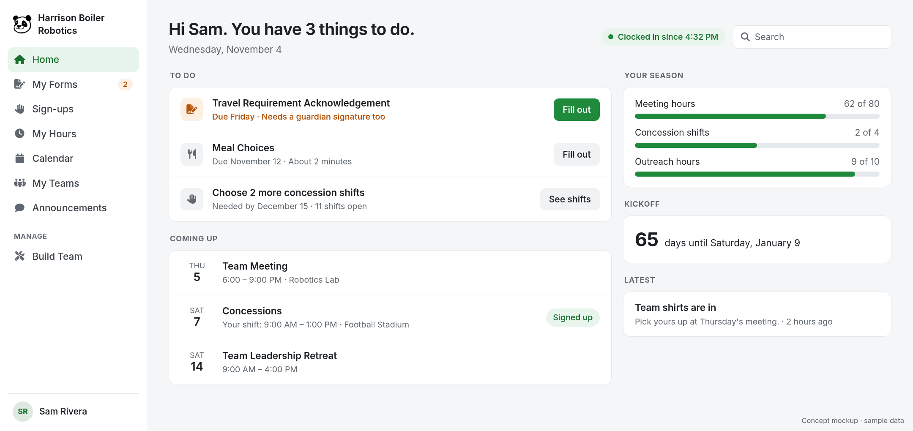
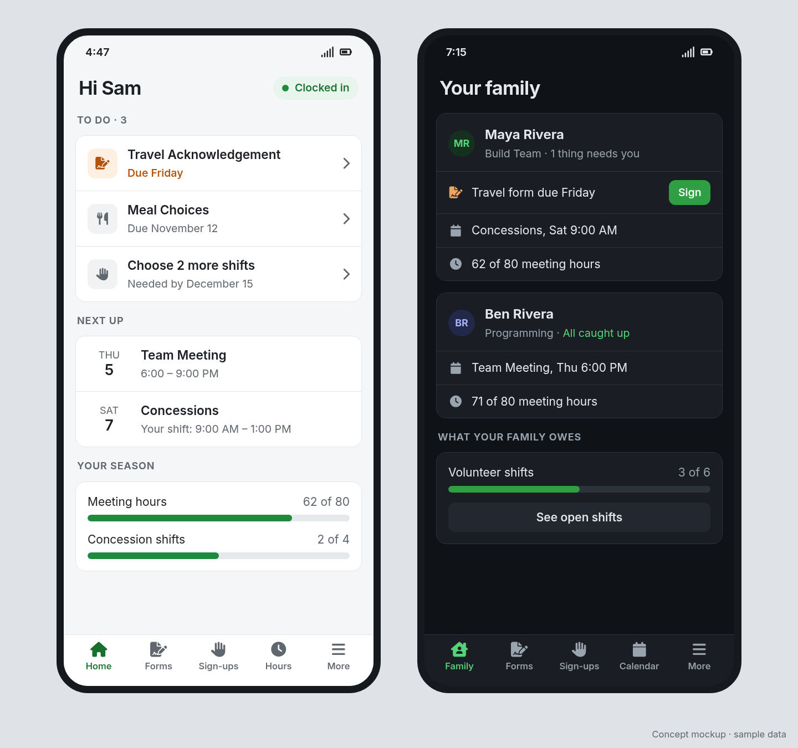

# My GatherPack

## Summary

Organize the app around the person using it and what they need to do,
instead of around records like People, Badges and Tokens. A member signs
in and sees what they need to do next. Their menu holds what they use,
while management tools sit in a separate area. Guardians get one place
for their children, and the most common tasks work well on a phone. Data
and permissions don't change, because these screens rearrange what
GatherPack already knows.

## What it might look like

These are concept mockups with made-up people and sample data, drawn to
show the idea. They aren't built screens or a final design, and the
research in the first step below could change them.

**Member home on a computer.** What to do comes first, followed by what's
coming up and progress for the season. The menu is short, and Manage appears
only for someone who manages something.

**On a phone.** A member's home in light mode, and a guardian's family view
in dark mode.

## Problem

Most screens are built for the person managing the records. Members and
guardians use the same screens, so they have to work out where things are
and which parts apply to them.

- **Everyone gets the same menu.** The sidebar lists every enabled
  feature for every person. Menu items have no way to say who they are
  for, so a member sees links to tools they may never use.
- **The dashboard doesn't answer "what do I need to do?"** It shows forms
  to complete and sign-ups, but not hours or commitments owed, or whether
  the person is clocked in. Those live on other pages.
- **Pages open on the manager's job.** At phone width, People opens with
  a full search form above the first result and runs to about 10,500 px
  tall. My Forms is followed directly by Manage Forms.
- **Guardians have no home.** Guardians are first-class in person fields
  and forms, but there's no single place to see each child and act for
  them.
- **Phones get a shrunken desktop.** At 390 px wide, the header and
  breadcrumb take the top 177 px, the site title is cut off, and the
  calendar's Week button runs off the screen. Only 13 of 24 templates with
  tables wrap them for narrow screens. Time Clock has 96 tap targets under
  32 px tall.

A new stylesheet doesn't address any of this. It changes how a page looks,
but not what the page shows or how many steps a task takes.

## What it does

- **A home that lists what to do.** Forms due, upcoming shifts, hours
  against commitments, clock status and announcements, most urgent first.
  When nothing is due, it says so. The calendar and shortcuts follow.
- **A menu for each person.** Members see a short list of what they use.
  Anyone who manages something also gets a separate Manage area, showing
  only what they can manage. The menu changes what is shown, not what is
  allowed: permissions still decide access.
- **A family view.** A guardian sees each child, with what they're already
  allowed to see of that child's forms, shifts, commitments and events, and
  can act for them wherever guardians already can. Today's rules don't show
  a guardian their child's team events, or commitments counted per person,
  such as the meeting hours in the mockup. Showing those is a separate
  permission decision. Guardian parts appear only for people who are
  guardians.
- **Phone versions of the top tasks.** Filling out a form, claiming a
  shift, checking hours and reading the calendar. On these screens, tables
  become simple lists, tap targets are comfortable, and the header stays
  out of the way. Rarely used admin screens can stay desktop-first.
- **A cleanup pass.** Where several screens do the same job, keep one.
  Where a page opens on a tool most people don't need, move the tool behind
  a button. Fix wording that misleads, such as required-field asterisks on
  a search form.

## How it's built

- **Home and family view.** New screens read existing data through
  existing models and policies: forms to complete, a person's sign-ups,
  commitment progress, open time clock punches, and guardians through
  `wards`. No new tables are expected. Existing dashboard cards and widget
  slots are reused where they fit.
- **Menu.** `NavItem` gains an optional `visible` check, the same pattern
  `ProfileTab` already uses, plus a group for Manage. This is a small
  upstream change, and useful to any feature that adds menu items.
- **Replacement screens.** Redesigned pages use the template override
  folder from [Theming and a modern skin](07-theming-and-modern-skin.md),
  so originals stay in place and one flag restores them. Pages that need
  only a small change, such as collapsing a search form, can be edited
  directly instead, and those edits are recorded like any other.
- **Permissions.** Every new screen uses the same policy checks as the page
  it replaces, with tests that each role sees only what it should. Hiding
  a menu link is never treated as access control.

**Size:** Medium to large, delivered in independent parts. No migrations
expected. A few upstream files for the menu change, plus one override per
redesigned screen. Flag off by default.

## Risks

- **Override drift.** Each replaced screen can miss a later upstream
  change, so this is the largest ongoing cost. Replace only screens that
  need new markup, and rely on the fork check that flags changed originals.
- **Designing from assumptions.** The findings above come from reading the
  code and viewing the site as an admin at phone width. They don't show
  where members and guardians actually get stuck.
- **Moving things people have learned.** Managers know where today's links
  are. Everything stays reachable, and the Manage area should keep familiar
  names.
- **Slow pages.** A home page drawing on several features can add many
  queries, particularly through team hierarchy lookups. It needs a query
  check with real data volumes.

## First step

Watch three or four members and a guardian do real tasks on their own
phones, such as "find out what you still owe" or "sign up for Saturday."
Use what they struggle with to set the order of the work.

Then build the home page and the menu change. They are likely the largest
visible gain for the least work, and every later part builds on them. The
family view and phone screens follow, one at a time.

## Adoption

This should follow the skin, because the shared override folder comes from
it and the new screens would look out of place in the old style. The menu
`visible` check stands alone and could be adopted first. The home page and
family view draw on forms, sign-ups, commitments and person fields where
present, and leave out any section whose feature isn't enabled.
