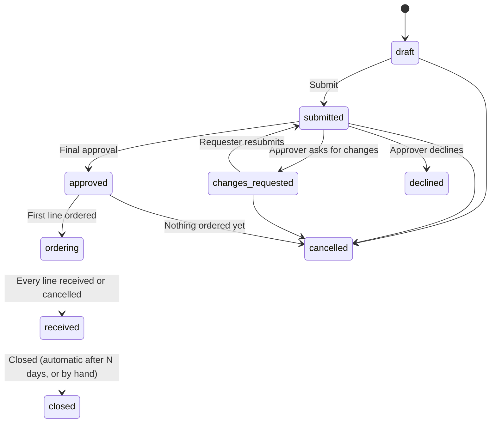

# Spec: Order Requests

Status: draft, 2026-11-15. Nothing is built.

This spec lives on `hbr/platform`, not on a feature branch. `feature/orders` is meant for upstream, so the feature branches themselves must not mention HBR.

## 1. Purpose

Members ask for things to be bought. Someone approves the request, a buyer places the order with a vendor, and the people who asked confirm it arrived. Today this runs on a Google Form that feeds a Google Sheet. This spec replaces it inside GatherPack as the first part of a larger **inventory** capability.

Three layers, each useful without the next:

- **Order requests** (`feature/orders`). Request, approve, buy, receive. Receiving can be a plain "it arrived".
- **Inventory** (`feature/inventory`, its own spec). Items, locations and stock counts.
- **Order receiving into inventory** (`feature/order-inventory`). Received lines become stock. The only place that knows both layers.

`feature/orders` and `feature/inventory` each branch from `feature/extension-registries` merged with `feature/recurring-routes-seams` (settings, hook catalog, routes and recurring-job seams; neither has the other's code), and `feature/order-inventory` depends on both.

Ledgers and Budgets are optional. Orders works with both turned off. Where the money comes from is tracked by orders itself, as funding sources (§3.13), so it works when the budgets are kept outside GatherPack. When Ledger and Budgets are on, a funding source can point at a Budget and a purchase can be recorded in a ledger (§6).

### 1.1 Scope

| Use case | Verdict | How |
|---|---|---|
| A member needs a part from a regular supplier | Fits | Request with one line from a preferred vendor |
| A one-off item from a general store or an unlisted shop | Fits | A line with "Other store" and a typed name; flagged to the approver |
| An item with no website, or the student doesn't know where to get it | Fits | A line with a description, an optional photo, and vendor "Not sure"; the buyer picks the vendor (§3.16) |
| A student finds a part on their phone and wants it | Fits | Paste or share the link; vendor and part number fill in where the vendor allows (§3.16) |
| Several items, from several vendors, for one project | Fits | One request, several lines, each with its vendor |
| A buyer combines approved lines from several requests into one vendor order | Fits | One purchase holds lines from any number of requests (§3.5) |
| Part of an order is backordered; the rest arrives | Fits | Line status per line; partial deliveries (§3.6) |
| The price at checkout differs from the request | Fits | Buyer records the actual price; within the tolerance it needs no new approval (§3.4) |
| A large request needs a second, more senior approval | Fits | Approval steps with amount thresholds (§3.3) |
| A volunteer buys with their own card and needs paying back | Fits | Purchase "paid with: personal, reimburse"; a ledger entry when ledgers are on (§6) |
| Knowing which budget pays for a request, when budgets are kept in a spreadsheet or accounting system | Fits | Funding source with an optional amount; spent and committed come from orders' own purchases (§3.13) |
| A purchase paid from a restricted gift or grant ("for robot parts only", "spend by June 30") | Fits | Restricted funding source: the approver sees the restriction and confirms the request fits it; a report lists what the gift bought, with receipts (§3.13) |
| One request paid partly from a grant and partly from general funds | Fits | A line can name its own funding source |
| Spending is checked against a GatherPack budget | Fits when Budgets is on | The funding source points at the Budget; approvers see its actual spending too (§6) |
| Fund accounting: restricted net assets, releases from restriction, donor statements | Non-goal | The accounting system's job. Orders records what was bought from which source; it doesn't keep the books. |
| "Order the same thing again" | Fits | Copy a past request as a new draft |
| Receive into a bin and track stock | Additive | `feature/order-inventory` through the receiving seam (§3.9) |
| Reorder when stock runs low | Additive | Inventory creates a draft request through the same API members use |
| Request quotes from several vendors before choosing | Not built; fits the model | Alternatives on a line; the approver picks one |
| Returns and refunds | Not built; fits the model | Line status `returned` and a negative delivery; a refund ledger entry |
| Donated items with no purchase | Non-goal here | Inventory's job (an "added" stock movement), not an order |
| Placing orders through vendor APIs or punch-out catalogs | Non-goal | Buyers order on the vendor's site and record it here |
| Paying vendors from GatherPack | Non-goal | Payment happens outside; GatherPack records it |
| Selling things to members (fundraising, apparel) | Non-goal | Different flow; not purchasing |
| Importing past requests from the Google Sheet | Non-goal | Past rows stay in the sheet; orders starts empty |

## 2. Concepts

| Concept | Meaning |
|---|---|
| Vendor | A place we buy from. Preferred vendors are listed first; "Other store" allows any shop by name; "Not sure" leaves it to the buyer. |
| Order request | One person's ask: who it's for (a team), when it's needed, why, and one or more lines |
| Line | One thing to buy: description, manufacturer and part number, vendor and vendor part number, link, quantity, unit, estimated price |
| Approval | One approver's decision on one step of a request: approved, changes requested, or declined, with a comment |
| Approval step | A level of approval a request needs, a row admins manage (Setup › Orders and Inventory › Approval Steps): name, minimum total, approvers (badge up to a team, or every team). Every request needs the first step, which always has a $0 minimum. |
| Purchase | An order placed with one vendor by a buyer: order number, date, actual costs, shipping and tax, paid with, receipt file. Holds lines from one or more requests. |
| Funding source | Where a request's money comes from: a budget or a restricted gift, kept in GatherPack or not, with an optional amount and, for a gift, its restriction |
| Delivery | A quantity of a line that arrived, who received it, when, and in what condition |
| Timeline | The readable history of a request: every submission, edit, approval, purchase, delivery and comment, with who and when |
| Approver, buyer | People allowed to approve or to buy for teams within their reach, granted by badge (§3.7) |

## 3. Order requests (`feature/orders`)

### 3.1 Model

A request has lines. Approval is per request; buying and receiving are per line. People ask for several things for one project, and vendors deliver partly and late.

- **Vendor.** Name, website, `domains` (so a pasted link fills in the vendor), `part_number_pattern` (optional; a regular expression with one capture group that pulls the vendor part number out of a product link, §3.16), account note (customer number, tax-exempt status; visible to buyers only), `preferred`, `active`. Organization-wide. Buyers and admins manage vendors.
- **Order request.** `team` (whose need; drives who approves and who sees it), `requested_by`, `needed_by` (optional), `title` (optional; blank takes the first line's description when submitted), `purpose` (why; optional, shown to approvers), `status` (§3.2), `funding_source` (§3.13; optional unless required by setting), watchers (other people who follow and may receive it). The requester can add watchers; anyone who can see a request can follow it themselves.
- **Line.** Belongs to a request. `description`, `manufacturer`, `manufacturer_part_number`, vendor (a `vendor`, an `other_vendor_name`, or neither for "Not sure"), `vendor_part_number`, `url`, `quantity` (whole number, default 1), `unit` ("each", "roll", "pack"), `units_per` (optional whole number: how many pieces one unit holds, so a "pack" of 100 is unit "pack", `units_per` 100; blank means 1), `estimated_unit_price`, `actual_unit_price`, `status` (§3.2), `purchase`, `funding_source` (blank means the request's), `note`, optional photo. Ordered. A line needs a `url` or a `description`; everything else is optional to the requester (§3.16).
- **Request total.** Sum of lines' quantity × price (actual where known, else estimated), plus an optional estimated shipping amount on the request. Always computed, never typed.

Amounts are stored as cents with `money-rails` (`monetize`), the money library GatherPack already includes and the ledger uses. It doesn't need the Ledger feature.

### 3.2 States

A request moves through:

A line in `needs_reapproval` doesn't change the request's status. The request stays `approved` or `ordering`, its other lines carry on, and the list wording adds "1 needs re-approval".

`ordering` and `received` are derived from the lines. Each line, once its request is approved, is one of:

| Line status | Means | Sheet equivalent |
|---|---|---|
| `approved` | Waiting for a buyer | Waiting |
| `ordered` | On a purchase | Ordered |
| `backordered` | Vendor says later; optional expected date | Backordered |
| `partly_received` | Some of the quantity arrived | — |
| `received` | All of it arrived, or someone confirmed it complete | Delivered |
| `problem` | Arrived wrong or damaged; note says what | — |
| `cancelled` | Won't be bought; reason required | — |
| `needs_reapproval` | A buyer's change went past the tolerance (§3.4) | — |

The request page shows the request status and each line's status. Lists show the request status with a count ("Ordering: 2 of 3 received").

### 3.3 Approval

**Steps (managed list, hbr.48).** Approval Steps on Setup: ordered rows, each with a name, approvers (badge up to a team, or every team; §3.7) and a minimum total. The first step has no minimum, so every request needs it; a request also needs each later step whose minimum it meets. Each step has a stable `key`, so existing approvals keep matching when a step is renamed.

**Deciding.** An approver on the current step chooses:
- **Approve** (optional comment). Moves to the next step, or to `approved` after the last.
- **Ask for changes** (comment required). Back to the requester; earlier approvals on this request are kept unless the requester then makes a material change.
- **Decline** (comment required). Final.

Approvers can also edit lines themselves (fix a part number, lower a quantity) before approving. Their edits show in the timeline.

**Material changes** clear approvals and need them again: adding a line, changing a line's vendor or part, or raising the total by more than the tolerance (§3.4). Lowering a quantity or cancelling a line doesn't.

**No approving yourself.** An approver can't approve, ask for changes on, or decline a request they made or one made by a relative (any relationship type). Another approver has to. The page says why the buttons are missing. Same rule as sign-ups §3.6. Watching a request doesn't count: students will add their mentor as a watcher, and on a team with one or two approvers that would leave nobody able to decide.

**Flags for approvers.** The approve screen marks lines from a non-preferred vendor, lines with vendor "Not sure", lines without a link or part number, lines without a price, a request with no purpose given, a `needed_by` that's already past or within 3 days (the same window as the needed-by notice, §3.11; stores carry no lead time), and the funding source's picture: its restriction, if any, and what would remain after this request (§3.13). A request with no funding source shows a picker for the approver.

### 3.4 Buying

1. The **To buy** queue lists approved lines within the buyer's reach, grouped by vendor, oldest `needed_by` first. Lines with vendor "Not sure" form their own group, "Vendor not chosen", at the top.
2. The buyer ticks lines (from any requests, one vendor) and chooses **Record purchase**. Ticking a "Not sure" line asks which vendor it was bought from, and the line takes that vendor. The purchase records vendor order number, order date, actual price per line, shipping, tax, paid with (§3.7), expected delivery, tracking link, receipt file(s). Lines become `ordered`.
3. A buyer can mark lines `backordered` (with an expected date), change a quantity, split a line (part now, rest later), or cancel a line with a reason.

**Price tolerance.** A setting, `orders_price_tolerance`: a percentage and an amount (default 10% or $25, whichever is larger). If a buyer's changes raise a request's total by more than that over the approved total, the affected lines become `needs_reapproval` and go back to the final step's approvers. Within it, the change is recorded in the timeline and nothing waits.

**Re-approval.** The final step's approvers see "Approved $X, now $Y (+$Z)" and choose Approve or Decline (a comment is needed to decline). There's no Ask for changes: the request's status doesn't change and the requester can't edit an approved request. The items are already counted as committed or spent, so the funding source's amount left isn't reduced again. The requester alone is told the decision, with the same Approved or Declined notice as a first decision.

A buyer may buy a request they approved or made; the approval is the control. Small organizations often have one person who approves and buys, so there's no setting to separate the two. An approver still can't approve their own request.

### 3.5 Purchases

A purchase belongs to one vendor and one buyer and holds any number of lines. Its total is the lines' actual prices plus shipping and tax. Shipping and tax are shown on the purchase, and split across its requests in proportion to their lines for reports. A purchase with an "Other" vendor carries that vendor name; a buyer can turn the name into a vendor record from there.

Purchases are visible to buyers, admins, and anyone who can see one of its requests (who then sees only their own lines and the vendor, date and status).

### 3.6 Receiving

Anyone allowed to receive a request (§3.8) can record a delivery on a line: quantity, date (default today), condition (`good`, `damaged`, `wrong item`), note, optional photo. **Mark all received** records the remaining quantity of every open line on a purchase or request at once.

- Quantity received ≥ quantity ordered → `received`. Less → `partly_received`.
- Damaged or wrong → `problem`, and the buyer is told. The buyer resolves it: reorder (a new line on the request, no new approval when it's a like-for-like replacement), or cancel.
- A buyer can mark a line received without a delivery record (it went straight to the person who needed it), with a note.

Receiving is an acknowledgement. Where it goes next is the receiving seam (§3.9).

### 3.7 Settings and grants

Registered through `Settings.register` (from `feature/extension-registries`):

| Setting | Meaning | Default |
|---|---|---|
| `feature_orders` | Feature flag, the setting `GatherPack::Features.register` creates | off |
| `orders_requesters` | Who can create requests: list of teams (members and below) | everyone signed in |
| (list) Approval Steps | §3.3 | one step, "Approval" |
| `orders_buyers` | Badge → team pairs (who buys), picked on Orders setup | none (admins only) |
| `orders_price_tolerance` | Percentage and amount, §3.4 | 10%, $25 |
| (list) Payment Methods | A row per way to pay, with a `reimburse` flag; at least one stays active | Team card; Paid personally (reimburse) |
| (list) Delivery Problems | What can be wrong with a delivery; a delivery is good or has one | Damaged; Wrong item |
| `orders_team_can_see` | Whether members of a request's team see its requests | on |
| `orders_require_other_vendor_reason` | A line from "Other" needs a reason | off |
| `orders_funding_managers` | Who manages funding sources: badge → highest team pairs (§3.13) | none (admins and team managers) |
| `orders_require_funding_source` | A funding source is needed before final approval | off |
| `orders_requesters_pick_funding` | Requesters see and choose a funding source on the request form. Off: approvers set it (§3.13) | off |
| `orders_close_after_days` | Received requests close after this many days | 14 |

Approver, buyer and funding-manager grants are badge → team pairs. A holder of the badge reaches the named team and every team below it, whatever teams they're in; with no team named, every team. A pair naming a team that doesn't exist grants nothing. Several pairs give the union. (Simplified in hbr.42; sign-ups, commitments and checklists keep the older "their own teams up to the highest team" rule.) Admins and managers of a request's team can always approve and buy for it. Approver, buyer and funding-manager grants share one implementation, `Orders::Reach`, separate from the sign-ups organizer grant. Reach is by team, not by vendor: a buyer grant covers every vendor for its teams, and who holds which supplier account goes in the vendor's account note.

### 3.8 Who sees and does what

| Who | Sees | Can |
|---|---|---|
| Requester | Their requests | Edit while draft, submitted or changes requested; cancel before anything is ordered; comment; receive; order again |
| Watchers | Requests they watch | Comment; receive; stop watching |
| Members of the request's team (when `orders_team_can_see`) | The team's requests, without vendor account notes | Comment; receive |
| Approvers | Requests within reach | §3.3 |
| Buyers | Requests within reach, vendor account notes, all purchases they made | §3.4–3.6 |
| Team managers and admins | Everything for their teams | Everything |

Nobody sees anything new about a person beyond their name on a request they can see. There are no public requests: only signed-in people in `orders_requesters` can make one.

### 3.9 Seams this layer offers

Orders knows nothing about inventory or ledgers. Other features attach through:

- **Hooks** (§7).
- **Notifications.** `order_request_changed.gatherpack` (any status change, with from and to) and `order_line_received.gatherpack` (a delivery recorded: line, quantity, condition, person), following `person_field_changed.gatherpack`.
- **Receiving extensions.** A small registry, `Orders.receiving_extensions`. An extension adds fields to the receive dialog for a line ("Put away in: [location]", "Track this item: ☐") and is called with the delivery after it's saved. `feature/order-inventory` fills it. With no extension registered, the dialog is quantity, date, condition and note.
- **Line entry extensions.** A registry, `Orders.line_entry_extensions`. An extension adds a picker above the line form on New request ("Pick from what we stock") and returns line attributes to fill in, including `item`. Fields stay editable and typing a line by hand is always available underneath. `feature/order-inventory` fills it. With none registered, the form starts with the link box (§3.16).
- **Line links.** A line has an optional polymorphic `item` (`item_type`, `item_id`). Orders only displays it (name and link). Inventory sets it when a request is made from an item, and "Order again" keeps it.
- **Creating requests.** `OrderRequest.draft_for(person:, team:, lines:)` is the supported way for another feature to start a request (inventory's reorder). It makes a draft the person then submits; nothing skips approval.

### 3.10 Timeline and audit

Every request has a timeline, stored in `order_request_events`: actor, action (`submitted`, `edited`, `approved`, `changes_requested`, `declined`, `purchased`, `backordered`, `received`, `problem`, `cancelled`, `commented`, `reapproval_needed`, `closed`), the step (for approvals), changed fields as before → after, and the comment. Written by the model in the same transaction as the change, so nothing changes without a timeline entry. Entries are never edited or deleted, including by admins. A cancelled or declined request stays.

All models also use `has_paper_trail versions: { class_name: "AuditLog" }`, as upstream models do. That covers raw field changes for admins (the audit log is admin-only and in a separate database). The timeline is what requesters, approvers and buyers read.

The request page shows the timeline under the lines, newest last, with approvals in bold. Printing a request (shared report print CSS) includes it, so a paper copy carries its approvals.

### 3.11 Notices

Mailer and reminder pattern as in forms and sign-ups, so notices reach a person on whatever channels that pattern delivers to; orders adds no channel of its own and gets any channel added to that pattern later. Students rarely read email, so the Home to-dos and Your orders (§3.15) are the main way a requester learns something changed.

| When | Who |
|---|---|
| Submitted, or resubmitted | Approvers on the current step |
| Approved on a step that isn't final | Approvers on the next step |
| Final approval | Requester, watchers; buyers within reach (daily digest by default, setting for each one) |
| Changes requested, declined | Requester, watchers |
| Ordered, backordered (with expected date) | Requester, watchers |
| Received in full | Requester, watchers, the buyer |
| Problem | The buyer |
| Needs re-approval | Final step's approvers |
| `needed_by` is in 3 days and nothing is ordered | Approvers or buyers, whoever holds it |
| Submitted and undecided for 5 days | Approvers on the current step, once |

### 3.12 Experiences

**Menu.** Orders registers a **Purchasing** section with `GatherPack::Features.register_section("Purchasing", …)` from its initializer, not under Finance, so it stays when Ledger is turned off. Orders is its first entry, with To approve, To buy, To receive, Vendors, Funding sources and Reports under it; inventory and later purchasing features join it.

**Member: ask for something.** Details in §3.16.
1. **New request** from Home (§3.15), from **Purchasing → Orders**, or from a shared or prefilled link.
2. Add items. Paste a link, or type what it is. A known vendor fills in from the link, and the part number too where the vendor has a pattern. Set the quantity. **Add another item.**
3. Optional, under **More details**: when it's needed (quick picks), what it's for, the team if they're on more than one, and per item the store, part numbers, unit, pack size, price, a photo and a note.
4. **Submit for approval.** The draft saves itself as they go.
5. **My requests** shows each request's status and the timeline. Notices tell them as it moves, and **Receive** appears when something is ordered.

**Approver: decide.**
1. **To approve** lists requests waiting on a step they can act on, with total, team, needed-by and flags.
2. The request page shows lines, flags and the funding picture, and a funding source picker when the request has none. For a restricted source, the restriction is shown above the buttons with a **This request fits the restriction** tick that Approve needs. **Approve**, **Ask for changes** or **Decline**, with a comment box above the buttons. On a phone, the tick, comment box and buttons sit in a bar fixed to the bottom of the screen.

**Buyer: buy.**
1. **To buy**, grouped by vendor. Tick lines, **Record purchase**, fill in what the vendor's checkout said, attach the receipt.
2. Later: mark backorders, update tracking, resolve problems.

**Member or team: receive.**
1. **To receive** lists ordered lines on requests they can receive, by purchase, with expected dates.
2. **Receive** on a line, or **Mark all received** on a purchase. Report damaged or wrong items there.

**Reports** (organizers and admins): open requests by status and age; spending by vendor, team and month (actual, with shipping and tax split); lines overdue against `needed_by`; non-preferred vendor spending. Each prints.

### 3.13 Funding sources

Where a request's money comes from. Kept by orders, so it works whether the budget lives in GatherPack, a spreadsheet or the accounting system. It's a label with an optional limit, not bookkeeping. Funding sources live in `feature/orders`.

**A funding source** has: name ("2026–27 Build Budget", "Robotics grant from a local foundation"), team (whose it is; requests from that team and teams below can use it), kind (`general` or `restricted`), optional amount, optional dates it can be spent between, `active`, and an optional link to a GatherPack Budget (§6). A restricted source also has:

- **Restriction**: what the money may be spent on, in the giver's terms ("Robot parts and tools for the 2027 season. No travel or food.").
- **Giver and reference** (grant number, gift letter date) and the gift documents as attachments. Seen only by funding managers, approvers and admins; others see the source's name.
- **Report due** date, optional, for the giver's report.

**Using it.**
- The approver sets the funding source. Requesters don't see it unless `orders_requesters_pick_funding` is on, and then may pick one or leave it for the approver. A line can name a different one, so a request can be split. A setting, `orders_require_funding_source`, makes a source required before final approval (default off).
- Approvers see each source the request uses: its amount, what orders has **spent** on it (purchases recorded, actual prices plus their share of shipping and tax), what's **committed** (approved and ordered lines not yet purchased, at estimated prices), and what would remain after this request. Sources without an amount show spent and committed only.
- For a restricted source, Approve needs the **fits the restriction** tick, recorded in the timeline with the approver's name. A request dated outside the source's dates is flagged.
- Over the amount is flagged, not blocked. Approvers see the numbers and decide; the same holds for a linked Budget (§6).
- A funding manager can move a purchased line to another source (a reallocation after the fact), with a reason. It's recorded in the timeline like any other change.

**Funding managers.** A setting, `orders_funding_managers` (badge → highest team pairs, as for buyers), plus admins and team managers. They create and edit sources for teams within reach. Approvers and buyers can't, unless they also hold the grant.

**Report.** Each source has a page: amount, spent, committed, remaining, and every line charged to it (date, item, vendor, request, approver, actual cost), with receipts attached to the purchases. Prints, and downloads as CSV. For a restricted gift, this page is the backing for the giver's report.

**Spent is orders' own number.** It counts purchases recorded in orders, nothing else. Money spent from the same source outside orders (a registration fee, travel) isn't in it. When the source is linked to a GatherPack Budget, the Budget's actual spending is shown next to it (§6). Otherwise an optional **spent outside orders** amount, typed by a funding manager with a date, keeps the remaining figure honest.

### 3.14 Data

New tables, with plain names as upstream uses (`vendors`, `purchases`, `funding_sources`, not `order_vendors`). The feature is meant for upstream, and a vendor list isn't specific to orders. If upstream's schema already has one of these names, ours takes an `order_` prefix.

| Table | Columns |
|---|---|
| `vendors` | `name`, `website`, `domains` (array), `part_number_pattern`, `account_note`, `preferred`, `active` |
| `order_requests` | `team_id`, `requested_by_id`, `title`, `purpose`, `needed_by`, `status`, `funding_source_id`, `estimated_shipping_cents`, `approved_total_cents`, `submitted_at`, `approved_at`, `closed_at` |
| `order_request_watchers` | `order_request_id`, `person_id` |
| `order_lines` | `order_request_id`, `position`, `description`, `manufacturer`, `manufacturer_part_number`, `vendor_id`, `other_vendor_name`, `other_vendor_reason`, `vendor_part_number`, `url`, `quantity`, `unit`, `units_per`, `estimated_unit_price_cents`, `actual_unit_price_cents`, `status`, `purchase_id`, `funding_source_id`, `expected_on`, `item_type`, `item_id`, `note`; photo attachment |
| `order_approvals` | `order_request_id`, `step_key`, `approver_id`, `decision`, `comment`, `cleared_at` (set when a material change voids it) |
| `purchases` | `vendor_id`, `other_vendor_name`, `buyer_id`, `vendor_order_number`, `ordered_on`, `shipping_cents`, `tax_cents`, `payment_method_id`, `reimburse_to_id`, `tracking_url`, `expected_on`, `ledger_entry_id` (nullable, §6), `note`; receipts as Active Storage attachments, as `LedgerEntry#receipts` |
| `order_deliveries` | `order_line_id`, `quantity`, `received_by_id`, `received_on`, `delivery_problem_kind_id` (null = good), `note`; photo attachment |
| `funding_sources` | `team_id`, `name`, `kind` (`general`, `restricted`), `amount_cents` (nullable), `starts_on`, `ends_on`, `restriction`, `giver`, `reference`, `report_due_on`, `spent_outside_cents`, `spent_outside_as_of`, `budget_id` (nullable, §6), `active`; documents as Active Storage attachments |
| `order_request_events` | `order_request_id`, `order_line_id` (nullable), `actor_id`, `action`, `step_key`, `changes` (jsonb), `comment`, `created_at` |

Approval steps are keyed by a stable `step_key` in the setting so renaming a step doesn't orphan its approvals.

Status changes and deliveries take a row lock on the request, so two buyers can't put the same line on two purchases.

Upstream files touched (estimate): the classic dashboard view (one `render` line for the card, as forms' Forms to Complete), `db/schema.rb`. Routes go in `config/routes/orders.rb` and jobs in `config/recurring.d/` through `feature/recurring-routes-seams`. The Home connector (§3.15) touches no upstream file. Settings, hook events and the feature registration go in `config/initializers/orders.rb` through `feature/extension-registries`, so `app/models/hook.rb` and `lib/settings.rb` aren't edited.

### 3.15 Home page and the My Orders card

Everything that says who is waiting on what comes from one query object, `Orders::WaitingOn.new(person)`. The To approve and To buy pages, the My Orders card and the Home connector all use it, so they can't disagree.

The classic dashboard shows the card: "My Orders" (to approve, to buy, to receive, and the viewer's open requests), rendered at the top like Forms to Complete, not as a widget. With `feature_my_gatherpack` on, that template is replaced, so **`feature/my-gatherpack-orders`** (from `feature/my-gatherpack` and `feature/orders`) puts the same information on Home, as a connector in the same pattern as forms and sign-ups ([`my-gatherpack-spec.md`](my-gatherpack-spec.md) §4, §6.1). The connector has no flag of its own and shows while Orders and My GatherPack are both on.

**To do: holding the next step.** A `:todo` section, counted in the heading. Each row has one button that opens the existing Orders page; nothing is approved or bought from Home. Rows sort by `needed_by`, so a request past its date comes first.

| Who | Row | Button |
|---|---|---|
| Approver on the current step, leaving out requests they can't decide (§3.3) | One per request: title, total, team | Review |
| Final step's approvers, for a line needing re-approval (§3.4) | One per request: title, "Needs re-approval" | Review |
| Requester with changes requested | One per request: title, the approver's comment, shortened | Update |
| Buyer within reach | **One summary row**: "12 lines to buy", dated by the earliest `needed_by` | Open To buy |
| The buyer on a line with a problem | One per request: title, "Problem with a delivery" | Resolve |
| Requester or watcher, with lines on a purchase still to receive | **One summary row**: "3 items to receive" | Receive |

The buy queue is one row so a buyer's list doesn't swamp To do or the heading's count.

Receiving is narrower here than the permission. Team members who can receive under `orders_team_can_see` still do so from To receive, but it isn't a to-do for them. The Home row and the card link to To receive filtered to the viewer's own and watched requests, so the number on the row matches the list it opens.

A receive to-do starts when a line is on a purchase, when **Receive** appears (§3.12), and stays until the line is received, even while the box is on its way. Orders are infrequent enough for that, and people rarely enter an expected date to wait for.

A draft isn't a to-do: an abandoned one would nag forever. It appears under Your orders.

**Your orders: what's active.** A `:side` section with no `items`, so it isn't counted. For anyone in `orders_requesters` it always shows a **New request** button, so Home is a way in even when nothing is open; with no active requests, the button is all it shows. For anyone else with nothing active, it renders nothing. It lists the viewer's own and watched requests that are draft, submitted, changes requested, approved or ordering, with the status wording lists use ("Ordering: 2 of 3 received"). It shows the five most recently changed, with a link to My requests.

**Menu.** Every orders item stays under the Purchasing heading, with inventory's (since hbr.44): no top or Manage placements and no Manage check, so who sees what is set by each item's own `visible:`. As everywhere in that menu, this changes what is shown, never what is allowed.

**Performance.** Home has a budget ([`my-gatherpack-spec.md`](my-gatherpack-spec.md) §6.3). `WaitingOn` must work out each request's current step in one pass over the requests and their approvals, not with a query per request, and is memoized for the request so the sections share it.

### 3.16 Requester experience

Most requesters are high-school students on a phone. The test for this section: a student who has the vendor's page open can ask for a part in under a minute, and a student with no link at all can still ask.

**The minimum.** A request can be submitted with one line that has a `url` or a `description`, and a quantity (default 1). Nothing else is required of the requester. Approvers can edit lines and set what's missing (§3.3), buyers record actual prices and vendors (§3.4), and the approve screen flags the gaps. `orders_require_other_vendor_reason`, when on, is the only setting that adds a required field for requesters.

**What requesters don't see.** Funding source (unless `orders_requesters_pick_funding`), estimated shipping, vendor account notes, approval steps, and price tolerance. The team box appears only when the person is on more than one team.

**Adding an item.** The line form, top to bottom:
1. Any line entry extension (§3.9), such as inventory's "Pick from what we stock".
2. **Link** box. Pasting a link:
   - matches the host against vendors' `domains` and sets the vendor;
   - if that vendor has a `part_number_pattern` and it matches, fills the vendor part number;
   - with an unknown host, sets "Other store" with the host as the name, which the requester can change.
   Nothing is fetched from the vendor's site; scraping is fragile and many vendors block it. Every filled field stays editable, and a pattern that doesn't match fills nothing.
3. **What is it?** (description) and **How many?** (quantity).
4. **More details** (collapsed on a phone): **Where from?** (preferred vendors, then **Other store** with a name box, then **Not sure**), part numbers, unit and pack size, price, photo, note.

There's always a way to ask without a link or a known vendor. A description plus "Not sure" is a valid line; so is "Other store: Menards" with no link, or a photo of the broken part with "Need 2 of these". The photo is taken with the phone's camera from the form.

**Getting to the form.**
- **New request** on Home (§3.15) and in the Purchasing menu.
- `/orders/requests/new?url=…` opens the form with that link already pasted, so a bookmark or a phone shortcut can send the page the student is looking at. Registering GatherPack as a phone share target belongs with making it an installable app, outside orders.

**Needed by.** Quick picks: **ASAP** (today), **This week**, **Before [next event]** (the next event on the team's calendar, when there is one), **Pick a date**, and **No rush** (blank). Blank sorts last everywhere `needed_by` sorts.

**Drafts.** The form saves itself as a draft as the requester types. **Submit for approval** is the only button. A draft appears under Your orders and My requests, where it can be finished or deleted.

**Words on screen.** The screens use plain words; the model keeps its names.

| In the model | On screen |
|---|---|
| Line | Item |
| Watcher, watch | Following, Follow |
| `submitted` | Waiting for approval |
| `changes_requested` | Needs changes |
| `approved` | Approved, not ordered yet |
| `ordering` | Ordered (with "2 of 3 here") |
| `received` | Here |
| `backordered` | Delayed |
| `problem` | Problem with delivery |
| Other vendor | Other store |
| Purchase | Order (on buyer screens only) |

An item still waiting on a declined, cancelled or sent-back request shows the request's word (Declined, Cancelled, Needs changes), not "Waiting for approval".

**Phone-first screens.** New request, My requests, a request's page, To receive, and To approve must work one-handed on a phone: one column, buttons at least 44 px tall, the main action in a bar fixed to the bottom. To buy, Vendors, Funding sources and Reports are built for a desktop and only need to be readable on a phone.

### 3.17 MCP tools (`feature/mcp-orders`)

The orders tools live in `feature/mcp-orders`, with inventory's (inventory spec §6), and appear only while `feature_orders` is on. They allow exactly what the pages allow: the same policies, scopes, domain actions and notices, with no limit or override of their own. Writes also need `mcp_write_enabled` and the `mcp_write` scope, as every MCP write does.

| Tool | Does | Mirrors |
|---|---|---|
| `list_order_requests` | Requests the person can see; filters: status, team, mine, waiting on me | Orders, My requests |
| `get_order_request` | One request: items, approvals, timeline, and purchase details as the page shows them to this person | Request page |
| `orders_waiting_on_me` | The person's next steps, from `Orders::WaitingOn` | Home To do, To approve |
| `list_to_buy` | Approved items within the person's buyer reach, by vendor | To buy |
| `list_purchases`, `get_purchase` | Purchases, with what a non-buyer may see limited as on the page | Purchases |
| `list_vendors`, `list_funding_sources`, `funding_source_report` | Vendors; funding sources with spent, committed and remaining; one source's report | Vendors, Funding sources |
| `create_order_request` | Makes a request through `draft_for` and submits it | New request |
| `decide_order_request` | Approve, ask for changes or decline, with a comment and the restriction tick where needed | Request page decision |
| `record_purchase` | Records a vendor order for chosen items | Record purchase |
| `update_order_line` | Backorder, change quantity or cancel an item | Buyer item actions |
| `record_delivery` | Records a delivery on an item | Receive |
| `set_funding_source` | Sets a request's or an item's funding source | Approve screen, reallocation |

## 4. Inventory (`feature/inventory`) — outline only

A separate spec. What orders needs from it, so the seams above are enough:

- **Item.** A kind of thing we keep: name, manufacturer, part number, unit, vendor part numbers by vendor, link, reorder point and quantity.
- **Location.** Nested places (shop → cabinet → bin).
- **Stock movement.** Every change to a quantity at a location (received, used, moved, counted, added, removed), with who and why. Stock is the sum.
- **Reorder.** Items at or below their reorder point list on a page; **Order these** calls `OrderRequest.draft_for` with lines filled from the items.
- **Stock unit.** Each item is counted in one unit (usually each). Order lines carry `units_per`, so receiving can convert.

## 5. Order receiving into inventory (`feature/order-inventory`)

Depends on `feature/orders` and `feature/inventory`. Small:

- A line entry extension (§3.9): **Pick from what we stock**, a search over items by name and part number at the top of the line form. Picking one fills the line from the item (description, manufacturer, part numbers, the preferred vendor and its link, unit) and sets `item`. This is the easy path for reorders and gives inventory clean lines without asking students for part numbers.
- A receiving extension: "Put away in: [location]" and "Track this item" (ticked when the line has an item). Saving a delivery records a `received` stock movement for quantity × `units_per` (blank `units_per` means 1), shown in the dialog before saving ("2 packs = 200 each") and editable there. Untracked lines stay acknowledgement only. When the line's item is a tracked item (inventory spec §3.15), receiving creates one unit per piece instead of a stock movement, and the dialog says so ("Adds 4 motors as units; label them later").
- A line without an item can be linked to an existing item, or **Create item from this line** (description, manufacturer, part numbers and vendor filled in). Free-text descriptions from students are expected; the buyer or whoever receives cleans them up at this point, not the requester at request time.
- "Order these" from inventory, through `draft_for`.

## 6. Ledgers and budgets (optional, in `feature/orders`)

Ledger and Budgets are upstream features that can be turned off (`GatherPack::Features.enabled?(:ledger)`, `:budgets`). Everything here appears only when they're on, and orders works the same with them off. It depends only on upstream code, so it lives in `feature/orders` rather than a branch of its own.

**Funding source linked to a Budget.** When Budgets is on, a funding manager can link a funding source (§3.13) to a Budget. Requests still pick the funding source, never the Budget directly, so the same request screen works with Budgets on or off. For a linked source, the approve screen also shows the Budget's amount and its actual spending from ledger entries (`Budget#actual_amount_cents`), which includes money spent outside orders. Committed is still computed in orders; `Budget` isn't changed. A restricted gift kept in the ledger is a Budget with its own ledger tag, linked to a restricted funding source.

**Ledger entry on a purchase.** When Ledger is on, a buyer recording a purchase can tick **Record in ledger** and pick a ledger they're allowed to add entries to (`LedgerEntryPolicy#create?`). That creates a finalized `LedgerEntry` for the purchase total as an expense, `created_by` the buyer, the receipt files copied, `metadata: { "purchase_id" => … }` (as entries already carry `gateway_id`), and tagged with the linked Budget's ledger tags for each line's funding source, so it counts against that budget. One purchase whose lines use several funding sources makes a split entry (child entries per source), using the existing split support. The purchase stores `ledger_entry_id`; the ledger entry page links back.

For **paid with: reimburse**, the entry's remark names who to pay back. Paying them is done in the ledger as today.

Buyers without ledger permission record the purchase without an entry; the purchase list shows "Not in ledger" for a treasurer to add later with **Record in ledger**.

## 7. Hooks

Every new model includes `CanBeHooked`. Register through `GatherPack::HookCatalog` (`feature/extension-registries`):

- Targets: `vendors`, `funding_sources`, `order_requests`, `order_lines`, `order_approvals`, `purchases`, `order_deliveries`.
- Events: `order_requests - submitted`, `order_requests - approved` (final), `order_requests - declined`, `order_lines - ordered`, `order_lines - backordered`, `order_lines - received`, `order_lines - problem`. Same shape as `form_responses - completed` and `signups - fulfilled`.

`order_request_events` isn't a hook target: it duplicates the events above. Inventory adds its own (`stock_movements`) in its spec.

## 8. Sample data and tests

- `fork/sample_data/features/orders.rb`: Northwind vendors (three preferred, one inactive) and requests in every state: a draft; one waiting on the first step; one over the threshold waiting on the second; one with changes requested; one declined; an approved request from two vendors with one line bought and one waiting; a purchase combining two requests; a backordered line with an expected date; a partly received line; a damaged delivery; a request received in full and closed; an "Other vendor" line; a price change within tolerance and one that triggered re-approval. Funding sources: a general budget with an amount, one with no amount, and a restricted grant with dates, a restriction and a report due; one request split between the grant and the general budget; one over the amount; one reallocated after purchase. One purchase recorded in a ledger against a linked Budget, one "Not in ledger".
- Model tests: state transitions and refusals; material change clears approvals, a lowered quantity doesn't; tolerance arithmetic; step thresholds; funding spent and committed, with shipping and tax shared out; restricted source needs the tick; line source overrides request source; self and relative approval refused; line can't join two purchases (lock); delivery quantities and statuses; timeline entry written for every change and never editable; ledger entry and split when Ledger is on; nothing ledger-related when it's off.
- Requester tests (§3.16): a line with only a link submits, and so does one with only a description; a line with neither is refused; a known domain sets the vendor; a matching `part_number_pattern` fills the part number and a non-matching one fills nothing; an unknown host sets "Other store" with the host; a "Not sure" line is flagged to the approver and lands in "Vendor not chosen", and recording its purchase sets the vendor; `?url=` prefills the form; a blank title takes the first line's description; funding source is hidden from requesters with `orders_requesters_pick_funding` off and shown with it on; a draft saves without a button; a watcher who holds an approver grant can approve; a relative can't.
- System tests: new request with a pasted link; new request with a description and a photo only; approve on a phone-sized screen; record purchase; receive.
- `WaitingOn` and the Home connector (§3.15): each row in the table appears for the right person and not for others; a requester never gets an approval row for their own or a relative's request; 30 lines to buy count as one to-do; a team member who can receive gets no receive row, and the requester's count matches the filtered page; Your orders shows only **New request** to a requester with nothing active, nothing to anyone else with nothing active, and leaves the heading's count alone; the query count doesn't grow with the number of requests; with `feature_my_gatherpack` off the card shows, and with it on Home does.
- `fork/catalog.yml` and `FORK.md` entries when the branch joins the manifest.

## 9. The Google Sheet this replaces

Today: a Google Form submits to a Google Sheet. Columns: Status (Waiting, Ordered, Delivered, Backordered), Status Time Stamp, Name Stamp (who last changed the status), Timestamp, Email Address, Name, Date Needed By, Manufacturer, Manufacturer Part Number, a description column, Supplier (from a list, or "Other"), Supplier Part Number, Hyperlink to Item, Requested Quantity, Cost (unit cost), Total Cost, Approving Mentor, Notes.

What the sheet can't do, and where this spec handles it:

| Sheet | Here |
|---|---|
| Only the last status change is kept (one time stamp, one name) | Timeline of every change (§3.10) |
| "Approving Mentor" is a typed name; nothing shows they approved | Approvals are recorded actions by the approver (§3.3) |
| One item per row; a multi-item ask is several unrelated rows | Request with lines |
| Quantity is free text ("1 roll", "70-100 pack box", sometimes in the part number column) | Whole-number quantity plus a unit and pack size |
| Total Cost is blank | Computed |
| No distinction between ordered, partly arrived and arrived wrong | Line statuses and deliveries (§3.2, §3.6) |
| No record of who bought it, from which order, or the actual price | Purchases (§3.5) |
| Status edited by anyone with the sheet | Each action has its own permission (§3.8) |

The sheet's supplier dropdown becomes the preferred vendors (§3.1). Approver and buyer badges and the approval steps are settings (§3.7).
## Orders setup (hbr.42)

Orders setup (an Orders button under Orders and Inventory on the main Setup page, with Approval Steps, Payment Methods and Delivery Problems; admins only; no Setup item in the menu) shows, in order: Who can ask (teams), Who sees every request (`orders_viewers`, teams: members of those teams and the teams below see every submitted request, view only), Who approves (team managers always; plus badge → team rows, saved as step 1), Over $X also needs (an amount and badge → team rows, saved as step 2), Who buys, and Paid with. Other step shapes can still be stored; the page lists them read-only and saving replaces them. The other orders settings keep their values and defaults and are not on any screen.
