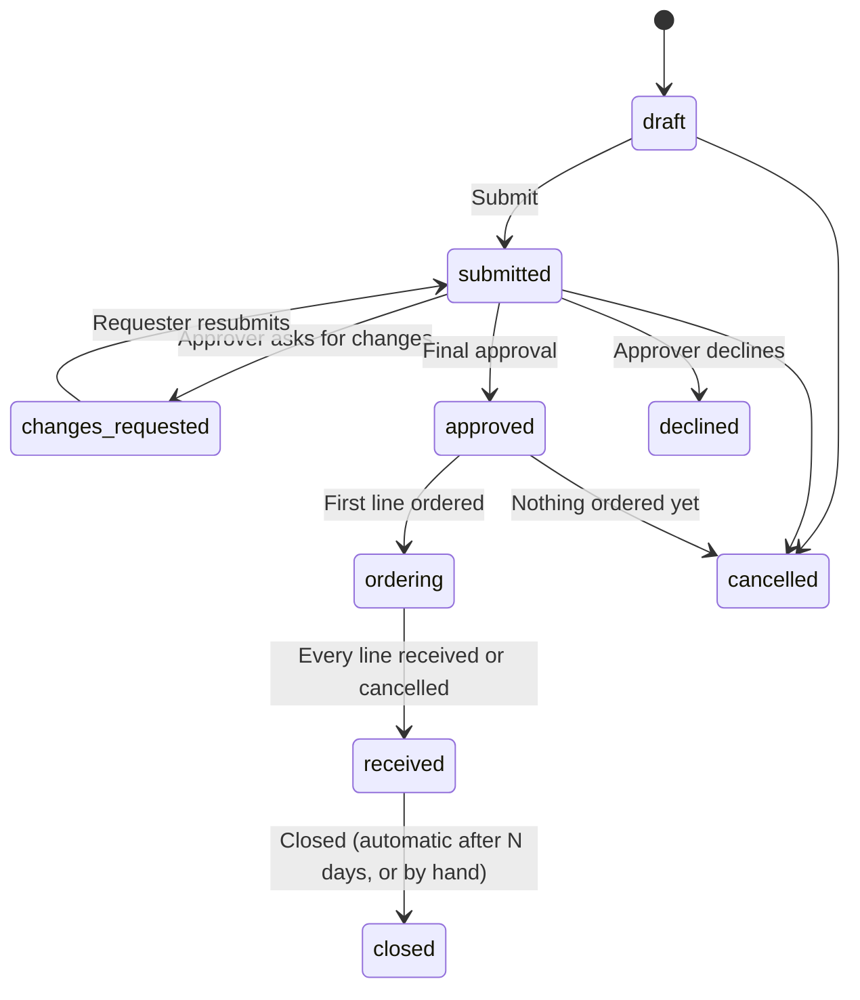

# Spec: Order Requests

Status: rev. 2, 2026-10-12. Draft; nothing is built. Decisions in §10 are settled or defaults; §11 lists open questions.

Rev. 3: **funding sources** (§3.13). Every request can say where its money comes from, whether or not that budget is kept in GatherPack, and restricted gifts carry their restriction to the approver. A funding source can point at a GatherPack Budget; requests no longer point at budgets directly (§6). The money line in §3.1 says plainly that it doesn't need the Ledger feature.

Rev. 2: a new **Purchasing** menu section (decision 10); an approver may also buy (decision 4, confirmed); plain table names (decision 11); importing from the sheet is deferred (§9).

This spec lives on `hbr/platform`, not on a feature branch. `feature/orders` is meant for upstream, so the feature branches themselves must not mention HBR. HBR's configuration and the move off the Google Sheet go in `orders-hbr-rollout.md` when the rollout is planned; §9 holds the facts needed until then.

## 1. Purpose

Members ask for things to be bought. Someone approves the request, a buyer places the order with a vendor, and the people who asked confirm it arrived. Today this runs on a Google Form that feeds a Google Sheet. This spec replaces it inside GatherPack as the first part of a larger **inventory** capability.

Three layers, each useful without the next:

- **Order requests** (`feature/orders`). Request, approve, buy, receive. Receiving can be a plain "it arrived".
- **Inventory** (`feature/inventory`, separate spec later). Items, locations and stock counts.
- **Order receiving into inventory** (`feature/order-inventory`). Received lines become stock. The only place that knows both layers.

Ledgers and Budgets are optional. Orders works with both turned off. Where the money comes from is tracked by orders itself, as funding sources (§3.13), so it works when the budgets are kept outside GatherPack. When Ledger and Budgets are on, a funding source can point at a Budget and a purchase can be recorded in a ledger (§6).

### 1.1 The rule for this spec

As in the sign-ups spec: adding a use case is configuration or an additive extension. If a use case needs the concepts in §2 to change shape, revise the concepts first, with a rev. note saying why. The table in §1.2 is the record.

### 1.2 Use cases

| Use case | Verdict | How |
|---|---|---|
| A member needs a part from a regular supplier | Fits | Request with one line from a preferred vendor |
| A one-off item from a general store or an unlisted shop | Fits | A line with "Other vendor" and a typed name; flagged to the approver |
| Several items, from several vendors, for one project | Fits | One request, several lines, each with its vendor |
| A buyer combines approved lines from several requests into one vendor order | Fits | One purchase holds lines from any number of requests (§3.5) |
| Part of an order is backordered; the rest arrives | Fits | Line status per line; partial deliveries (§3.6) |
| The price at checkout differs from the request | Fits | Buyer records the actual price; within the tolerance it needs no new approval (§3.4) |
| A large request needs a second, more senior approval | Fits | Approval steps with amount thresholds (§3.3) |
| A volunteer buys with their own card and needs paying back | Fits | Purchase "paid with: personal, reimburse"; a ledger entry when ledgers are on (§6) |
| Knowing which budget pays for a request, when budgets are kept in a spreadsheet or accounting system | Fits | Funding source with an optional amount; spent and committed come from orders' own purchases (§3.13) |
| A purchase paid from a restricted gift or grant ("for robot parts only", "spend by June 30") | Fits | Restricted funding source: the approver sees the restriction and confirms the request fits it; a report lists what the gift bought, with receipts (§3.13) |
| One request paid partly from a grant and partly from general funds | Fits | A line can name its own funding source |
| Spending is checked against a GatherPack budget | Fits when Budgets is on | The funding source points at the Budget; approvers see its actual spending too (§6) |
| Fund accounting: restricted net assets, releases from restriction, donor statements | Non-goal | The accounting system's job. Orders records what was bought from which source; it doesn't keep the books. |
| "Order the same thing again" | Fits | Copy a past request as a new draft |
| Receive into a bin and track stock | Additive | `feature/order-inventory` through the receiving seam (§3.9) |
| Reorder when stock runs low | Additive | Inventory creates a draft request through the same API members use |
| Request quotes from several vendors before choosing | Additive, later | Alternatives on a line; the approver picks one |
| Returns and refunds | Additive, later | Line status `returned` and a negative delivery; a refund ledger entry |
| Donated items with no purchase | Non-goal here | Inventory's job (an "added" stock movement), not an order |
| Placing orders through vendor APIs or punch-out catalogs | Non-goal | Buyers order on the vendor's site and record it here |
| Paying vendors from GatherPack | Non-goal | Payment happens outside; GatherPack records it |
| Selling things to members (fundraising, apparel) | Non-goal | Different flow; not purchasing |

## 2. Concepts

| Concept | Meaning |
|---|---|
| Vendor | A place we buy from. Preferred vendors are listed first; "Other" allows any shop by name. |
| Order request | One person's ask: who it's for (a team), when it's needed, why, and one or more lines |
| Line | One thing to buy: description, manufacturer and part number, vendor and vendor part number, link, quantity, unit, estimated price |
| Approval | One approver's decision on one step of a request: approved, changes requested, or declined, with a comment |
| Approval step | A level of approval a request needs (for example "Mentor", then "Treasurer" above $500). The last one is the final approval. |
| Purchase | An order placed with one vendor by a buyer: order number, date, actual costs, shipping and tax, paid with, receipt file. Holds lines from one or more requests. |
| Funding source | Where a request's money comes from: a budget or a restricted gift, kept in GatherPack or not, with an optional amount and, for a gift, its restriction |
| Delivery | A quantity of a line that arrived, who received it, when, and in what condition |
| Timeline | The readable history of a request: every submission, edit, approval, purchase, delivery and comment, with who and when |
| Approver, buyer | People allowed to approve or to buy for teams within their reach, granted by badge (§3.7) |

## 3. Order requests (`feature/orders`)

### 3.1 Model

- **Vendor.** Name, website, `domains` (so a pasted link fills in the vendor), account note (customer number, tax-exempt status; visible to buyers only), `preferred`, `active`. Organization-wide. Buyers and admins manage vendors.
- **Order request.** `team` (whose need; drives who approves and who sees it), `requested_by`, `needed_by`, `title`, `purpose` (why; shown to approvers), `status` (§3.2), `funding_source` (§3.13; optional unless required by setting), watchers (other people who follow and may receive it).
- **Line.** Belongs to a request. `description`, `manufacturer`, `manufacturer_part_number`, `vendor` or `other_vendor_name`, `vendor_part_number`, `url`, `quantity` (whole number), `unit` ("each", "roll", "pack of 100"), `estimated_unit_price`, `actual_unit_price`, `status` (§3.2), `purchase`, `funding_source` (blank means the request's), `note`. Ordered.
- **Request total.** Sum of lines' quantity × price (actual where known, else estimated), plus an optional estimated shipping amount on the request. Always computed, never typed.

Amounts are stored as cents with `money-rails` (`monetize`), the money library GatherPack already includes and the ledger uses. It doesn't need the Ledger feature.

### 3.2 States

A request moves through:

`ordering` and `received` are derived from the lines. Each line, once its request is approved, is one of:

| Line status | Means | Sheet equivalent |
|---|---|---|
| `approved` | Waiting for a buyer | Waiting |
| `ordered` | On a purchase | Ordered |
| `backordered` | Vendor says later; optional expected date | Backordered |
| `partly_received` | Some of the quantity arrived | — |
| `received` | All of it arrived, or someone confirmed it complete | Delivered |
| `problem` | Arrived wrong or damaged; note says what | — |
| `cancelled` | Won't be bought; reason required | — |
| `needs_reapproval` | A buyer's change went past the tolerance (§3.4) | — |

The request page shows the request status and each line's status. Lists show the request status with a count ("Ordering: 2 of 3 received").

### 3.3 Approval

**Steps.** A setting, `orders_approval_steps`: an ordered list, each with a name, its approver grants (§3.7) and a minimum request total (0 means always). A request needs every step whose minimum it meets, in order. The last needed step is the final approval. Default: one step, "Approval", for everyone.

**Deciding.** An approver on the current step chooses:
- **Approve** (optional comment). Moves to the next step, or to `approved` after the last.
- **Ask for changes** (comment required). Back to the requester; earlier approvals on this request are kept unless the requester then makes a material change.
- **Decline** (comment required). Final.

Approvers can also edit lines themselves (fix a part number, lower a quantity) before approving. Their edits show in the timeline.

**Material changes** clear approvals and need them again: adding a line, changing a line's vendor or part, or raising the total by more than the tolerance (§3.4). Lowering a quantity or cancelling a line doesn't.

**No approving yourself.** An approver can't approve, ask for changes on, or decline a request they made or that's for a relative (any relationship type), or one they're a watcher on. Another approver has to. The page says why the buttons are missing. Same rule as sign-ups §3.6.

**Flags for approvers.** The approve screen marks lines from a non-preferred vendor, lines without a link or part number, a `needed_by` that's already past or within the vendor's usual lead time, and the funding source's picture: its restriction, if any, and what would remain after this request (§3.13).

### 3.4 Buying

1. The **To buy** queue lists approved lines within the buyer's reach, grouped by vendor, oldest `needed_by` first.
2. The buyer ticks lines (from any requests, one vendor) and chooses **Record purchase**: vendor order number, order date, actual price per line, shipping, tax, paid with (§3.7), expected delivery, tracking link, receipt file(s). Lines become `ordered`.
3. A buyer can mark lines `backordered` (with an expected date), change a quantity, split a line (part now, rest later), or cancel a line with a reason.

**Price tolerance.** A setting, `orders_price_tolerance`: a percentage and an amount (default 10% or $25, whichever is larger). If a buyer's changes raise a request's total by more than that over the approved total, the affected lines become `needs_reapproval` and go back to the final step's approvers. Within it, the change is recorded in the timeline and nothing waits.

A buyer may buy a request they approved or made; the approval is the control (decision 4).

### 3.5 Purchases

A purchase belongs to one vendor and one buyer and holds any number of lines. Its total is the lines' actual prices plus shipping and tax. Shipping and tax are shown on the purchase, and split across its requests in proportion to their lines for reports. A purchase with an "Other" vendor carries that vendor name; a buyer can turn the name into a vendor record from there.

Purchases are visible to buyers, admins, and anyone who can see one of its requests (who then sees only their own lines and the vendor, date and status).

### 3.6 Receiving

Anyone allowed to receive a request (§3.8) can record a delivery on a line: quantity, date (default today), condition (`good`, `damaged`, `wrong item`), note, optional photo. **Mark all received** records the remaining quantity of every open line on a purchase or request at once.

- Quantity received ≥ quantity ordered → `received`. Less → `partly_received`.
- Damaged or wrong → `problem`, and the buyer is told. The buyer resolves it: reorder (a new line on the request, no new approval when it's a like-for-like replacement), or cancel.
- A buyer can mark a line received without a delivery record (it went straight to the person who needed it), with a note.

Receiving is an acknowledgement. Where it goes next is the receiving seam (§3.9).

### 3.7 Settings and grants

Registered through `Settings.register` (from `feature/extension-registries`):

| Setting | Meaning | Default |
|---|---|---|
| `orders_enabled` | Feature flag | off |
| `orders_requesters` | Who can create requests: list of teams (members and below) | everyone signed in |
| `orders_approval_steps` | §3.3 | one step |
| `orders_buyers` | List of badge → highest team pairs, as `signups_organizers` | none (admins only) |
| `orders_price_tolerance` | Percentage and amount, §3.4 | 10%, $25 |
| `orders_paid_with` | Choices for a purchase: label and whether it needs reimbursing ("Team card", "Purchase order", "Personal card — reimburse") | Team card, Personal card — reimburse |
| `orders_team_can_see` | Whether members of a request's team see its requests | on |
| `orders_require_other_vendor_reason` | A line from "Other" needs a reason | off |
| `orders_funding_managers` | Who manages funding sources: badge → highest team pairs (§3.13) | none (admins and team managers) |
| `orders_require_funding_source` | A funding source is needed before final approval | off |
| `orders_close_after_days` | Received requests close after this many days | 14 |

Approver and buyer grants use the delegated-grant pattern from forms and sign-ups: a badge, capped at a highest team. A holder acts on requests whose team is within reach (teams they belong to and those above, up to the highest team, plus teams below their own). Several pairs give the union. Admins and managers of a request's team can always approve and buy for it. See sign-ups §9 question 1 on sharing this pattern.

### 3.8 Who sees and does what

| Who | Sees | Can |
|---|---|---|
| Requester | Their requests | Edit while draft, submitted or changes requested; cancel before anything is ordered; comment; receive; order again |
| Watchers | Requests they watch | Comment; receive |
| Members of the request's team (when `orders_team_can_see`) | The team's requests, without vendor account notes | Comment; receive |
| Approvers | Requests within reach | §3.3 |
| Buyers | Requests within reach, vendor account notes, all purchases they made | §3.4–3.6 |
| Team managers and admins | Everything for their teams | Everything |

Nobody sees anything new about a person beyond their name on a request they can see.

### 3.9 Seams this layer offers

Orders knows nothing about inventory or ledgers. Other features attach through:

- **Hooks** (§7).
- **Notifications.** `order_request_changed.gatherpack` (any status change, with from and to) and `order_line_received.gatherpack` (a delivery recorded: line, quantity, condition, person), following `person_field_changed.gatherpack`.
- **Receiving extensions.** A small registry, `Orders.receiving_extensions`. An extension adds fields to the receive dialog for a line ("Put away in: [location]", "Track this item: ☐") and is called with the delivery after it's saved. `feature/order-inventory` fills it. With no extension registered, the dialog is quantity, date, condition and note.
- **Line links.** A line has an optional polymorphic `item` (`item_type`, `item_id`). Orders only displays it (name and link). Inventory sets it when a request is made from an item, and "Order again" keeps it.
- **Creating requests.** `OrderRequest.draft_for(person:, team:, lines:)` is the supported way for another feature to start a request (inventory's reorder). It makes a draft the person then submits; nothing skips approval.

### 3.10 Timeline and audit

Every request has a timeline, stored in `order_request_events`: actor, action (`submitted`, `edited`, `approved`, `changes_requested`, `declined`, `purchased`, `backordered`, `received`, `problem`, `cancelled`, `commented`, `reapproval_needed`, `closed`), the step (for approvals), changed fields as before → after, and the comment. Written by the model in the same transaction as the change, so nothing changes without a timeline entry. Entries are never edited or deleted, including by admins. A cancelled or declined request stays.

All models also use `has_paper_trail versions: { class_name: "AuditLog" }`, as upstream models do. That covers raw field changes for admins (the audit log is admin-only and in a separate database). The timeline is what requesters, approvers and buyers read.

The request page shows the timeline under the lines, newest last, with approvals in bold. Printing a request (shared report print CSS) includes it, so a paper copy carries its approvals.

### 3.11 Notices

Mailer and reminder pattern as in forms and sign-ups:

| When | Who |
|---|---|
| Submitted, or resubmitted | Approvers on the current step |
| Approved on a step that isn't final | Approvers on the next step |
| Final approval | Requester, watchers; buyers within reach (daily digest by default, setting for each one) |
| Changes requested, declined | Requester, watchers |
| Ordered, backordered (with expected date) | Requester, watchers |
| Received in full | Requester, watchers, the buyer |
| Problem | The buyer |
| Needs re-approval | Final step's approvers |
| `needed_by` is in 3 days and nothing is ordered | Approvers or buyers, whoever holds it |
| Submitted and undecided for 5 days | Approvers on the current step, once |

### 3.12 Experiences

**Member: ask for something.**
1. **Purchasing → Orders** (decision 10) → **New request**.
2. Pick the team it's for (defaults to the person's only team), give a title, the date it's needed, and why.
3. Add lines. Paste a link first: a known vendor fills in from the domain. Then description, manufacturer and part number, vendor part number, quantity, unit, price. Choosing "Other vendor" shows a name box (and a reason box if required). **Add another line.**
4. The total updates as they type. **Save draft** or **Submit for approval**.
5. **My requests** shows each request's status and the timeline. They get emails as it moves, and **Receive** appears when something is ordered.

**Approver: decide.**
1. **To approve** lists requests waiting on a step they can act on, with total, team, needed-by and flags.
2. The request page shows lines, flags and the funding picture. For a restricted source, the restriction is shown above the buttons with a **This request fits the restriction** tick that Approve needs. **Approve**, **Ask for changes** or **Decline**, with a comment box above the buttons.

**Buyer: buy.**
1. **To buy**, grouped by vendor. Tick lines, **Record purchase**, fill in what the vendor's checkout said, attach the receipt.
2. Later: mark backorders, update tracking, resolve problems.

**Member or team: receive.**
1. **To receive** lists ordered lines on requests they can receive, by purchase, with expected dates.
2. **Receive** on a line, or **Mark all received** on a purchase. Report damaged or wrong items there.

**Reports** (organizers and admins): open requests by status and age; spending by vendor, team and month (actual, with shipping and tax split); lines overdue against `needed_by`; non-preferred vendor spending. Each prints.

### 3.13 Funding sources

Where a request's money comes from. Kept by orders, so it works whether the budget lives in GatherPack, a spreadsheet or the accounting system. It's a label with an optional limit, not bookkeeping.

**A funding source** has: name ("2026–27 Build Budget", "Robotics grant from a local foundation"), team (whose it is; requests from that team and teams below can use it), kind (`general` or `restricted`), optional amount, optional dates it can be spent between, `active`, and an optional link to a GatherPack Budget (§6). A restricted source also has:

- **Restriction**: what the money may be spent on, in the giver's terms ("Robot parts and tools for the 2027 season. No travel or food.").
- **Giver and reference** (grant number, gift letter date) and the gift documents as attachments. Seen only by funding managers, approvers and admins; others see the source's name.
- **Report due** date, optional, for the giver's report.

**Using it.**
- The requester picks a funding source for the request, or leaves it for the approver. A line can name a different one, so a request can be split. A setting, `orders_require_funding_source`, makes a source required before final approval (default off).
- Approvers see each source the request uses: its amount, what orders has **spent** on it (purchases recorded, actual prices plus their share of shipping and tax), what's **committed** (approved and ordered lines not yet purchased, at estimated prices), and what would remain after this request. Sources without an amount show spent and committed only.
- For a restricted source, Approve needs the **fits the restriction** tick, recorded in the timeline with the approver's name. A request dated outside the source's dates is flagged.
- Over the amount is flagged, not blocked (decision 5).
- A funding manager can move a purchased line to another source (a reallocation after the fact), with a reason. It's recorded in the timeline like any other change.

**Funding managers.** A setting, `orders_funding_managers` (badge → highest team pairs, as for buyers), plus admins and team managers. They create and edit sources for teams within reach. Approvers and buyers can't, unless they also hold the grant.

**Report.** Each source has a page: amount, spent, committed, remaining, and every line charged to it (date, item, vendor, request, approver, actual cost), with receipts attached to the purchases. Prints, and downloads as CSV. For a restricted gift, this page is the backing for the giver's report.

**Spent is orders' own number.** It counts purchases recorded in orders, nothing else. Money spent from the same source outside orders (a registration fee, travel) isn't in it. When the source is linked to a GatherPack Budget, the Budget's actual spending is shown next to it (§6). Otherwise an optional **spent outside orders** amount, typed by a funding manager with a date, keeps the remaining figure honest.

### 3.14 Data

New tables (upstream naming):

| Table | Columns |
|---|---|
| `vendors` | `name`, `website`, `domains` (array), `account_note`, `preferred`, `active` |
| `order_requests` | `team_id`, `requested_by_id`, `title`, `purpose`, `needed_by`, `status`, `funding_source_id`, `estimated_shipping_cents`, `approved_total_cents`, `submitted_at`, `approved_at`, `closed_at` |
| `order_request_watchers` | `order_request_id`, `person_id` |
| `order_lines` | `order_request_id`, `position`, `description`, `manufacturer`, `manufacturer_part_number`, `vendor_id`, `other_vendor_name`, `other_vendor_reason`, `vendor_part_number`, `url`, `quantity`, `unit`, `estimated_unit_price_cents`, `actual_unit_price_cents`, `status`, `purchase_id`, `funding_source_id`, `expected_on`, `item_type`, `item_id`, `note` |
| `order_approvals` | `order_request_id`, `step_key`, `approver_id`, `decision`, `comment`, `cleared_at` (set when a material change voids it) |
| `purchases` | `vendor_id`, `other_vendor_name`, `buyer_id`, `vendor_order_number`, `ordered_on`, `shipping_cents`, `tax_cents`, `paid_with`, `reimburse_to_id`, `tracking_url`, `expected_on`, `ledger_entry_id` (nullable, §6), `note`; receipts as Active Storage attachments, as `LedgerEntry#receipts` |
| `order_deliveries` | `order_line_id`, `quantity`, `received_by_id`, `received_on`, `condition`, `note`; photo attachment |
| `funding_sources` | `team_id`, `name`, `kind` (`general`, `restricted`), `amount_cents` (nullable), `starts_on`, `ends_on`, `restriction`, `giver`, `reference`, `report_due_on`, `spent_outside_cents`, `spent_outside_as_of`, `budget_id` (nullable, §6), `active`; documents as Active Storage attachments |
| `order_request_events` | `order_request_id`, `order_line_id` (nullable), `actor_id`, `action`, `step_key`, `changes` (jsonb), `comment`, `created_at` |

Approval steps are keyed by a stable `step_key` in the setting so renaming a step doesn't orphan its approvals.

Status changes and deliveries take a row lock on the request, so two buyers can't put the same line on two purchases.

Upstream files touched (estimate): `config/routes.rb` (or the plugin routes seam), the dashboard view (one `render` line for the card, as forms' Forms to Complete; decision 7), `db/schema.rb`. Settings, hook events and the feature registration go in `config/initializers/orders.rb` through `feature/extension-registries`, so `app/models/hook.rb` and `lib/settings.rb` aren't edited.

## 4. Inventory (`feature/inventory`) — outline only

A separate spec. What orders needs from it, so the seams above are enough:

- **Item.** A kind of thing we keep: name, manufacturer, part number, unit, vendor part numbers by vendor, link, reorder point and quantity.
- **Location.** Nested places (shop → cabinet → bin).
- **Stock movement.** Every change to a quantity at a location (received, used, moved, counted, added, removed), with who and why. Stock is the sum.
- **Reorder.** Items at or below their reorder point list on a page; **Order these** calls `OrderRequest.draft_for` with lines filled from the items.

## 5. Order receiving into inventory (`feature/order-inventory`)

Depends on `feature/orders` and `feature/inventory`. Small:

- A receiving extension: "Put away in: [location]" and "Track this item" (ticked when the line has an item). Saving a delivery records a `received` stock movement for the quantity. Untracked lines stay acknowledgement only (decision 6).
- A line without an item can be linked to an existing item, or **Create item from this line** (description, manufacturer, part numbers and vendor filled in).
- "Order these" from inventory, through `draft_for`.

## 6. Ledgers and budgets (optional, in `feature/orders`)

Ledger and Budgets are upstream features that can be turned off (`GatherPack::Features.enabled?(:ledger)`, `:budgets`). Everything here appears only when they're on, and orders works the same with them off.

**Funding source linked to a Budget.** When Budgets is on, a funding manager can link a funding source (§3.13) to a Budget. Requests still pick the funding source, never the Budget directly, so the same request screen works with Budgets on or off. For a linked source, the approve screen also shows the Budget's amount and its actual spending from ledger entries (`Budget#actual_amount_cents`), which includes money spent outside orders. Committed is still computed in orders; `Budget` isn't changed. A restricted gift kept in the ledger is a Budget with its own ledger tag, linked to a restricted funding source.

**Ledger entry on a purchase.** When Ledger is on, a buyer recording a purchase can tick **Record in ledger** and pick a ledger they're allowed to add entries to (`LedgerEntryPolicy#create?`). That creates a finalized `LedgerEntry` for the purchase total as an expense, `created_by` the buyer, the receipt files copied, `metadata: { "purchase_id" => … }` (as entries already carry `gateway_id`), and tagged with the linked Budget's ledger tags for each line's funding source, so it counts against that budget. One purchase whose lines use several funding sources makes a split entry (child entries per source), using the existing split support. The purchase stores `ledger_entry_id`; the ledger entry page links back.

For **paid with: reimburse**, the entry's remark names who to pay back. Paying them is done in the ledger as today.

Buyers without ledger permission record the purchase without an entry; the purchase list shows "Not in ledger" for a treasurer to add later with **Record in ledger**.

## 7. Hooks

Every new model includes `CanBeHooked`. Register through `GatherPack::HookCatalog` (`feature/extension-registries`):

- Targets: `vendors`, `funding_sources`, `order_requests`, `order_lines`, `order_approvals`, `purchases`, `order_deliveries`.
- Events: `order_requests - submitted`, `order_requests - approved` (final), `order_requests - declined`, `order_lines - ordered`, `order_lines - backordered`, `order_lines - received`, `order_lines - problem`. Same shape as `form_responses - completed` and `signups - fulfilled`.

`order_request_events` isn't a hook target: it duplicates the events above. Inventory adds its own (`stock_movements`) in its spec.

## 8. Sample data and tests

- `fork/sample_data/features/orders.rb`: Northwind vendors (three preferred, one inactive) and requests in every state: a draft; one waiting on the first step; one over the threshold waiting on the second; one with changes requested; one declined; an approved request from two vendors with one line bought and one waiting; a purchase combining two requests; a backordered line with an expected date; a partly received line; a damaged delivery; a request received in full and closed; an "Other vendor" line; a price change within tolerance and one that triggered re-approval. Funding sources: a general budget with an amount, one with no amount, and a restricted grant with dates, a restriction and a report due; one request split between the grant and the general budget; one over the amount; one reallocated after purchase. One purchase recorded in a ledger against a linked Budget, one "Not in ledger".
- Model tests: state transitions and refusals; material change clears approvals, a lowered quantity doesn't; tolerance arithmetic; step thresholds; funding spent and committed, with shipping and tax shared out; restricted source needs the tick; line source overrides request source; self and relative approval refused; line can't join two purchases (lock); delivery quantities and statuses; timeline entry written for every change and never editable; ledger entry and split when Ledger is on; nothing ledger-related when it's off.
- System tests: new request with a pasted link; approve; record purchase; receive.
- `fork/catalog.yml` and `FORK.md` entries when the branch joins the manifest.

## 9. HBR source process (moves to `orders-hbr-rollout.md`)

Today: a Google Form submits to a Google Sheet. Columns: Status (Waiting, Ordered, Delivered, Backordered), Status Time Stamp, Name Stamp (who last changed the status), Timestamp, Email Address, Name, Date Needed By, Manufacturer, Manufacturer Part Number, a description column, Supplier (from a list, or "Other"), Supplier Part Number, Hyperlink to Item, Requested Quantity, Cost (unit cost), Total Cost, Approving Mentor, Notes.

What the sheet can't do, and where this spec handles it:

| Sheet | Here |
|---|---|
| Only the last status change is kept (one time stamp, one name) | Timeline of every change (§3.10) |
| "Approving Mentor" is a typed name; nothing shows they approved | Approvals are recorded actions by the approver (§3.3) |
| One item per row; a multi-item ask is several unrelated rows | Request with lines |
| Quantity is free text ("1 roll", "70-100 pack box", sometimes in the part number column) | Whole-number quantity plus a unit |
| Total Cost is blank | Computed |
| No distinction between ordered, partly arrived and arrived wrong | Line statuses and deliveries (§3.2, §3.6) |
| No record of who bought it, from which order, or the actual price | Purchases (§3.5) |
| Status edited by anyone with the sheet | Each action has its own permission (§3.8) |

Rollout notes to settle then: the preferred supplier list (the sheet's dropdown), who holds the approver and buyer badges, and whether HBR uses one approval step or a threshold. Moving data off the sheet is deferred until the rollout is planned (2026-10-12).

## 10. Decisions (defaults until confirmed)

1. **Three layers, separate branches.** `feature/orders` from `feature/extension-registries`; `feature/inventory` from upstream; `feature/order-inventory` depending on both.
2. **Ledger and budget links live in `feature/orders`**, shown only when those upstream features are on. They depend only on upstream code, so they don't need a branch of their own.
3. **Requests have lines; approval is per request; buying and receiving are per line.** Matches how people ask (one project, several things) and how vendors deliver (partly, late).
4. **A buyer may buy what they approved or asked for** (confirmed 2026-10-12). The approval is the control; small organizations often have one person who approves and buys. An approver still can't approve their own request. No setting to separate the two.
5. **Budgets and funding sources inform, don't block.** Approvers see the numbers and decide.
6. **Receiving is an acknowledgement unless inventory is in the build** and the line is tracked.
7. **Dashboard card, native.** "My Orders" (requests waiting on me: to approve, to buy, to receive, and my open requests) renders at the top of the dashboard like Forms to Complete, not as a widget.
8. **The timeline is append-only**, written in the same transaction as each change.
9. **No public requests.** Only signed-in people in `orders_requesters`.
10. **A Purchasing menu section** (2026-10-12). Orders is its first entry, with To approve, To buy, To receive, Vendors, Funding sources and Reports under it; inventory and later purchasing features join it. Registered with `GatherPack::Features.register_section("Purchasing", …)` from the orders initializer, not under Finance, so it stays when Ledger is turned off.
11. **Plain table names** (default). `vendors`, `purchases` and `funding_sources`, not `order_vendors` and `order_purchases`. The feature is meant for upstream, which uses plain names, and a vendor list is something the ledger could use later too. The risk is upstream adding its own `vendors` table for something else while we still carry this; check upstream's schema before the first migration and rename then if it's taken.
12. **Funding sources live in orders** (rev. 3), not as a separate feature, until a second feature needs them. They're labels with an optional limit and orders' own spent figure. If the ledger or another feature wants them, they move to their own branch with orders depending on it.

## 11. Open questions

1. **Vendor-level reach.** Should a buyer grant be limited to some vendors (a person who holds one supplier's account)? Default no.
2. **Share the delegated-grant pattern** with forms and sign-ups (sign-ups §9 question 1) before adding a third and fourth copy of it here.
